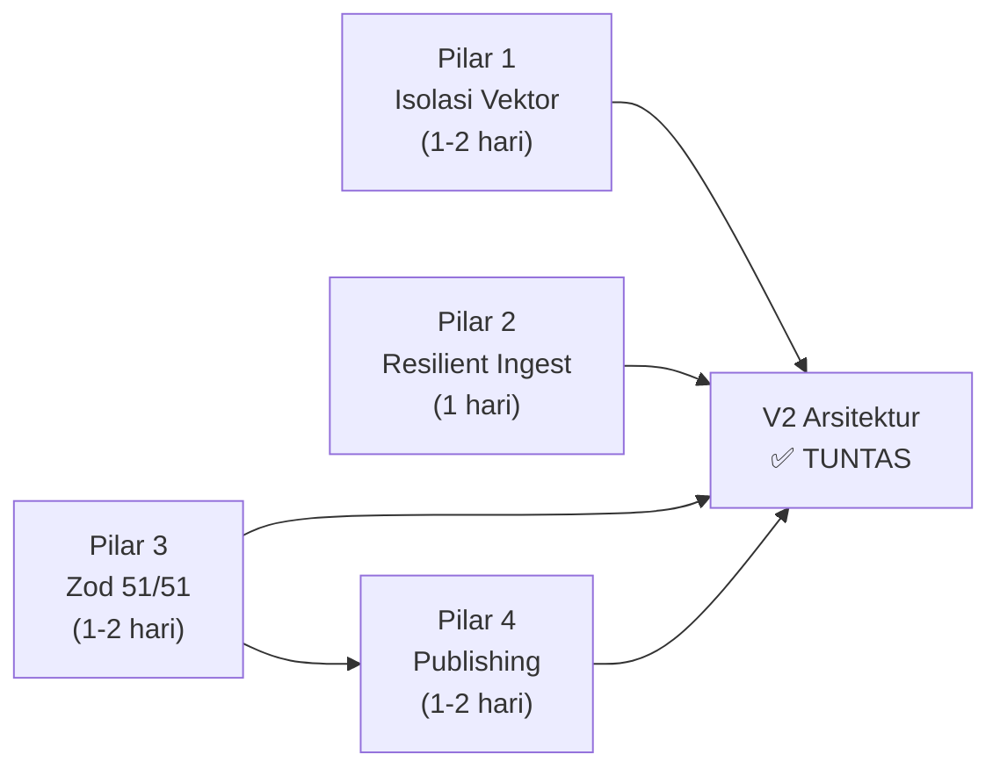

# ⚡ ARAHAN EKSEKUSI 4 PILAR ARSITEKTUR — MATHBANK V2.0

## *Architectural Directive — Ready for Agent Execution*

> **Dari:** Antigravity (Architecture Analysis)
> **Kepada:** Agent pelaksana (Paperclip / Salman / Ichsan)
> **Tanggal:** 23 Oktober 2026
> **Branch:** `paperclip/dev`
> **Repositori:** `/home/hari/projects/mathbank`
> **Acuan:** `docs/RENCANA-MATHBANK-V2.md`, `docs/RENCANA-ADOPSI-ARSITEKTUR-MATHCORE-SOAL.md`

---

## 0. PRASYARAT SEBELUM MULAI

```bash
cd /home/hari/projects/mathbank
pnpm backup:db                    # WAJIB — backup sebelum migrasi apapun
pnpm db:verify                    # Pastikan 26 tabel / 24 trigger / 0 drift
pnpm check                        # tsc 0, lint 0, test hijau
git status                         # working tree bersih
```

**Aturan mutlak:**
1. Setiap pilar = **1 branch** (`v2/pilar-N-<slug>` dari `paperclip/dev`)
2. Setiap perubahan skema = **migrasi Drizzle** (bukan `db:push`)
3. `pnpm check` + `pnpm test:db` HIJAU sebelum merge
4. Evidence di commit message (CONSTRAINTS #44)

---

# PILAR 1 — ISOLASI TABEL VEKTOR `question_embeddings`

**Branch:** `v2/pilar-1-isolasi-embedding`
**Estimasi:** 1–2 hari
**Risiko:** SEDANG (migrasi data 11.867 vektor)
**Dampak:** Ukuran baris `questions` turun ~4.5 KB → ~280 bytes (hemat 93% RAM buffer pool)

## 1.1 Konteks & Motivasi

Kolom `embedding vector(1024)` saat ini **inline** di tabel `questions` (baris 82 `src/lib/db/schema/question.ts`). Setiap `SELECT` pada daftar soal (pagination, filter, pencarian trigram) memuat 4 KB vektor yang **tidak dipakai** — memboroskan RAM buffer pool PostgreSQL.

## 1.2 File yang HARUS Diubah

| # | File | Perubahan | Baris Terdampak |
|---|------|-----------|:---------------:|
| 1 | `src/lib/db/schema/question.ts` | Hapus 3 kolom embedding, tambah tabel baru `questionEmbeddings` | L82–L84 |
| 2 | `src/lib/db/projections/question.ts` | Tidak berubah (embedding sudah dikeluarkan dari proyeksi) | — |
| 3 | `src/lib/services/enrichment/embed.ts` | Update `db.update(questions)` → `db.insert(questionEmbeddings).onConflictDoUpdate(...)` | L62–L68 |
| 4 | `src/lib/ingest/dedup.ts` | Ganti `questions.embedding` → `JOIN questionEmbeddings` | L52, L68, L76, L79 |
| 5 | `src/lib/services/question-read.ts` | Ganti `questions.embedding` → `LEFT JOIN questionEmbeddings` | L347–L348 |
| 6 | `src/lib/db/invariants.ts` | Update `EXPECTED_INVARIANTS.tables` 26 → 27, `hnswIndexes` 1 → 1 (tetap) | L17–L21 |
| 7 | `scripts/db-verify.ts` | Update harapan tabel (26 → 27) | — |

## 1.3 Langkah Eksekusi (Urut Ketat)

### Langkah 1: Buat tabel `questionEmbeddings` di skema Drizzle

Tambahkan di `src/lib/db/schema/question.ts` (setelah definisi `questions`):

```typescript
/**
 * question_embeddings — vektor terisolasi 1:1 (ADR-0019).
 * PK = question_id (bukan id terpisah) → hemat 1 kolom + 1 index.
 */
export const questionEmbeddings = pgTable(
  "question_embeddings",
  {
    questionId: uuid("question_id")
      .primaryKey()
      .references(() => questions.id, { onDelete: "cascade" }),
    embedding: vector1024("embedding").notNull(),
    embeddingContentHash: varchar("embedding_content_hash", { length: 64 }),
    embeddingModelName: varchar("embedding_model_name", { length: 100 }),
    createdAt: timestamp("created_at", { withTimezone: true })
      .defaultNow()
      .notNull(),
    updatedAt: timestamp("updated_at", { withTimezone: true })
      .defaultNow()
      .notNull(),
  },
  (t) => [
    // Partial HNSW Index — hanya soal aktif + ready (hemat RAM index).
    // ⚠️ Partial index dengan subquery tidak didukung PostgreSQL —
    // gunakan trigger atau materialized view untuk menjaga ini.
    // Untuk sekarang, index penuh pada tabel kecil ini sudah cukup efisien.
    index("idx_question_embeddings_hnsw").using(
      "hnsw",
      sql`${t.embedding} vector_cosine_ops`,
    ),
  ],
);

export const questionEmbeddingsRelations = relations(
  questionEmbeddings,
  ({ one }) => ({
    question: one(questions, {
      fields: [questionEmbeddings.questionId],
      references: [questions.id],
    }),
  }),
);
```

**Ekspor** di `src/lib/db/schema/index.ts`:
```typescript
export { questionEmbeddings, questionEmbeddingsRelations } from "./question";
```

### Langkah 2: Generate migrasi Drizzle (tabel baru SAJA dulu)

```bash
pnpm drizzle-kit generate --name=create-question-embeddings
```

Review SQL yang dihasilkan — pastikan hanya `CREATE TABLE question_embeddings` + index. **Jangan hapus kolom `questions.embedding` di langkah ini.**

### Langkah 3: Tulis migrasi manual backfill

Buat `drizzle/manual/NN-backfill-embeddings.sql`:

```sql
-- Backfill: salin vektor dari questions ke question_embeddings.
-- Idempoten: ON CONFLICT DO NOTHING.
INSERT INTO question_embeddings (question_id, embedding, embedding_content_hash, embedding_model_name, created_at, updated_at)
SELECT id, embedding, embedding_content_hash, embedding_model_name, NOW(), NOW()
FROM questions
WHERE embedding IS NOT NULL
ON CONFLICT (question_id) DO NOTHING;

-- Verifikasi: hitung harus sama.
-- SELECT count(*) FROM questions WHERE embedding IS NOT NULL;
-- SELECT count(*) FROM question_embeddings;
```

Jalankan:
```bash
psql "$DATABASE_URL" -f drizzle/manual/NN-backfill-embeddings.sql
# Verifikasi:
psql "$DATABASE_URL" -At -c "SELECT count(*) FROM question_embeddings"
# Harus = 11867 (atau jumlah terkini)
```

### Langkah 4: Update kode konsumen (3 file)

**File 1 — `src/lib/services/enrichment/embed.ts`:**

```typescript
// SEBELUM (baris ~62–68):
await db
  .update(questions)
  .set({
    embedding: r.vector,
    embeddingContentHash: contentHash,
    embeddingModelName: model,
    updatedAt: new Date(),
  })
  .where(eq(questions.id, q.id));

// SESUDAH:
import { questionEmbeddings } from "@/lib/db/schema/question";

await db
  .insert(questionEmbeddings)
  .values({
    questionId: q.id,
    embedding: r.vector,
    embeddingContentHash: contentHash,
    embeddingModelName: model,
  })
  .onConflictDoUpdate({
    target: questionEmbeddings.questionId,
    set: {
      embedding: r.vector,
      embeddingContentHash: contentHash,
      embeddingModelName: model,
      updatedAt: new Date(),
    },
  });
```

Juga update query baca `embeddingContentHash` di baris ~33–39 (saat cek skip):
```typescript
// SEBELUM:
const rows = await db.select({
  // ...
  embeddingContentHash: questions.embeddingContentHash,
  // ...
}).from(questions)

// SESUDAH:
import { questionEmbeddings } from "@/lib/db/schema/question";

const rows = await db.select({
  id: questions.id,
  contentMarkdown: questions.contentMarkdown,
  embeddingContentHash: questionEmbeddings.embeddingContentHash,
  authorId: questions.authorId,
  isFlagged: questions.isFlagged,
})
.from(questions)
.leftJoin(questionEmbeddings, eq(questionEmbeddings.questionId, questions.id))
.where(and(inArray(questions.id, questionIds), isNull(questions.deletedAt)));
```

**File 2 — `src/lib/ingest/dedup.ts`:**

```typescript
// SEBELUM (baris ~52):
const [src] = await db.select({
  id: questions.id,
  grade: questions.grade,
  embedding: questions.embedding,
  answerKey: questions.answerKey,
}).from(questions)

// SESUDAH:
import { questionEmbeddings } from "@/lib/db/schema/question";

const [src] = await db.select({
  id: questions.id,
  grade: questions.grade,
  embedding: questionEmbeddings.embedding,
  answerKey: questions.answerKey,
})
.from(questions)
.leftJoin(questionEmbeddings, eq(questionEmbeddings.questionId, questions.id))
.where(and(eq(questions.id, questionId), isNull(questions.deletedAt)))
.limit(1);

// SEBELUM (baris ~68–79): query kandidat mirip
const rows = await db.select({
  id: questions.id,
  answerKey: questions.answerKey,
  distance: sql<number>`(${questions.embedding} <=> ${literal}::vector)`,
})
.from(questions)
.where(and(
  isNull(questions.deletedAt),
  ne(questions.id, questionId),
  eq(questions.grade, src.grade),
  sql`${questions.embedding} IS NOT NULL`,
))
.orderBy(sql`${questions.embedding} <=> ${literal}::vector`)
.limit(limit);

// SESUDAH:
const rows = await db.select({
  id: questions.id,
  answerKey: questions.answerKey,
  distance: sql<number>`(${questionEmbeddings.embedding} <=> ${literal}::vector)`,
})
.from(questions)
.innerJoin(questionEmbeddings, eq(questionEmbeddings.questionId, questions.id))
.where(and(
  isNull(questions.deletedAt),
  ne(questions.id, questionId),
  eq(questions.grade, src.grade),
))
.orderBy(sql`${questionEmbeddings.embedding} <=> ${literal}::vector`)
.limit(limit);
```

**File 3 — `src/lib/services/question-read.ts`** (baris ~347–348):

```typescript
// SEBELUM:
semanticWhere = sql`${questions.embedding} IS NOT NULL`;
orderBy = [asc(sql`${questions.embedding} <=> ${literal}::vector`)];

// SESUDAH:
import { questionEmbeddings } from "@/lib/db/schema/question";

// Di bagian FROM, tambahkan LEFT JOIN:
// .leftJoin(questionEmbeddings, eq(questionEmbeddings.questionId, questions.id))

semanticWhere = sql`${questionEmbeddings.embedding} IS NOT NULL`;
orderBy = [asc(sql`${questionEmbeddings.embedding} <=> ${literal}::vector`)];
```

### Langkah 5: Update invariants & db:verify

`src/lib/db/invariants.ts`:
```typescript
export const EXPECTED_INVARIANTS = {
  tables: 27,        // 26 → 27 (+question_embeddings)
  checkConstraints: 2,
  hnswIndexes: 1,    // tetap 1 (pindah ke tabel baru)
  triggers: 24,      // tetap (trigger updated_at bisa ditambah nanti)
} as const;
```

### Langkah 6: Drop kolom lama (TERAKHIR, setelah semua tes hijau)

Buat migrasi terpisah setelah memastikan semua kode sudah mengacu tabel baru:

```bash
pnpm drizzle-kit generate --name=drop-inline-embedding
```

Hapus dari `src/lib/db/schema/question.ts`:
```typescript
// HAPUS baris 82–84:
-    embedding: vector1024("embedding"),
-    embeddingContentHash: varchar("embedding_content_hash", { length: 64 }),
-    embeddingModelName: varchar("embedding_model_name", { length: 100 }),
```

Dan hapus juga `aiTagged` / `aiTaggedAt` bila dipindahkan ke tabel baru, **ATAU** pertahankan di `questions` bila masih relevan untuk query listing (keputusan: pertahankan `aiTagged` di `questions` karena dipakai filter daftar).

### Langkah 7: Verifikasi akhir

```bash
pnpm db:verify      # 27 tabel, 24 trigger, 1 HNSW, 0 drift
pnpm check          # tsc 0, lint 0, test hijau
pnpm test:db        # integrasi DB hijau
psql "$DATABASE_URL" -At -c "SELECT count(*) FROM question_embeddings"
# Harus = jumlah soal ber-embedding
```

### DoD Pilar 1:
- [ ] Tabel `question_embeddings` ada di DB, terisi 11.867 baris
- [ ] Semua query pencarian semantik + dedup mengacu tabel baru
- [ ] Kolom `embedding` dihapus dari `questions`
- [ ] `pnpm db:verify` hijau (27 tabel)
- [ ] `pnpm check` + `pnpm test:db` hijau
- [ ] Index HNSW aktif di tabel baru

---

# PILAR 2 — TOLERANSI PARSIAL INGEST & ANTI-SSRF

**Branch:** `v2/pilar-2-resilient-ingest`
**Estimasi:** 1 hari
**Risiko:** RENDAH
**File utama:** `src/lib/ingest/service.ts`, `src/lib/ingest/commit.ts`, `src/lib/ingest/media/fetch.ts`

## 2.1 Toleransi Parsial Ingest Batch

### Masalah Saat Ini

Ingest batch (`/api/v1/ingest/commit`) menggunakan **1 transaksi** untuk seluruh artikel. Jika 1 soal dari 30 gagal validasi KaTeX → seluruh batch rollback.

### Perubahan yang Diperlukan

**File: `src/lib/ingest/commit.ts`**

Ubah pola dari single-transaction menjadi per-item commit:

```typescript
// POLA BARU: validasi + commit per-indeks
export interface CommitResult {
  storedCount: number;
  failedCount: number;
  failures: Array<{
    index: number;
    stemPreview: string;    // 80 char pertama soal
    reason: string;         // pesan error spesifik
  }>;
  questionIds: string[];    // ID soal yang berhasil tersimpan
}

export async function commitParsedItems(
  items: ParsedItem[],
  queueItemId: string,
  // ...params lain
): Promise<CommitResult> {
  const result: CommitResult = {
    storedCount: 0,
    failedCount: 0,
    failures: [],
    questionIds: [],
  };

  for (let i = 0; i < items.length; i++) {
    const item = items[i];
    try {
      // Validasi per-item (KaTeX, format, skema)
      validateParsedItem(item); // throws bila cacat

      // Commit per-item dalam transaksi kecil
      const questionId = await db.transaction(async (tx) => {
        // ... insert question + opsi + media ...
        return insertedId;
      });

      result.storedCount++;
      result.questionIds.push(questionId);
    } catch (e) {
      result.failedCount++;
      result.failures.push({
        index: i,
        stemPreview: (item.stem ?? "").slice(0, 80),
        reason: e instanceof Error ? e.message : String(e),
      });
    }
  }

  return result;
}
```

**File: `src/app/api/v1/ingest/commit/route.ts`**

Update respons API untuk menyertakan detail parsial:
```typescript
// Respons envelope:
return NextResponse.json({
  data: {
    storedCount: result.storedCount,
    failedCount: result.failedCount,
    failures: result.failures,         // detail per-item yang gagal
    questionIds: result.questionIds,
  },
});
```

### Tes yang Diperlukan

```typescript
// src/lib/ingest/commit.test.ts — tambahkan:
it("menyimpan soal valid meski ada soal cacat dalam batch", async () => {
  const items = [
    validItem({ stem: "Soal 1" }),
    invalidItem({ stem: "\\(unclosed" }),  // KaTeX cacat
    validItem({ stem: "Soal 3" }),
  ];
  const result = await commitParsedItems(items, queueId);
  expect(result.storedCount).toBe(2);
  expect(result.failedCount).toBe(1);
  expect(result.failures[0].index).toBe(1);
  expect(result.failures[0].reason).toContain("KaTeX");
});
```

## 2.2 Anti-SSRF DNS Rebinding

### Masalah Saat Ini

`src/lib/ingest/media/fetch.ts` memakai `fetch()` bawaan yang mengikuti redirect dan tidak memvalidasi IP tujuan setelah DNS resolve.

### Perubahan yang Diperlukan

**File: `src/lib/ingest/media/fetch.ts`**

```typescript
import { lookup } from "node:dns/promises";

/** IP yang DILARANG diakses (metadata cloud, loopback, link-local). */
const BLOCKED_RANGES = [
  /^127\./,           // loopback
  /^10\./,            // private A
  /^172\.(1[6-9]|2\d|3[01])\./,  // private B
  /^192\.168\./,      // private C
  /^169\.254\./,      // link-local / cloud metadata
  /^0\./,             // "this" network
  /^::1$/,            // IPv6 loopback
  /^fe80:/i,          // IPv6 link-local
  /^fd/i,             // IPv6 ULA
];

function isBlockedIp(ip: string): boolean {
  return BLOCKED_RANGES.some((re) => re.test(ip));
}

/** Validasi URL sebelum fetch: hanya http/https, resolve DNS, tolak IP internal. */
async function validateMediaUrl(urlStr: string): Promise<void> {
  const url = new URL(urlStr);

  // 1. Hanya skema yang diizinkan
  if (!["http:", "https:"].includes(url.protocol)) {
    throw new Error(`Skema URL tidak diizinkan: ${url.protocol}`);
  }

  // 2. Resolve DNS manual — cegah rebinding
  const { address } = await lookup(url.hostname);
  if (isBlockedIp(address)) {
    throw new Error(`Alamat IP terblokir: ${url.hostname} → ${address}`);
  }
}

export async function fetchMedia(url: string, opts?: FetchMediaOpts): Promise<FetchMediaResult> {
  // Validasi SEBELUM fetch
  await validateMediaUrl(url);

  const res = await fetch(url, {
    redirect: "manual",      // ← KUNCI: jangan ikuti redirect otomatis
    signal: AbortSignal.timeout(opts?.timeoutMs ?? 15000),
  });

  // Tolak redirect — jangan ikuti secara otomatis
  if ([301, 302, 307, 308].includes(res.status)) {
    const location = res.headers.get("location");
    if (location) {
      // Validasi URL tujuan redirect juga
      await validateMediaUrl(new URL(location, url).href);
      // Fetch ulang ke tujuan (hanya 1 level redirect)
      return fetchMedia(new URL(location, url).href, {
        ...opts,
        _redirectCount: ((opts as any)?._redirectCount ?? 0) + 1,
      });
    }
    throw new Error(`Redirect tanpa Location header (${res.status})`);
  }

  // ... lanjut proses normal ...
}
```

### Tes yang Diperlukan

```typescript
it("menolak URL metadata cloud", async () => {
  await expect(
    validateMediaUrl("http://169.254.169.254/latest/meta-data/")
  ).rejects.toThrow("terblokir");
});

it("menolak redirect ke IP internal", async () => {
  // Mock fetch yang redirect ke 127.0.0.1
  // ...
});
```

### DoD Pilar 2:
- [ ] Ingest batch 30 soal: 28 valid tersimpan, 2 cacat dilaporkan per-indeks
- [ ] Respons API menyertakan `{ storedCount, failedCount, failures }`
- [ ] `fetchMedia()` memvalidasi DNS sebelum koneksi
- [ ] `redirect: 'manual'` ditegakkan
- [ ] URL `169.254.x.x` / `10.x.x.x` / `127.x.x.x` ditolak
- [ ] Tes unit + integrasi DB hijau

---

# PILAR 3 — API HARDENING (ZOD 51/51 ROUTE)

**Branch:** `v2/pilar-3-zod-routes`
**Estimasi:** 1–2 hari
**Risiko:** RENDAH
**Dampak:** 100% endpoint tervalidasi kontrak Zod

## 3.1 Inventaris Route yang Belum Zod

Jalankan audit ini untuk mendapat daftar pasti:

```bash
cd /home/hari/projects/mathbank
grep -rn "wrapRoute" src/app/api/ --include="*.ts" -l | wc -l
# Bandingkan dengan total route handler:
find src/app/api/ -name "route.ts" | wc -l
```

Lalu cek mana yang belum punya parameter `schema` atau `body`:

```bash
grep -rn "wrapRoute({" src/app/api/ --include="*.ts" -A5 | grep -B1 "handler:" | grep -v "schema\|body\|query"
```

## 3.2 Pola Standar Penambahan Zod

Untuk setiap route handler yang belum punya validasi Zod, terapkan pola ini:

```typescript
// src/app/api/v1/[domain]/route.ts
import { z } from "zod";
import { wrapRoute } from "@/lib/api/route-wrapper";

// 1. Definisikan skema di bagian atas file
const querySchema = z.object({
  page: z.coerce.number().int().min(1).default(1),
  limit: z.coerce.number().int().min(1).max(100).default(20),
  status: z.enum(["draft", "review", "ready", "archived"]).optional(),
  q: z.string().max(500).optional(),
});

// 2. Untuk POST/PUT/PATCH, definisikan body schema
const bodySchema = z.object({
  title: z.string().min(1).max(255),
  // ...field lain
});

// 3. Pasang di wrapRoute
export const GET = wrapRoute({
  auth: true,
  permission: "question:read",
  query: querySchema,            // ← validasi query params
  handler: async ({ query, actor }) => {
    // query sudah tervalidasi & ter-parse
    return listQuestions(query, actor);
  },
});

export const POST = wrapRoute({
  auth: true,
  permission: "question:create",
  body: bodySchema,              // ← validasi request body
  handler: async ({ body, actor }) => {
    return createQuestion(body, actor);
  },
});
```

## 3.3 Prioritas Route (kerjakan urut)

| Prioritas | Domain | Route | Method |
|:---------:|--------|-------|--------|
| 🔴 | `/api/v1/ingest/*` | commit, queue, upload | POST |
| 🔴 | `/api/v1/questions/*` | CRUD, status, flag, bulk | ALL |
| 🟡 | `/api/v1/bundles/*` | CRUD, items, export | ALL |
| 🟡 | `/api/v1/topics/*` | CRUD, tree | ALL |
| 🟢 | `/api/v1/sources/*` | CRUD | ALL |
| 🟢 | `/api/v1/events/*` | CRUD | ALL |
| 🟢 | `/api/v1/tags/*` | CRUD | ALL |
| 🟢 | `/api/settings` | read, update | GET, PATCH |
| 🟢 | `/api/mcp` | tools | POST |

## 3.4 Aturan Validasi Konsisten

- **ID (UUID):** `z.string().uuid()`
- **Pagination:** `z.coerce.number().int().min(1).default(1)`
- **Limit:** `z.coerce.number().int().min(1).max(100).default(20)`
- **Status enum:** `z.enum(["draft", "review", "ready", "archived"])`
- **Teks bebas:** `z.string().max(N)` — selalu beri batas panjang
- **Markdown:** `z.string().min(1).max(50000)` — batas 50K karakter
- **Array ID:** `z.array(z.string().uuid()).min(1).max(200)`

### DoD Pilar 3:
- [ ] `grep -c "wrapRoute" src/app/api/ -r` = total route handler
- [ ] Semua route handler punya `query:` atau `body:` schema Zod
- [ ] Request dengan payload salah → HTTP 400 `{ error: { code: "VALIDATION_ERROR" } }`
- [ ] Tidak ada route handler tanpa `wrapRoute` (kecuali `/api/auth/*` Better Auth)
- [ ] `pnpm check` hijau

---

# PILAR 4 — PUBLISHING ENGINE (MESIN CETAK V2)

**Branch:** `v2/pilar-4-publishing-engine`
**Estimasi:** 1–2 hari
**Risiko:** RENDAH (murni CSS/Layout + 1 kolom JSONB)
**File utama:** `src/lib/db/schema/bundle.ts`, `src/styles/print.css`, `src/components/bundles/bundle-print-view.tsx`

## 4.1 Tambah Kolom `printConfig` JSONB di `bundles`

**File: `src/lib/db/schema/bundle.ts`** — tambahkan kolom setelah `instructions`:

```typescript
import { jsonb } from "drizzle-orm/pg-core";

// Tipe TypeScript untuk printConfig
export interface BundlePrintConfig {
  institutionName?: string;
  tagline?: string;
  instructions?: string;
  durationMinutes?: number;
  twoColumnLayout?: boolean;
  includeAnswerKey?: boolean;
  showQuestionNumber?: boolean;
  pageSize?: "A4" | "Letter";
}

// Di dalam definisi tabel bundles, tambahkan:
printConfig: jsonb("print_config")
  .$type<BundlePrintConfig>()
  .default({
    institutionName: "Math My ID",
    twoColumnLayout: true,
    includeAnswerKey: false,
    showQuestionNumber: true,
    pageSize: "A4",
  })
  .notNull(),
```

Generate migrasi:
```bash
pnpm drizzle-kit generate --name=add-bundle-print-config
```

## 4.2 Standar CSS Paged Media A4 2-Kolom

**File: `src/styles/print.css`** — tambahkan/perbarui aturan cetak:

```css
/* ═══════════════════════════════════════════════════════════════
   PRINT ENGINE V2 — Naskah Ujian A4 Anti-Potong
   Sumber inovasi: Soal (worksheet.module.css)
   ═══════════════════════════════════════════════════════════════ */

@media print {
  /* Ukuran & margin halaman */
  @page {
    size: A4 portrait;
    margin: 2cm 1.5cm;
  }

  /* Layout 2-kolom seimbang */
  .print-columns {
    column-count: 2;
    column-gap: 9mm;
    column-rule: 1px solid var(--mb-border-subtle, #e5e5e5);
  }

  /* Layout 1-kolom (fallback) */
  .print-single-column {
    column-count: 1;
  }

  /* Butir soal — anti-potong + gutter nomor 2-digit */
  .print-item {
    break-inside: avoid;
    page-break-inside: avoid;
    padding-left: 24px;       /* Gutter: nomor "10." s.d. "99." tidak menabrak */
    position: relative;
    margin-bottom: 12px;
  }

  /* Nomor soal absolut (menempel di gutter kiri) */
  .print-item-number {
    position: absolute;
    left: 0;
    font-weight: 700;
    font-variant-numeric: tabular-nums;
  }

  /* Blok yang tidak boleh terbelah antar-halaman */
  .print-figure,
  .print-options,
  .print-stimulus {
    break-inside: avoid;
    page-break-inside: avoid;
  }

  /* Header & instruksi menempel ke konten di bawahnya */
  .print-header,
  .print-instruction {
    break-after: avoid;
    page-break-after: avoid;
  }

  /* KaTeX di cetak: pastikan tidak overflow */
  .katex-display {
    overflow-x: visible !important;
    max-width: 100%;
  }

  /* Sembunyikan elemen UI (sidebar, nav, tombol) */
  .no-print,
  nav,
  aside,
  button:not(.print-keep) {
    display: none !important;
  }
}
```

## 4.3 Komponen Print View dengan `printConfig`

**File: `src/components/bundles/bundle-print-view.tsx`** — update untuk membaca `printConfig`:

```tsx
import type { BundlePrintConfig } from "@/lib/db/schema/bundle";

interface BundlePrintViewProps {
  bundle: {
    title: string;
    printConfig: BundlePrintConfig;
    // ...props lain
  };
  items: BundleItemWithQuestion[];
  showAnswerKey?: boolean;
}

export function BundlePrintView({ bundle, items, showAnswerKey }: BundlePrintViewProps) {
  const config = bundle.printConfig;
  const columnClass = config.twoColumnLayout ? "print-columns" : "print-single-column";

  return (
    <div className="print-page">
      {/* Kop lembaga dinamis */}
      {config.institutionName && (
        <header className="print-header text-center mb-4">
          <h1 className="text-lg font-bold">{config.institutionName}</h1>
          {config.tagline && <p className="text-sm">{config.tagline}</p>}
        </header>
      )}

      {/* Judul naskah */}
      <h2 className="print-header text-center font-bold text-base mb-2">
        {bundle.title}
      </h2>

      {/* Instruksi */}
      {config.instructions && (
        <div className="print-instruction text-sm mb-4 border-b pb-2">
          {config.instructions}
          {config.durationMinutes && (
            <span className="ml-2">Waktu: {config.durationMinutes} menit.</span>
          )}
        </div>
      )}

      {/* Soal dalam kolom */}
      <div className={columnClass}>
        {items.map((item, idx) => (
          <div key={item.id} className="print-item">
            {config.showQuestionNumber !== false && (
              <span className="print-item-number">{idx + 1}.</span>
            )}
            {/* render soal, opsi, gambar */}
          </div>
        ))}
      </div>

      {/* Kunci jawaban (opsional, halaman terpisah) */}
      {showAnswerKey && config.includeAnswerKey && (
        <div className="break-before-page mt-8">
          <h3 className="font-bold mb-4">Kunci Jawaban</h3>
          {/* ... render kunci ... */}
        </div>
      )}
    </div>
  );
}
```

## 4.4 API Update `printConfig`

**File: `src/app/api/v1/bundles/[id]/route.ts`** — tambahkan validasi Zod untuk `printConfig`:

```typescript
const printConfigSchema = z.object({
  institutionName: z.string().max(255).optional(),
  tagline: z.string().max(500).optional(),
  instructions: z.string().max(2000).optional(),
  durationMinutes: z.number().int().min(1).max(600).optional(),
  twoColumnLayout: z.boolean().optional(),
  includeAnswerKey: z.boolean().optional(),
  showQuestionNumber: z.boolean().optional(),
  pageSize: z.enum(["A4", "Letter"]).optional(),
}).optional();

const updateBundleSchema = z.object({
  title: z.string().min(1).max(255).optional(),
  // ...field lain
  printConfig: printConfigSchema,
});
```

## 4.5 MediaImage CLS Fix + ETag 304 (ACT-17)

**File: `src/app/img/[shortId]/route.ts`** — tambahkan ETag:

```typescript
export const GET = wrapRoute({
  auth: false,  // gambar publik
  handler: async ({ params }) => {
    const asset = await getMediaByShortId(params.shortId);
    if (!asset) return new Response(null, { status: 404 });

    // ETag dari content hash
    const etag = `"${asset.contentHash}"`;
    const ifNoneMatch = request.headers.get("if-none-match");
    if (ifNoneMatch === etag) {
      return new Response(null, { status: 304 });
    }

    return new Response(asset.data, {
      headers: {
        "Content-Type": asset.mimeType,
        "ETag": etag,
        "Cache-Control": "public, max-age=31536000, immutable",
      },
    });
  },
});
```

**File: `src/components/math/math-content.tsx`** — aspect ratio untuk CLS:

```tsx
// Saat render gambar inline {{img:shortId}}, teruskan dimensi:

```

### DoD Pilar 4:
- [ ] Kolom `print_config` JSONB ada di tabel `bundles` (migrasi Drizzle)
- [ ] Halaman cetak membaca `printConfig` (kop, instruksi, layout kolom)
- [ ] CSS `@page A4`, `break-inside: avoid`, gutter 24px aktif saat `Ctrl+P`
- [ ] Gambar punya `width`/`height` → CLS = 0
- [ ] Endpoint gambar mendukung `ETag` / `If-None-Match` → 304
- [ ] `pnpm check` hijau

---

# URUTAN EKSEKUSI YANG DIREKOMENDASIKAN



**Rekomendasi paralel:**
- **Agent A:** Pilar 1 (isolasi vektor) — paling berisiko, kerjakan lebih dulu
- **Agent B:** Pilar 3 (Zod routes) — banyak file tapi repetitif, paralel aman
- **Setelah P1+P3 merge:** Pilar 2 + Pilar 4 bisa paralel (file berbeda)

**Total estimasi:** 4–7 hari-orang → **2–3 hari kalender** dengan 2 agent paralel.

---

## CHECKLIST VERIFIKASI AKHIR (setelah 4 pilar merge)

```bash
pnpm backup:db
pnpm db:verify       # 27 tabel, 24+ trigger, 0 drift
pnpm check           # tsc 0, lint 0, coverage ≥90%
pnpm test:db         # integrasi DB hijau
# Verifikasi per pilar:
psql "$DATABASE_URL" -At -c "SELECT count(*) FROM question_embeddings"  # ≥11.867
psql "$DATABASE_URL" -At -c "SELECT count(*) FROM bundles WHERE print_config IS NOT NULL"  # = total bundles
```

---

*Dokumen ini siap dieksekusi oleh agent. Tidak ada keputusan yang menunggu persetujuan CEO — semua sudah diratifikasi di `RENCANA-MATHBANK-V2.md`.*
