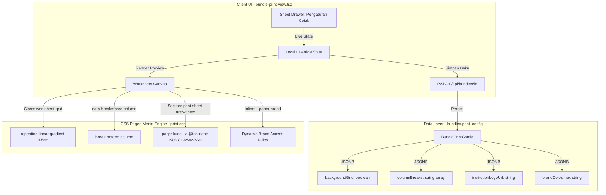

## Goal Capsule

- **Objective:** Guru dan pengajar matematika dapat mencetak naskah soal ujian (*worksheet*) fisik/PDF standar A4 dari MathBank dengan kualitas editorial percetakan profesional setara Axiom, dilengkapi latar berpetak milimeter blok (0,5 cm) untuk sketsa geometri/grafik, penanda badge chip otomatis pada running header agar lembar ujian dan kunci tidak tertukar saat difotokopi, kontrol pemecahan kolom mandiri (*force-column*) untuk menyeimbangkan layout 2-kolom, serta personalisasi logo dan palet institusi sekolah.
- **Means:** Implementasi bertahap 4 unit kerja (*4-phase implementation*) yang memperluas skema `bundlePrintConfigSchema` secara *backwards-compatible*, menambahkan aturan CSS Paged Media Level 3 pada `src/styles/print.css`, dan memperkaya antarmuka panel laci (*Sheet Drawer*) pada `src/components/bundles/bundle-print-view.tsx` (KTD1–KTD4).
- **Authority Hierarchy:**
  - `Product Contract` memegang otoritas mutlak atas perilaku pengguna, fungsionalitas tombol, dan batas mutu naskah cetak.
  - `Planning Contract` (KTD) memegang otoritas atas arsitektur CSS Paged Media, struktur kolom JSONB, dan mekanisme status reaktif di klien.
  - `Implementation Units` mengimplementasikan perubahan tanpa mengubah kontrak atau menurunkan ambang mutu (`CONSTRAINTS.md`).
- **Stop Conditions:**
  - Jika penambahan aturan CSS merusak netralisasi shell cetak atau menyebabkan KaTeX meluber keluar kolom.
  - Jika modifikasi skema memicu kegagalan migrasi database atau memutus kompatibilitas naskah yang sudah tersimpan sebelumnya.
- **Execution Profile:** TDD bertahap (per-unit unit test & CSS regression test), verifikasi mekanis menyeluruh (`typecheck`, `lint`, `test`, `build`), dan uji rendering cetak browser nyata.

---

## Product Contract

### Summary
Rencana ini mengadopsi 4 fitur unggulan sistem cetak repositori Axiom ke dalam *Publishing Engine V2* MathBank:
1. Latar kertas berpetak (*grid 0,5 cm*) via CSS murni untuk kebutuhan sketsa matematika.
2. Badge chip otomatis pada running header halaman 2+ (`LEMBAR SOAL`, `KUNCI JAWABAN`, `PEMBAHASAN`).
3. Kontrol pemecahan kolom manual (`force-column`) per butir soal untuk mengatasi naskah menggantung pada layout 2-kolom.
4. Logo institusi kustom dan preset warna identitas kop naskah.

### Problem Frame
MathBank v2.0 telah berhasil mengadopsi geometri penerbitan mathmyid.cls (`margin: 0.9cm 1cm 1.2cm 1cm`), pengurungan aman formula KaTeX (`overflow-x: hidden`), gutter nomor 28px, serta kontrol responsif mobile ("Pas Layar"). Kendati demikian, naskah cetak MathBank masih memiliki kelemahan jika dibandingkan dengan pendahulunya (Axiom):
1. **Ketiadaan Bidang Sketsa Geometri/Grafik:** Siswa tidak memiliki panduan kisi berpetak pada naskah soal esai atau ruang coretan saat menggambar grafik fungsi atau bangun ruang.
2. **Risiko Lembar Tercampur Pasca-Fotokopi:** Saat sekolah mencetak massal lalu memfotokopi naskah dan kunci jawaban secara terpisah, pengawas atau siswa rentan tertukar karena running header halaman 2+ hanya bertuliskan judul naskah tanpa indikator jenis lembar (*badge chip*).
3. **Keseimbangan Kolom 2-Kolom yang Kaku:** Jika soal nomor tertentu terlalu panjang, naskah 2-kolom sering menghasilkan kolom kiri yang penuh sesak sementara kolom kanan kosong di bagian bawah, tanpa mekanisme bagi guru untuk memindahkan butir soal ke kolom berikutnya.
4. **Identitas Institusi yang Terkunci:** Badge logo institusi pada kop naskah masih terkunci paten pada teks hijau `"MATH MY ID"`.

### Requirements

#### Grup A: Latar Belakang & Visual Cetak
- R1. Naskah cetak harus mendukung pilihan latar belakang kertas berpetak (*grid 0,5 cm*) yang dirender murni melalui CSS `repeating-linear-gradient` tanpa dependensi aset gambar eksternal.
- R2. Latar berpetak 0,5 cm harus terlihat jelas pada layar pratinjau dan tetap tercetak pada kertas fisik/PDF melalui penegakan aturan `print-color-adjust: exact`.
- R3. Guru dapat memilih latar belakang naskah melalui laci pengaturan cetak (*Sheet Drawer*): `Latar: Polos | Kertas Kotak (0,5 cm)`.

#### Grup B: Penanda Lembar Running Header (CSS Named Pages)
- R4. Running header pada halaman 2+ harus menyertakan chip identitas lembar di sudut kanan atas (`@top-right`).
- R5. Chip identitas harus otomatis berganti sesuai konteks halaman tanpa manipulasi DOM runtime:
  - Halaman naskah utama: `LEMBAR SOAL`.
  - Halaman lembar kunci jawaban: `KUNCI JAWABAN` (menggunakan CSS named page `@page kunci`).
  - Halaman lembar pembahasan: `PEMBAHASAN` (menggunakan CSS named page `@page pembahasan`).
  - Halaman lembar jawaban siswa: `LEMBAR JAWABAN` (menggunakan CSS named page `@page jawaban`).
- R6. Chip identitas pada halaman 1 tetap disupresi bersama kop naskah (`@page :first`).

#### Grup C: Keseimbangan Kolom Naskah (Lompat Kolom per Butir Soal)
- R7. Guru dapat menandai satu atau beberapa butir soal tertentu dalam naskah untuk dipaksa melompat ke kolom berikutnya (`force-column`).
- R8. Butir soal yang ditandai `force-column` harus menerapkan aturan CSS `break-before: column;` saat naskah dalam mode 2-kolom.
- R9. Pada mode 1-kolom, penanda `force-column` terdegradasi aman menjadi pemisah biasa tanpa menyebabkan halaman terpotong prematur.

#### Grup D: Personalisasi Identitas & Logo Institusi
- R10. Kop naskah harus mendukung logo kustom sekolah/bimbel melalui URL gambar (`institutionLogoUrl`).
- R11. Jika `institutionLogoUrl` tidak diisi, kop naskah otomatis kembali menggunakan logo baku Math My ID (*graceful fallback*).
- R12. Warna garis pembatas dan aksen kop naskah dapat disesuaikan melalui pilihan preset warna brand institusi (`brandColor`: Hijau Emerald `#0b6b3a`, Biru Edukasi `#0158ca`, Hitam Formal `#111111`).

### Scope Boundaries

#### In-Scope
- Perluasan skema validasi Zod `bundlePrintConfigSchema` dan interface `BundlePrintConfig`.
- Pembaruan berkas gaya cetak `src/styles/print.css` untuk kelas `.worksheet-grid`, named pages `@page kunci/@page pembahasan`, dan atribut `[data-break="force-column"]`.
- Penambahan kontrol UI pada laci `Sheet` di `src/components/bundles/bundle-print-view.tsx`.
- Pemutakhiran unit test di `bundle-print-view.test.tsx` dan `print-phase4.test.ts`.

#### Out-of-Scope (Non-Goals)
- Pembuatan tabel database baru (tetap mematuhi prinsip KISS ADR-0021).
- Rendering PDF di sisi server (Node.js/Puppeteer) — pencetakan tetap 100% di browser klien.
- Migrasi naskah massal — seluruh field baru bertipe opsional (`.optional()`).

### Success Criteria
- SC1. Latar kotak 0,5 cm dapat diaktifkan dan menghasilkan grid presisi tanpa pergeseran teks KaTeX.
- SC2. Running header halaman 2+ membedakan secara visual naskah soal, kunci jawaban, dan pembahasan pada file PDF hasil cetak.
- SC3. Pengujian unit `bundle-print-view.test.tsx` dan `print-phase4.test.ts` mencapai 100% kelulusan.
- SC4. Pembangunan produksi `pnpm build` sukses dengan 0 galat TypeScript dan 0 peringatan ESLint.

---

## Planning Contract

### Key Technical Decisions

- KTD1. **Latar Kertas Berpetak via CSS Linear Gradient Murni (session-settled: user-directed — chosen over aset gambar SVG/PNG: zero payload network overhead)**:
  Latar grid 0,5 cm diimplementasikan menggunakan dua gradien linier berulang (`repeating-linear-gradient`) transparan dengan garis tipis beropasitas rendah (`rgba(0, 0, 0, 0.08)`). Pendekatan ini tidak membebani memori, tidak membutuhkan request HTTP aset gambar, dan diskalakan otomatis sesuai dimensi kertas A4 maupun Letter.
- KTD2. **Penyelarasan Chip Running Header via CSS Named Pages (session-settled: user-approved — chosen over DOM pseudo-headers: kepatuhan penuh Chromium Paged Media Level 3)**:
  Mengadopsi aturan Axiom probe-03: ekstra lembar kunci jawaban (`.print-sheet-answerkey`), pembahasan (`.print-sheet-explanation`), dan lembar isian (`.print-sheet-answers`) dideklarasikan menggunakan aturan CSS `page: kunci;`, `page: pembahasan;`, dan `page: jawaban;`. Peramban Chromium secara otomatis mengganti isi `@top-right { content: "KUNCI JAWABAN"; }` ketika berpindah halaman tanpa intervensi JavaScript.
- KTD3. **Penyimpanan Daftar Lompat Kolom sebagai Array String UUID (`columnBreaks: string[]`)**:
  Daripada membuat tabel relasi per-item, ID butir soal yang dipaksa pindah kolom disimpan dalam kolom JSONB `bundles.print_config` sebagai array UUID string (`columnBreaks?: string[]`). Saat render, elemen `li.print-item` yang cocok mendapatkan atribut `data-break="force-column"`.
- KTD4. **Penyesuaian Warna Aksen Kop via CSS Custom Properties (`--paper-brand`)**:
  Warna garis kop naskah dimigrasikan dari warna hijau statis `#0b6b3a` menjadi CSS variable `var(--paper-brand, #0b6b3a)`. Nilai warna yang dipilih diinjeksikan secara dinamis ke elemen pembungkus naskah.

### High-Level Technical Design



### Assumptions
- Seluruh browser modern berbasis Chromium/WebKit menghormati aturan `@page` margin box dan CSS Named Pages (`page: <name>`).
- Logo kustom institusi yang disematkan telah diunggah sebelumnya ke sistem penyimpanan publik atau format Data URL yang valid.
- Tidak ada perubahan struktural pada relasi database relasional PostgreSQL (skema tabel `bundles` tetap utuh).

### System-Wide Impact
- Tidak ada dampak negatif ke API eksternal atau service ingest.
- Pengujian unit bundle API (`bundle-api.db.test.ts`) dan bundle service (`bundle-service.db.test.ts`) tetap kompatibel penuh karena field baru bersifat opsional.

### Risks & Dependencies
- **Risiko:** Pengaturan `print-color-adjust` diabaikan oleh pengguna jika pengaturan browser "Background Graphics" dimatikan saat mencetak.
  *Mitigasi:* Berikan catatan panduan singkat di panel laci (*"Pastikan opsi 'Grafik Latar Belakang' aktif di dialog cetak browser"*).
- **Risiko:** Pemilihan `force-column` pada soal pertama menyebabkan kolom 1 kosong.
  *Mitigasi:* Tambahkan aturan di UI agar soal nomor 1 tidak dapat ditandai `force-column` (soal 1 selalu tunduk pada aturan relaksasi butir pertama).

---

## Implementation Units

### U1. Background Grid 0,5 cm (Kertas Kotak Geometri)
- **Goal:** Menyediakan fitur latar belakang kertas berpetak 0,5 cm (milimeter blok) untuk mendukung pengerjaan soal sketsa grafik dan geometri.
- **Requirements:** R1, R2, R3, SC1.
- **Dependencies:** Tidak ada.
- **Files:**
  - `src/lib/contracts/bundle.ts`
  - `src/lib/db/schema/bundle.ts`
  - `src/styles/print.css`
  - `src/components/bundles/bundle-print-view.tsx`
  - `src/components/bundles/bundle-print-view.test.tsx`
  - `src/styles/print-phase4.test.ts`
- **Approach:**
  1. Tambahkan `backgroundGrid?: z.boolean().optional()` pada `bundlePrintConfigSchema` dan interface `BundlePrintConfig`.
  2. Tambahkan kelas `.worksheet.worksheet-grid` pada `src/styles/print.css` yang mendefinisikan kisi 0,5 cm horizontal dan vertikal via `repeating-linear-gradient`.
  3. Pada `@media print` di `print.css`, sertakan override khusus untuk `.worksheet.worksheet-grid` agar tidak terhapus oleh aturan umum `background: transparent !important;`:
     ```css
     .worksheet.worksheet-grid {
       background-image: repeating-linear-gradient(
         to right,
         transparent 0,
         transparent calc(0.5cm - 0.25pt),
         rgba(0, 0, 0, 0.12) calc(0.5cm - 0.25pt),
         rgba(0, 0, 0, 0.12) 0.5cm
       ),
       repeating-linear-gradient(
         to bottom,
         transparent 0,
         transparent calc(0.5cm - 0.25pt),
         rgba(0, 0, 0, 0.12) calc(0.5cm - 0.25pt),
         rgba(0, 0, 0, 0.12) 0.5cm
       ) !important;
       print-color-adjust: exact !important;
       -webkit-print-color-adjust: exact !important;
     }
     ```
  4. Tambahkan toggle switch pada drawer Pengaturan Cetak di `bundle-print-view.tsx`: "Latar Kertas Kotak (0,5 cm)".
  5. Sematkan kelas `worksheet-grid` pada pembungkus `.worksheet` jika opsi aktif.
- **Patterns to follow:** Pola toggle `fitToScreen` dan `includeAnswerSheet` di `bundle-print-view.tsx`.
- **Test scenarios:**
  - *Skenario 1 (Happy Path):* Mengaktifkan toggle kisi di drawer menambahkan kelas `worksheet-grid` pada elemen lembar naskah.
  - *Skenario 2 (State Persistence):* Menyimpan konfigurasi dengan `backgroundGrid: true` mengirimkan payload yang sesuai ke mutasi API.
  - *Skenario 3 (CSS Invariant):* Aturan `.worksheet-grid` pada `print.css` terverifikasi memiliki deklarasi gradien 0,5 cm.
- **Verification:** `pnpm test src/styles/print-phase4.test.ts` dan `pnpm test src/components/bundles/bundle-print-view.test.tsx` lulus 100%.

---

### U2. Running Header Badge Chips Berbasis Named Pages
- **Goal:** Menghadirkan badge penanda jenis lembar di running header halaman 2+ (`LEMBAR SOAL`, `KUNCI JAWABAN`, `PEMBAHASAN`, `LEMBAR JAWABAN`) agar halaman naskah tidak tertukar saat difotokopi.
- **Requirements:** R4, R5, R6, SC2.
- **Dependencies:** U1.
- **Files:**
  - `src/styles/print.css`
  - `src/components/bundles/bundle-print-view.tsx`
  - `src/components/bundles/bundle-print-view.test.tsx`
  - `src/styles/print-phase4.test.ts`
- **Approach:**
  1. Pada `src/styles/print.css`, perbarui aturan `@page` default:
     - `@top-left`: menampilkan judul naskah (`var(--print-bundle-title)`).
     - `@top-right`: menampilkan badge chip default (`var(--print-sheet-badge, "LEMBAR SOAL")`) berbingkai rapi.
  2. Deklarasikan aturan CSS Named Pages:
     - `@page kunci { @top-right { content: "KUNCI JAWABAN"; } }`
     - `@page pembahasan { @top-right { content: "PEMBAHASAN"; } }`
     - `@page jawaban { @top-right { content: "LEMBAR JAWABAN"; } }`
  3. Tautkan kelas bagian lembar naskah:
     - `.print-sheet-answerkey { page: kunci; }`
     - `.print-sheet-explanation { page: pembahasan; }`
     - `.print-sheet-answers { page: jawaban; }`
  4. Pertahankan supresi `@top-*` pada halaman pertama via `@page :first`.
- **Patterns to follow:** Arsitektur CSS Named Pages Axiom probe-03.
- **Test scenarios:**
  - *Skenario 1 (CSS Rules):* Berkas `print.css` memuat deklarasi `@page kunci`, `@page pembahasan`, dan `@page jawaban`.
  - *Skenario 2 (DOM Linkage):* Elemen kunci jawaban terhubung ke `page: kunci` dan pembahasan terhubung ke `page: pembahasan`.
- **Verification:** Tes CSS regression pada `print-phase4.test.ts` memvalidasi keberadaan aturan named pages.

---

### U3. Lompat Kolom (force-column) per Butir Soal
- **Goal:** Memberikan kendali kepada pengajar untuk memaksa butir soal tertentu berpindah ke kolom kedua pada tata letak naskah 2-kolom guna menghasilkan tata letak yang seimbang.
- **Requirements:** R7, R8, R9.
- **Dependencies:** U1, U2.
- **Files:**
  - `src/lib/contracts/bundle.ts`
  - `src/lib/db/schema/bundle.ts`
  - `src/styles/print.css`
  - `src/components/bundles/bundle-print-view.tsx`
  - `src/components/bundles/bundle-print-view.test.tsx`
- **Approach:**
  1. Tambahkan `columnBreaks?: z.array(z.string()).optional()` pada `bundlePrintConfigSchema` dan interface `BundlePrintConfig` (menyimpan array `questionId`).
  2. Tambahkan aturan CSS pada `src/styles/print.css`:
     ```css
     .print-columns .print-item[data-break="force-column"] {
       break-before: column;
     }
     ```
  3. Pada `bundle-print-view.tsx`:
     - Tambahkan kontrol pemilih butir soal di laci pengaturan (deretan chip tombol nomor butir `[1] [2] ...` yang dapat diklik untuk toggle aktif/nonaktif) khusus saat mode 2-kolom aktif. Soal nomor 1 dikecualikan dari pemilihan karena selalu tunduk pada aturan relaksasi butir pertama.
     - Pasang atribut `data-break="force-column"` pada tag `li.print-item` jika `columnBreaks.includes(it.question.id)`. Kanvas naskah tetap bersih tanpa tombol tambahan agar tidak berisiko bocor ke cetakan fisik.
- **Patterns to follow:** Pola atribut data `data-first-item` yang sudah stabil di MathBank.
- **Test scenarios:**
  - *Skenario 1 (Rendering Atribut):* Butir soal yang dimasukkan ke `columnBreaks` merender atribut `data-break="force-column"`.
  - *Skenario 2 (Exclusion):* Butir soal yang tidak ditandai tidak merender atribut `data-break`.
  - *Skenario 3 (State Toggle):* Menandai butir soal nomor 5 memperbarui state array `columnBreaks`.
- **Verification:** Pengujian unit di `bundle-print-view.test.tsx` memastikan manipulasi `columnBreaks` berjalan presisi.

---

### U4. Logo Institusi Kustom & Preset Palet Multi-Brand
- **Goal:** Memungkinkan sekolah atau bimbel mempersonalisasi kop naskah soal dengan logo institusi mereka sendiri dan memilih warna identitas brand resmi.
- **Requirements:** R10, R11, R12.
- **Dependencies:** U1, U2, U3.
- **Files:**
  - `src/lib/contracts/bundle.ts`
  - `src/lib/db/schema/bundle.ts`
  - `src/styles/print.css`
  - `src/components/bundles/bundle-print-view.tsx`
  - `src/components/bundles/bundle-print-view.test.tsx`
- **Approach:**
  1. Tambahkan `institutionLogoUrl?: z.string().url().or(z.literal("")).optional()` dan `brandColor?: z.string().optional()` pada skema kontrak cetak.
  2. Di `src/styles/print.css`, perbarui variabel `--paper-green` agar membaca `var(--paper-brand, #0b6b3a)`.
  3. Pada komponen Kop (`bundle-print-view.tsx`):
     - Migrasikan kelas arbitrary hardcoded `#0b6b3a` pada logo, garis horizontal (`headerRule`), judul naskah (`print-bundle-title`), dan kotak petunjuk (`instruction`) agar membaca warna `--paper-brand` yang diatur dinamis via inline style naskah.
     - Jika `config.institutionLogoUrl` tersedia, tampilkan gambar logo institusi `` dengan tinggi `h-9` dan `object-contain`, dilengkapi `onError` fallback otomatis ke badge teks baku Math My ID jika URL gambar rusak/gagal dimuat.
     - Jika tidak tersedia, tampilkan badge teks baku hijau `"MATH MY ID"`.
     - Sediakan pemilih preset warna di laci pengaturan: Hijau Math My ID (`#0b6b3a`), Biru Edukasi (`#0158ca`), dan Hitam Percetakan (`#111111`).
- **Patterns to follow:** Komponen `BrandBlock` dari Axiom `src/components/print-kop.tsx`.
- **Test scenarios:**
  - *Skenario 1 (Custom Logo Render):* Jika `institutionLogoUrl` diisi, elemen `img` dirender dan badge Math My ID disembunyikan.
  - *Skenario 2 (Fallback Render):* Jika `institutionLogoUrl` kosong/null, badge Math My ID dirender normal.
  - *Skenario 3 (Brand Color Variable):* Nilai warna yang dipilih disuntikkan ke style naskah.
- **Verification:** Unit test di `bundle-print-view.test.tsx` memverifikasi rendering logo kustom dan fallback.

---

## Verification Contract

### Test Commands
```bash
# 1. Typecheck TypeScript murni (0 error)
pnpm typecheck

# 2. Linting kode dan aturan penamaan bahasa Inggris (CONSTRAINTS #28b)
pnpm lint && pnpm lint:names

# 3. Unit test komponen cetak dan aturan CSS
pnpm test src/components/bundles/bundle-print-view.test.tsx \
          src/components/bundles/bundle-print-view-phase4.test.tsx \
          src/styles/print-phase4.test.ts

# 4. Seluruh rangkaian tes integrasi (130 test suite)
pnpm test

# 5. Build produksi Next.js Turbopack
pnpm build
```

---

## Definition of Done

- [ ] Seluruh unit implementasi (U1 s.d. U4) selesai diimplementasikan tanpa meninggalkan *dead-code* atau *strikethrough text*.
- [ ] Kontrak Zod `bundlePrintConfigSchema` dan interface TypeScript `BundlePrintConfig` tersinkronisasi 100%.
- [ ] Aturan CSS Paged Media tidak menyebabkan luapan teks atau KaTeX di luar kolom A4.
- [ ] Penanda running header otomatis menyesuaikan teks halaman naskah, kunci, dan pembahasan.
- [ ] Seluruh tombol kontrol dan pemilih pada laci pengaturan cetak memiliki target sentuh minimal $44 \times 44\text{ px}$.
- [ ] Seluruh teks antarmuka berbahasa Indonesia dan identifier teknis berbahasa Inggris (`pnpm lint:names` lolos).
- [ ] Semua 1.422+ pengujian unit lulus (100% hijau) dan `pnpm build` sukses.
