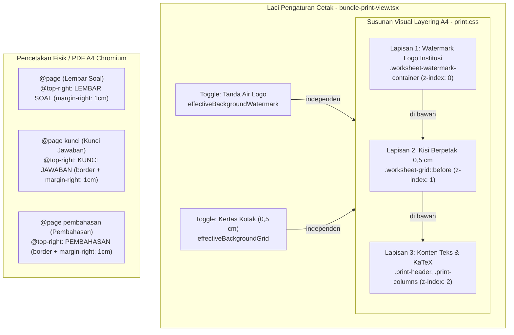

## Goal Capsule

- **Objective:** Halaman cetak naskah soal MathBank (`/bundles/[id]/print`) menyajikan tata letak A4 presisi penerbitan editorial dengan susunan visual berjenjang (*layering order*) yang benar: tanda air logo institusi berada di dasar (lapisan 1), kisi berpetak milimeter blok 0,5 cm membentang di atas tanda air (lapisan 2), dan teks konten/formula KaTeX berada di lapisan terdepan yang tajam (lapisan 3). Pengajar dapat mengaktifkan kedua opsi latar secara independen maupun bersamaan tanpa konflik state atau tombol, badge running header tercetak rapi pada named pages (kunci jawaban dan pembahasan), target sentuh tombol memenuhi standar aksesibilitas WCAG 2.5.5 ($\ge 44 \times 44\text{ px}$), dan test suite bebas dari *false confidence*.
- **Means:** 
  1. Penataan ulang CSS Stacking Context pada `src/styles/print.css` dengan memindahkan kisi `.worksheet-grid` ke pseudo-element `::before` (`z-index: 1`), mempertahankan `.worksheet-watermark-container` pada `z-index: 0`, dan menaikkan konten naskah (`.print-header`, `.print-columns`, `.print-item`, dll.) ke `z-index: 2`.
  2. Dekoupling kontrol antarmuka latar belakang di `src/components/bundles/bundle-print-view.tsx` menjadi dua tombol toggle mandiri ("Tanda Air Logo" dan "Kertas Kotak (0,5 cm)"), sinkronisasi state Preset B (Pedoman Guru) agar mereset override watermark, dan penyesuaian fallback state.
  3. Penambahan deklarasi border chip, padding, dan `margin-right: 1cm` pada running header `@top-right` untuk named pages `@page kunci`, `@page pembahasan`, dan `@page jawaban`.
  4. Peningkatan ukuran tombol nomor butir *force-column* di `bundle-print-view.tsx:511` dari `min-h-[40px] min-w-[40px]` menjadi `min-h-[44px] min-w-[44px]`.
  5. Perbaikan assertion test di `src/styles/print-phase4.test.ts:58` agar memvalidasi deklarasi `@page` aktual di baris 257.
  6. Pendaftaran dokumen perencanaan ke dalam `docs/PETA-DOKUMEN.md`.
- **Authority Hierarchy:**
  - `Product Contract` memegang otoritas atas perilaku visual naskah cetak, kemandirian toggle latar, dan batas aksesibilitas sentuh pengguna.
  - `Planning Contract` memegang otoritas atas arsitektur CSS Stacking Context, struktur DOM pseudo-element, dan strategi pengujian unit.
  - `Implementation Units` mengimplementasikan perbaikan secara terisolasi tanpa merusak 46 batas mutu `CONSTRAINTS.md`.
- **Stop Conditions:**
  - Jika penataan ulang z-index menyebabkan teks atau rumus matematika KaTeX tertutup atau tidak dapat diseleksi (*unselectable*).
  - Jika pemisahan toggle latar merusak kompatibilitas skema `bundlePrintConfigSchema` atau mutasi database `updateBundle`.
- **Execution Profile:** TDD bertahap (per-unit unit test), verifikasi visual peramban, dan penegakan gerbang mutu mekanis (`pnpm typecheck`, `pnpm lint`, `pnpm test`, `pnpm build`).

---

## Product Contract

### Summary
Rencana ini menindaklanjuti hasil evaluasi kode menyeluruh (*code review*) pada implementasi fitur cetak paket soal MathBank (`/bundles/[id]/print`) dan klarifikasi kebutuhan pengguna. Perbaikan mencakup koreksi susunan penumpukan visual (*stacking context*), pemisahan kontrol latar belakang agar kisi dan tanda air dapat diaktifkan bersamaan, perapian estetika badge running header pada lembar kunci dan pembahasan, peningkatan ukuran target sentuh aksesibilitas, eliminasi uji lolos semu (*false confidence*), dan kepatuhan dokumentasi repositori.

### Problem Frame
Implementasi awal cetak naskah dan watermark logo MathBank memiliki beberapa cacat yang teridentifikasi dalam audit:
1. **Pembalikan Urutan Lapisan (*Stacking Inversion*):** Kisi kotak 0,5 cm digambar pada `background-image` elemen `.worksheet`. Karena SVG tanda air (`PrintWatermark`) merupakan elemen anak di DOM, watermark justru menimpa garis kisi kotak. Pengguna menginginkan urutan sebaliknya: watermark di dasar, garis kotak di atas watermark, baru teks soal di atasnya.
2. **Keterbatasan Antarmuka Latar Belakang:** Kontrol latar belakang di panel laci saat ini didesain sebagai 3 tombol mutually exclusive ("Latar Polos", "Kertas Kotak", "Tanda Air Logo"). Jika pengguna ingin mencetak naskah berpetak yang sekaligus memiliki tanda air resmi sekolah, antarmuka tidak memfasilitasinya.
3. **Desinkronisasi State:** Fallback `effectiveBackgroundWatermark` bernilai `true` secara default saat `config.backgroundWatermark` belum didefinisikan. Jika bundel lama yang memiliki `backgroundGrid: true` dibuka, kedua tombol terpilih bersamaan (`variant="default"`), membingungkan pengguna.
4. **Hilangnya Border Badge Running Header pada Halaman Kunci & Pembahasan:** CSS Named Pages (`@page kunci`, `@page pembahasan`) hanya mendefinisikan `content: "..."` tanpa mengulang properti border dan offset margin kanan 1 cm, sehingga badge tercetak polos menempel ke pinggir fisik kertas.
5. **Pelanggaran Target Sentuh Minimum:** Tombol nomor butir pemilih kolom *force-column* berukuran $40 \times 40\text{ px}$, melanggar standar aksesibilitas WCAG 2.5.5 ($\ge 44 \times 44\text{ px}$).
6. **Uji Lolos Semu (*False Confidence*):** Tes unit di `print-phase4.test.ts:58` memeriksa substring komentar docblock, bukan aturan CSS aktual.
7. **Pendaftaran Dokumen:** Berkas perencanaan cetak Axiom belum terdaftar di `docs/PETA-DOKUMEN.md`.

### Requirements

#### Grup A: Susunan Lapisan & Visualisasi Latar Belakang
- R1. Tanda air logo institusi (`PrintWatermark`), kisi kertas berpetak 0,5 cm (`worksheet-grid`), dan konten naskah soal harus tertumpuk dengan urutan visual yang konsisten:
  - Lapisan 1 (Dasar): Tanda Air Logo Institusi
  - Lapisan 2 (Tengah): Kisi Berpetak 0,5 cm (melintang di atas tanda air)
  - Lapisan 3 (Terdepan): Teks Soal, Formula Matematika KaTeX, Garis Kop, dan Petunjuk Ujian
- R2. Pengajar dapat mengaktifkan Latar Polos, Kertas Kotak saja, Tanda Air Logo saja, ATAU Kertas Kotak + Tanda Air Logo secara bersamaan.
- R3. Pada tampilan pratinjau desktop naskah panjang (>640px), posisi tanda air harus tetap tampak secara wajar dan tidak terdorong ribuan piksel ke ujung bawah naskah.

#### Grup B: Antarmuka Kontrol Cetak (*Sheet Drawer*)
- R4. Kontrol Latar Belakang Naskah pada laci pengaturan cetak menyediakan tombol toggle mandiri untuk "Tanda Air Logo" dan "Kertas Kotak (0,5 cm)" dengan target sentuh minimal $44 \times 44\text{ px}$.
- R5. Tombol chip nomor butir soal *force-column* pada baris 511 harus diperbesar menjadi minimal $44 \times 44\text{ px}$ (`min-h-[44px] min-w-[44px]`).
- R6. Peralihan preset naskah (Preset A: Lembar Siswa dan Preset B: Pedoman Guru) harus menyinkronkan state latar belakang secara terprediksi tanpa kebocoran state antar-preset.

#### Grup C: Header CSS Paged Media & Harmoni Palet
- R7. Badge chip running header sudut kanan atas (`@top-right`) pada named pages (`@page kunci`, `@page pembahasan`, dan `@page jawaban`) harus mempertahankan styling berbingkai rapi (`border`, `border-radius`, `padding`, warna brand) dan ter-indentasi `margin-right: 1cm` konsisten dengan lembar soal utama.
- R8. Warna tanda air `PrintWatermark` harus selaras secara visual dengan warna brand naskah (`--paper-brand`).

### Scope Boundaries

#### In-Scope
- Pembaruan berkas styling cetak `src/styles/print.css`.
- Penyesuaian antarmuka laci dan state di `src/components/bundles/bundle-print-view.tsx`.
- Penyelarasan aset SVG di `src/components/bundles/print-watermark.tsx`.
- Pemutakhiran pengujian unit di `src/components/bundles/bundle-print-view.test.tsx` dan `src/styles/print-phase4.test.ts`.
- Pendaftaran dokumen di `docs/PETA-DOKUMEN.md`.

#### Out-of-Scope (Non-Goals)
- Perubahan skema basis data PostgreSQL (`bundles.print_config` tetap menyimpan boolean `backgroundGrid` dan `backgroundWatermark` secara independen).
- Penulisan ulang mesin KaTeX atau pustaka rendering matematika.
- Rendering PDF server-side berbasis headless Chrome daemon (tetap memanfaatkan dialog cetak bawaan peramban).

### Success Criteria
- SC1. Pada mode kombinasi, garis kisi kotak 0,5 cm tampak jelas melintang di atas grafik tanda air logo, dan seluruh teks soal berada di atas garis kisi (100% terbaca).
- SC2. Mengaktifkan dan menonaktifkan "Kertas Kotak" maupun "Tanda Air Logo" dapat dilakukan secara terpisah tanpa saling mematikan.
- SC3. Seluruh tombol di dalam laci pengaturan cetak memiliki dimensi minimal $44 \times 44\text{ px}$.
- SC4. Halaman ekstra Kunci Jawaban dan Pembahasan memiliki chip running header berbingkai dengan offset 1 cm pada cetakan PDF fisik.
- SC5. Seluruh 1.422+ pengujian unit lulus (100% hijau), `pnpm lint:names` lolos, dan `pnpm build` sukses dengan 0 galat.

---

## Planning Contract

### Key Technical Decisions

- KTD1. **Stacking Context 3-Lapisan via Pseudo-Element `.worksheet-grid::before` (session-settled: user-directed — chosen over DOM grid overlay container: zero extra DOM nodes)**:
  Untuk memposisikan grid di atas watermark, grid 0,5 cm dipindahkan dari `background-image` elemen `.worksheet` ke pseudo-element `.worksheet.worksheet-grid::before`.
  - `.worksheet-watermark-container`: `z-index: 0; position: absolute;` (layar) / `position: fixed !important;` (cetak).
  - `.worksheet.worksheet-grid::before`: `z-index: 1; position: absolute; inset: 0; pointer-events: none; background-image: repeating-linear-gradient(...);` (layar) dan `position: fixed !important; inset: 0;` (cetak).
  - Konten teks (`.header`, `.print-columns`, `.print-item`, dll.): `z-index: 2; position: relative;`.
  Hal ini menjamin urutan penumpukan fisik: Watermark $\rightarrow$ Grid 0,5 cm $\rightarrow$ Teks Naskah Soal.
- KTD2. **Dekoupling Toggle Latar Belakang menjadi Dua Tombol Mandiri (session-settled: user-directed — chosen over 4-option radio segmented control)**:
  Alih-alih membuat tombol radio "Polos / Kotak / Watermark / Keduanya", laci pengaturan menyediakan dua tombol toggle mandiri:
  - Tombol 1: `Tanda Air Logo` (`variant={effectiveBackgroundWatermark ? "default" : "outline"}`)
  - Tombol 2: `Kertas Kotak (0,5 cm)` (`variant={effectiveBackgroundGrid ? "default" : "outline"}`)
  Pengguna dapat menyalakan salah satu, mematikan keduanya (latar polos), atau menyalakan keduanya sekaligus.
- KTD3. **Penyelarasan Badge Chip Named Pages via Aturan CSS `@top-right` Bersama**:
  CSS Paged Media Chromium tidak mewarisi properti box margin-box dari `@page` dasar. Properti `font-size: 7.5pt`, `font-weight: 700`, `border: 1px solid var(--paper-brand, #0158ca)`, `padding: 1px 5px`, `margin-right: 1cm`, `border-radius: 3px`, dan `text-transform: uppercase` dideklarasikan secara eksplisit pada `@top-right` untuk `@page kunci`, `@page pembahasan`, dan `@page jawaban`.
- KTD4. **Pengujian Regex Spesifik pada CSS Paged Media**:
  Uji `src/styles/print-phase4.test.ts` dimutakhirkan dari periksa substring longgar menjadi regex berbasis blok `@page\s*\{[^}]*margin:\s*0\.9cm\s+0\s+1\.2cm\s+1cm/` untuk mencegah lolos semu dari komentar docblock.

### High-Level Technical Design



### Assumptions
- Seluruh browser Chromium menghormati aturan `print-color-adjust: exact` pada pseudo-element `::before`.
- Skema JSONB `bundles.print_config` dapat menerima `backgroundGrid: boolean` dan `backgroundWatermark: boolean` secara independen tanpa migrasi skema tabel DDL.

### System-Wide Impact
- Tidak ada dampak negatif ke API endpoint mutasi paket atau service ingest.
- Operasi patch JSONB di database PostgreSQL tetap menggunakan SQL shallow merge (`COALESCE(print_config, '{}'::jsonb) || patch::jsonb`), sehingga field lain tetap utuh.

---

## Implementation Units

### U1. CSS Stacking Context 3-Lapisan & Penyelarasan Running Header Named Pages
- **Goal:** Memastikan kisi kotak 0,5 cm berada di atas tanda air logo dan di bawah teks naskah, serta merapikan chip running header pada named pages cetak.
- **Requirements:** R1, R3, R7, SC1, SC4.
- **Dependencies:** Tidak ada.
- **Files:**
  - `src/styles/print.css`
  - `src/styles/print-phase4.test.ts`
- **Approach:**
  1. Pada `src/styles/print.css` (`@media screen` dan `@media print`):
     - Ubah deklarasi `.worksheet.worksheet-grid` menjadi pseudo-element `.worksheet.worksheet-grid::before` dengan `content: ""`, `position: absolute` (screen) atau `position: fixed !important` (print), `inset: 0`, `z-index: 1`, `pointer-events: none`, dan aturan `repeating-linear-gradient`.
     - Pertahankan `.worksheet-watermark-container` pada `z-index: 0`.
     - Naikkan seluruh elemen konten naskah (`.header`, `.instruction`, `.print-columns`, `.print-single-column`, `.print-header`, `.print-item`, `.print-sheet-answerkey`, dll.) menjadi `position: relative !important; z-index: 2 !important;`.
  2. Pada aturan CSS Named Pages (`@page kunci`, `@page pembahasan`, `@page jawaban`):
     - Lengkapi `@top-right` dengan aturan styling badge chip: `font-size: 7.5pt; font-weight: 700; border: 1px solid var(--paper-brand, #0158ca); padding: 1px 5px; margin-right: 1cm; border-radius: 3px; text-transform: uppercase; letter-spacing: 0.05em;`.
  3. Perbarui pengujian di `src/styles/print-phase4.test.ts`:
     - Ganti assertion substring longgar di baris 58 dengan regex pencocokan blok `@page` aktual: `expect(css).toMatch(/@page\s*\{[^}]*margin:\s*0\.9cm\s+0\s+1\.2cm\s+1cm/);`.
     - Tambahkan assertion bahwa `.worksheet-grid::before` memiliki `z-index: 1` dan elemen konten memiliki `z-index: 2`.
- **Patterns to follow:** Pola isolasi lapisan paged media mathmyid.cls.
- **Test scenarios:**
  - *Skenario 1 (Stacking CSS Rule):* Berkas `print.css` memuat aturan `z-index: 1` untuk `.worksheet-grid::before` dan `z-index: 2` untuk elemen konten cetak.
  - *Skenario 2 (Named Page Styling):* Aturan `@page kunci` memuat deklarasi `border` dan `margin-right: 1cm`.
  - *Skenario 3 (Regression Elimination):* Tes `print-phase4.test.ts` memvalidasi aturan `@page` asli tanpa terpengaruh komentar docblock.
- **Verification:** `pnpm test src/styles/print-phase4.test.ts` lulus 100%.

---

### U2. Dekoupling Antarmuka Latar Belakang & Peningkatan Target Sentuh
- **Goal:** Memungkinkan pemilihan latar belakang kisi dan tanda air secara independen serta memenuhi standar aksesibilitas target sentuh minimal 44px.
- **Requirements:** R2, R4, R5, R6, SC2, SC3.
- **Dependencies:** U1.
- **Files:**
  - `src/components/bundles/bundle-print-view.tsx`
  - `src/components/bundles/bundle-print-view.test.tsx`
- **Approach:**
  1. Pada `bundle-print-view.tsx`:
     - Ganti grid 3 tombol "Latar Belakang Naskah" menjadi 2 tombol toggle mandiri:
       - Tombol "Tanda Air Logo": toggle `setBackgroundWatermarkOverride(!effectiveBackgroundWatermark)`.
       - Tombol "Kertas Kotak (0,5 cm)": toggle `setBackgroundGridOverride(!effectiveBackgroundGrid)`.
       - Jika keduanya tidak aktif, naskah otomatis berlatar polos.
     - Perbarui fallback `effectiveBackgroundWatermark`:
       ```tsx
       const effectiveBackgroundWatermark: boolean =
         backgroundWatermarkOverride ?? (config.backgroundWatermark ?? true);
       ```
     - Pada `applyPresetB` (Pedoman Guru), tambahkan reset state: `setBackgroundWatermarkOverride(false)` dan `setBackgroundGridOverride(false)`.
     - Pada baris 511 (tombol chip nomor butir *force-column*), ubah kelas `min-h-[40px] min-w-[40px]` menjadi `min-h-[44px] min-w-[44px]`.
     - Pada ringkasan bilah atas sticky (baris 290), tampilkan indikator jika Tanda Air aktif atau jika mode kombinasi aktif.
  2. Perbarui pengujian di `bundle-print-view.test.tsx`:
     - Tambahkan uji bahwa "Tanda Air Logo" dan "Kertas Kotak" dapat diaktifkan secara bersamaan.
     - Tambahkan uji bahwa tombol chip butir soal memiliki class `min-h-[44px] min-w-[44px]`.
     - Uji bahwa Preset B mematikan watermark override.
- **Patterns to follow:** Pola toggle state mandiri di MathBank AppShell.
- **Test scenarios:**
  - *Skenario 1 (Kombinasi Bersamaan):* Mengklik tombol "Tanda Air Logo" dan "Kertas Kotak" menghasilkan kedua kelas `worksheet-watermark` dan `worksheet-grid` pada elemen lembar naskah.
  - *Skenario 2 (Preset Guru):* Memanggil `applyPresetB` mematikan latar belakang watermark.
  - *Skenario 3 (Aksesibilitas):* Tombol nomor butir *force-column* memiliki atribut ukuran minimal 44px.
- **Verification:** `pnpm test src/components/bundles/bundle-print-view.test.tsx` lulus 100%.

---

### U3. Harmoni Palet Warna Watermark & Ketahanan State Persistensi
- **Goal:** Mengharmoniskan gradien warna SVG tanda air dengan identitas warna institusi dan memastikan payload simpan baku tidak kehilangan konfigurasi.
- **Requirements:** R8, SC1.
- **Dependencies:** U1, U2.
- **Files:**
  - `src/components/bundles/print-watermark.tsx`
  - `src/components/bundles/bundle-print-view.tsx`
  - `src/components/bundles/bundle-print-view.test.tsx`
- **Approach:**
  1. Pada `src/components/bundles/print-watermark.tsx`:
     - Perbarui defs gradien SVG agar memanfaatkan CSS Custom Property `var(--paper-brand, #0158ca)` untuk aksen warna busur utama dan sayap M, dengan fallback warna baku yang elegan.
  2. Pada `bundle-print-view.tsx`:
     - Pastikan `handleSaveDefault` mengirimkan `backgroundWatermark: effectiveBackgroundWatermark` dan `backgroundGrid: effectiveBackgroundGrid` ke mutasi database.
     - Pertahankan field `pageSize`, `showQuestionNumber`, dan `institutionLogoUrl` jika sudah ada di konfigurasi awal bundel.
  3. Tambahkan pengujian di `bundle-print-view.test.tsx` untuk memverifikasi payload simpan baku memuat `backgroundWatermark`.
- **Patterns to follow:** Pola CSS variables `--paper-brand` di `bundle-print-view.tsx`.
- **Test scenarios:**
  - *Skenario 1 (Brand Harmony):* Elemen SVG watermark membaca variabel `--paper-brand`.
  - *Skenario 2 (Simpan Baku Payload):* Mutasi API menerima konfigurasi `backgroundWatermark: true` dan `backgroundGrid: true` saat disimpan.
- **Verification:** `pnpm test src/components/bundles/bundle-print-view.test.tsx` lulus 100%.

---

### U4. Kepatuhan Dokumentasi Repositori & Gerbang Mutu Penuh
- **Goal:** Mendaftarkan seluruh dokumen perencanaan ke indeks resmi repositori dan memastikan 100% batas mutu mekanis hijau.
- **Requirements:** CONSTRAINTS #31, #32, AGENTS.md §5, SC5.
- **Dependencies:** U1, U2, U3.
- **Files:**
  - `docs/PETA-DOKUMEN.md`
- **Approach:**
  1. Pada `docs/PETA-DOKUMEN.md`:
     - Tambahkan entri dokumen rencana cetak Axiom (`docs/plans/2026-10-28-1442-feat-adopsi-fitur-cetak-axiom-plan.md`) pada tabel Rencana & Desain Fitur.
     - Tambahkan entri dokumen rencana perbaikan menyeluruh ini (`docs/plans/2026-10-29-1119-fix-bundle-print-review-findings-plan.md`).
  2. Jalankan rangkaian lengkap gerbang mutu mekanis MathBank:
     - `pnpm typecheck`
     - `pnpm lint` && `pnpm lint:names`
     - `pnpm test`
     - `pnpm build`
- **Verification:** Seluruh gerbang mutu keluar dengan exit code 0 tanpa peringatan.

---

## Verification Contract

### Test Commands
```bash
# 1. Typecheck TypeScript murni (0 error)
pnpm typecheck

# 2. Linting kode dan aturan penamaan bahasa Inggris (CONSTRAINTS #28b)
pnpm lint && pnpm lint:names

# 3. Unit test komponen cetak dan aturan CSS
pnpm test src/styles/print-phase4.test.ts \
          src/components/bundles/bundle-print-view.test.tsx \
          src/components/bundles/bundle-print-view-phase4.test.tsx

# 4. Seluruh rangkaian tes integrasi unit (130 test suite)
pnpm test

# 5. Build produksi Next.js Turbopack
pnpm build
```

---

## Definition of Done

- [ ] Kisi berpetak 0,5 cm (`worksheet-grid::before`) berada di atas watermark (`worksheet-watermark-container`) dan di bawah konten teks (`z-index: 2`).
- [ ] Tombol kontrol "Tanda Air Logo" dan "Kertas Kotak (0,5 cm)" dapat diaktifkan secara independen maupun bersamaan.
- [ ] Chip nomor butir lompat kolom memiliki ukuran minimal $44 \times 44\text{ px}$ (`min-h-[44px] min-w-[44px]`).
- [ ] Running header `@top-right` pada named pages (`@page kunci`, `@page pembahasan`, `@page jawaban`) memiliki styling berbingkai dengan offset margin kanan 1 cm.
- [ ] Uji regresi CSS di `print-phase4.test.ts` memvalidasi aturan `@page` aktual tanpa lolos semu.
- [ ] Berkas perencanaan terdaftar rapi di `docs/PETA-DOKUMEN.md`.
- [ ] Seluruh 1.422+ pengujian unit lulus (100% hijau), `pnpm lint:names` lulus, dan `pnpm build` sukses.
