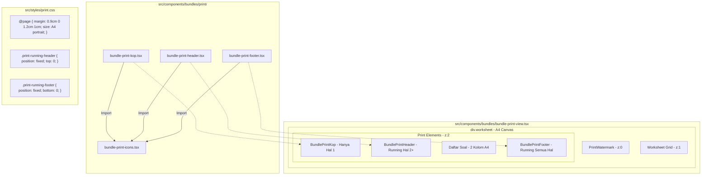

## Goal Capsule

- **Objective:** Menghasilkan lembar cetak naskah soal A4 (*print bundle*) yang profesional, presisi, dan sesuai identitas visual penerbitan Math My ID—dilengkapi kop resmi halaman 1 bergaya teknikal, running header halaman lanjutan (hal 2+), serta running footer dengan kanal media sosial dan badge nomor halaman.
- **Means:** Membangun arsitektur komponen React/TSX modular berbasis semantic HTML, CSS Paged Media modern, dan SVG/CSS ornamen murni tanpa background raster/includegraphic (KTD1–KTD4) yang terintegrasi langsung ke `src/components/bundles/bundle-print-view.tsx` dan `src/styles/print.css`.
- **Authority Hierarchy:**
  1. Kontrak User & Mockup (`docs/mockup/{kop.png,Header.png,footer.png,logoTextLite.png}`): Bentuk visual, hierarki elemen, dan larangan memakai grafik latar belakang/includegraphic utuh.
  2. Batasan Mutu Mekanis (`CONSTRAINTS.md` & `AGENTS.md`): Penamaan file Inggris, UI Indonesia, larangan `useMemo`/`useCallback`, larangan `space-y-*` (gunakan `flex flex-col gap-*`), dan gerbang mutu `pnpm lint:names` & `pnpm typecheck`.
  3. Desain Paged Media Browser (ADR-0021 & Chromium print engine): Kompatibilitas CSS `@media print` tanpa dependensi eksternal berat (KISS).
- **Stop Conditions:** Berhenti dan minta arahan jika terdapat inkonsistensi antara format margin naskah A4 saat ini (Axiom geometry) dengan tinggi kop yang menyebabkan pergeseran halaman drastis pada bundel besar (>30 soal).
- **Execution Profile:** `code`
- **Remaining Work Ownership:** Seluruh unit implementasi (U1 s.d. U6) dikerjakan dan diverifikasi hingga tuntas melalui alur `ce-work`.

---

## Product Contract

### Summary
Fitur ini mengimplementasikan sistem tata letak *Kop, Running Header, dan Running Footer* standar penerbitan naskah soal A4 (*worksheet*) pada MathBank berdasarkan panduan mockup di `docs/mockup/`. Seluruh komponen ornamen grafis (garis miring, sudut poligon, grid titik-titik, dan garis pemisah teknikal) dikonstruksi secara murni menggunakan kode (HTML, CSS modern, dan inline SVG) untuk menjamin ketajaman visual 300+ DPI baik di layar maupun saat dicetak ke kertas fisik/PDF tanpa menggunakan gambar raster utuh sebagai latar belakang.

### Problem Frame
Saat ini lembar cetak naskah paket soal (`/bundles/[id]/print`) hanya memiliki kop teks sederhana dengan garis horizontal datar, belum memiliki running header pada halaman lanjutan, dan belum memiliki footer terstandar yang memuat akun media sosial resmi Math My ID serta penomoran halaman dinamis. Ketika dicetak fisik atau diekspor ke PDF, naskah tampak belum terstandarisasi layaknya buku latihan atau lembar kerja resmi penerbitan. Selain itu, guru dan siswa membutuhkan identitas materi yang konsisten pada setiap halaman agar lembar soal yang tercecer tetap dapat diidentifikasi bab, latihan, dan nomor halamannya.

### Requirements

#### Kelompok 1: Kop Naskah Halaman Pertama (Mockup `kop.png`)
- R1. Naskah cetak menampilkan kop resmi (*header banner*) pada halaman pertama dengan tata letak geometris teknikal:
  - Badge nomor urut/bab bersudut poligon di sudut kiri atas (misal "01").
  - Logo resmi Math My ID beserta slogan *"Learning by Doing"* (menggunakan aset `logoTextLite.png`).
  - Garis vertikal pemisah antara identitas penerbit dan konten naskah.
  - Judul materi/topik utama dengan tipografi tebal huruf kapital (diambil dari judul bundel atau konfigurasi).
  - Badge pill rounded warna biru tua di bawah judul berisi ikon dokumen dan label latihan (misal "LATIHAN 1").
  - Kotak rounded di sebelah kanan berbingkai aksen warna emas/kuning berisi kode identifikasi paket naskah (misal "MMI-XI-B11-L01").
  - Ornamen aksen geometris garis miring dan pola matriks titik-titik (*dot matrix pattern*) di tepi kanan.
  - Garis batas bawah teknikal (*technical border rule*) yang membentang penuh dengan aksen takik sudut (*chamfer notch*) dan titik simpul (*node circle*).

#### Kelompok 2: Running Header Halaman Lanjutan (Mockup `Header.png`)
- R2. Naskah cetak menampilkan running header ringkas pada halaman kedua dan seterusnya:
  - Teks brand "Math My ID" tebal di sisi kiri.
  - Aksen 3 garis miring paralel miring (*slanted stripes*): garis pertama berwarna kuning/emas dan dua garis berikutnya berwarna biru tua.
  - Judul topik/bab materi yang sedang dipelajari.
  - Label nomor latihan di sisi kanan (misal "Latihan 1").
  - Aksen garis miring ganda emas dan ikon status di pojok kanan.
  - Garis pembatas bawah tipis (*hairline rule*) dengan lekukan sudut halus di bawah nama brand.

#### Kelompok 3: Running Footer Semua Halaman (Mockup `footer.png`)
- R3. Naskah cetak menampilkan running footer pada setiap halaman:
  - Sisi kiri memuat 5 kanal media sosial resmi dengan ikon vektor asli dan teks handle `mathmyid`:
    - YouTube (`mathmyid`)
    - Instagram (`mathmyid`)
    - Facebook (`mathmyid`)
    - Telegram (`mathmyid`)
    - X / Twitter (`mathmyid`)
  - Setiap kanal dipisahkan oleh garis vertikal pemisah (`|`).
  - Sisi kanan memuat badge nomor halaman bersudut poligon miring (*slanted polygon badge*):
    - Garis aksen diagonal luar.
    - Poligon aksen emas/kuning miring.
    - Poligon blok biru tua pekat yang memuat angka nomor halaman warna putih tebal.

#### Kelompok 4: Konstruksi Visual & Integritas Render (Bebas Raster Background)
- R4. **Larangan Grafis Latar Belakang Raster:** Seluruh bentuk visual, poligon, garis miring, bingkai kode, badge latihan, dan garis bawah teknikal WAJIB dikonstruksi menggunakan semantic HTML, CSS modern (`clip-path`, `transform: skewX`, `border`, CSS gradients), atau elemen SVG inline murni. Dilarang memotong mockup menjadi gambar `.png` utuh untuk dijadikan background naskah.
- R5. **Ketajaman Vektor Cetak:** Seluruh ikon media sosial dan ornamen grafis harus berbasis vektor tajam (SVG) sehingga tidak pecah atau kabur saat dicetak pada printer beresolusi 300 s.d. 1200 DPI.
- R6. **Preservasi Aset Logo Resmi:** Mengintegrasikan file `docs/mockup/logoTextLite.png` sebagai aset logo resmi yang ditempatkan di `public/brand/logo-text-lite.png` dengan rasio aspek terjaga dan tampilan tajam.

#### Kelompok 5: Tata Letak Cetak Paged Media & Pratinjau Layar
- R7. Tampilan kop, header, dan footer harus berfungsi secara serasi baik pada pratinjau layar (desktop dan mobile) maupun saat dicetak fisik / disimpan ke PDF via `window.print()`.
- R8. Header halaman lanjutan tidak boleh menumpuk atau merusak kop halaman pertama saat dicetak.
- R9. Footer halaman harus selalu menempel di bagian bawah setiap lembar fisik cetak tanpa menabrak butir soal paling bawah.

### Key Decisions
- **KD1 (Konstruksi Kode Murni / Zero Background Image):** Menolak pemotongan gambar raster mockup utuh sebagai latar belakang. Memilih konstruksi CSS `clip-path` + inline SVG ornamen agar ukuran file naskah ringan, teks dapat diindeks/disalin, dan resolusi cetak sempurna (*crisp* pada semua level zoom). `(session-settled: user-directed — dipilih daripada background raster image: mematuhi arahan tegas pengguna agar tidak memakai includegraphic/background gambar)`. Governs R4, R5.
- **KD2 (Pemisahan Komponen Modular):** Memecah kop, running header, dan running footer ke dalam modul komponen terpisah di `src/components/bundles/print/` agar mudah dirawat dan diuji tanpa menggelembungkan berkas utama `bundle-print-view.tsx`. Governs R1, R2, R3, R7.
- **KD3 (Mekanisme Paged Media CSS Chromium):** Menggunakan kombinasi flow dokumen natural untuk Kop Halaman 1 (yang otomatis hanya muncul di lembar pertama) dan `position: fixed` dengan padding pengaman untuk running header dan running footer saat `@media print`. Governs R7, R8, R9.

### Scope Boundaries

#### In Scope
- Penempatan dan penyalinan aset `docs/mockup/logoTextLite.png` ke dalam direktori publik aplikasi (`public/brand/logo-text-lite.png`).
- Pembuatan komponen `BundlePrintKop` untuk header halaman pertama (`kop.png`).
- Pembuatan komponen `BundlePrintHeader` untuk running header halaman 2+ (`Header.png`).
- Pembuatan komponen `BundlePrintFooter` untuk running footer semua halaman (`footer.png`).
- Pembuatan komponen ornamen grafis SVG pembantu (pola dot-matrix, ikon media sosial resmi YouTube, Instagram, Facebook, Telegram, X).
- Penyesuaian aturan CSS cetak di `src/styles/print.css` untuk tata letak paged media, margin naskah, dan z-index stacking context.
- Integrasi ke `src/components/bundles/bundle-print-view.tsx` dengan pemetaan data dinamis (judul bundel, bab/topik, kode paket).
- Pengujian unit dan snapshot visual untuk memastikan komponen tidak mengalami regresi rendering.

#### Out of Scope / Deferred
- Pengubahan skema database PostgreSQL `bundles` (menggunakan kolom `print_config` yang sudah ada via ADR-0021).
- Pengubahan logika parsing KaTeX atau rendering butir soal matematika.
- Pembuatan editor interaktif drag-and-drop untuk mendesain kop baru (konfigurasi mengikuti template baku Math My ID).

### Success Criteria
- [ ] Kop naskah halaman 1 terpasang dengan elemen visual yang 100% presisi mencerminkan mockup `kop.png` tanpa gambar latar belakang raster.
- [ ] Running header halaman 2+ tampil rapi dengan aksen 3 garis miring dan pemisah teks sesuai `Header.png`.
- [ ] Running footer tampil di setiap lembar naskah dengan 5 ikon media sosial yang dapat diklik/terbaca jelas dan badge nomor halaman poligon sesuai `footer.png`.
- [ ] Pengujian cetak peramban (Chrome / Firefox `window.print()`) menunjukkan kop hanya berada di halaman pertama, header muncul di halaman lanjutan, dan footer berada di dasar setiap halaman tanpa menimpa teks soal.
- [ ] Seluruh pengujian otomatis (`pnpm typecheck`, `pnpm lint`, `pnpm lint:names`, `pnpm test`) lulus hijau 100%.

---

## Planning Contract

### Key Technical Decisions

- KTD1. **Struktur Komponen Modular di `src/components/bundles/print/`:**
  Membuat direktori baru `src/components/bundles/print/` yang memuat:
  - `bundle-print-kop.tsx`: Komponen kop halaman 1.
  - `bundle-print-header.tsx`: Komponen running header halaman 2+.
  - `bundle-print-footer.tsx`: Komponen running footer.
  - `bundle-print-icons.tsx`: Koleksi path SVG vektor ikon media sosial resmi (YouTube, Instagram, Facebook, Telegram, X) dan pola dot-matrix.
  *Alasan:* Memisahkan markup grafis yang padat dari logika pengaturan dan daftar soal di `bundle-print-view.tsx`.

- KTD2. **Teknik Geometri CSS untuk Poligon dan Aksen Miring:**
  - Badge sudut "01": Menggunakan CSS `clip-path: polygon(0 0, 100% 0, 80% 100%, 0 100%)` atau SVG path dengan warna background `#002b66`.
  - Aksen 3 garis miring pada header: Menggunakan `span` dengan utility `skew-x-[-25deg] inline-block` dan background color tokens.
  - Badge nomor halaman pada footer: Menggunakan pembungkus flex dengan aksen diagonal paralel dan poligon utama ber-`clip-path: polygon(25% 0, 100% 0, 100% 100%, 0% 100%)` berwarna biru navy dan kuning emas.
  - Garis batas bawah teknikal kop: Menggunakan kombinasi border CSS dan SVG inline garis bersimpul (*notched polyline*) untuk mereproduksi lekukan dan lingkaran simpul secara presisi di layar dan cetak.
  *Alasan:* Menghilangkan ketergantungan pada gambar bitmap eksternal dan menjamin ketajaman tak terbatas (*infinite resolution*) saat dicetak.

- KTD3. **Strategi Penempatan CSS Paged Media Multi-halaman:**
  - **Kop Halaman 1:** Ditempatkan di dalam elemen pembungkus naskah `.worksheet` sebagai elemen normal flow pertama. Dengan demikian, kop hanya dicetak pada lembar pertama dan mendorong butir soal ke bawahnya secara alami.
  - **Running Header (Hal 2+):** Dikonfigurasi dengan kelas `.print-running-header` yang memiliki gaya `@media print { display: flex; position: fixed; top: 0; left: 1cm; right: 0; }`. Pada halaman 1, kop naskah diposisikan relatif dengan background putih solid (`bg-white z-20`) membentang dari batas atas kertas sehingga running header tertutupi secara sempurna di halaman 1, namun otomatis muncul di puncak halaman 2, 3, dst tanpa bocor.
  - **Running Footer (Semua Hal):** Dikonfigurasi dengan kelas `.print-running-footer` yang memiliki gaya `@media print { display: flex; position: fixed; bottom: 0; left: 1cm; right: 0; }`. Margin bawah halaman A4 di `@page` diatur sebesar `1.2cm` sehingga area teks soal tidak akan pernah tumpang tindih dengan footer.
  *Alasan:* Merupakan satu-satunya metode yang terbukti stabil pada mesin peramban Chromium (Blink) tanpa memerlukan pustaka pemecah halaman JavaScript berat.

- KTD4. **Palet Warna & Preservasi Tinta Cetak:**
  - Token warna utama:
    - Biru Navy Math My ID: `#002b66` (utama) / `#003399`.
    - Kuning Emas Aksen: `#e69500` / `#f59e0b`.
    - Abu-abu Teks Sekunder: `#4b5563`.
    - Hitam Teks Utama: `#111111`.
  - Mengaplikasikan `print-color-adjust: exact !important; -webkit-print-color-adjust: exact !important;` pada seluruh elemen badge, garis aksen, dan logo agar peramban tidak memutihkan warna latar grafis saat mode hemat tinta aktif.
  *Alasan:* Menjaga konsistensi estetika brand Math My ID pada cetakan fisik.

- KTD5. **Format Kode Paket & Fallback Data:**
  - Kode paket di kanan kop diformat mengikuti pola: `MMI-[KELAS]-[KODE_TOPIK]-[LATIHAN]`. Contoh: jika paket memiliki grade 11 dan judul bab 1, kodenya adalah `MMI-XI-B01-L01`. Jika data tidak lengkap, disediakan fallback otomatis yang terformat rapi.
  - Nomor latihan pada pill badge diambil dari konfigurasi cetak atau diekstrak dari judul paket.
  *Alasan:* Memberikan kesan naskah terbitan resmi yang terorganisir dengan rapi.

### High-Level Technical Design



### Assumptions
- Aset gambar `docs/mockup/logoTextLite.png` memiliki resolusi yang cukup tinggi dan latar belakang transparan untuk disajikan pada kop halaman pertama.
- Pengguna peramban mencetak naskah menggunakan Chromium (Chrome, Edge), Firefox, atau Safari modern yang mendukung CSS `position: fixed` pada paged media.
- Kompatibilitas responsif di layar ponsel tetap dipertahankan dengan menyusutkan ukuran font kop secara proporsional atau stacking vertikal yang anggun.

---

## Implementation Units

### U1. Integrasi Aset Logo & Token Warna Cetak Math My ID
- **Goal:** Menempatkan aset logo resmi Math My ID ke direktori publik dan mendefinisikan token warna cetak khusus kop/header/footer.
- **Requirements:** R4, R5, R6.
- **Dependencies:** Tidak ada.
- **Files:**
  - `public/brand/logo-text-lite.png` (baru - disalin dari `docs/mockup/logoTextLite.png`)
  - `src/styles/print.css` (modifikasi token warna & utility cetak)
- **Approach:**
  1. Buat direktori `public/brand/` jika belum ada dan salin `docs/mockup/logoTextLite.png` ke `public/brand/logo-text-lite.png`.
  2. Tambahkan variabel CSS `--paper-navy: #002b66;` dan `--paper-gold: #f59e0b;` pada `:root` dan `.worksheet` di `src/styles/print.css`.
  3. Tambahkan utility class pendukung cetak untuk aksen miring dan pemaksaan warna cetak (`print-color-adjust: exact`).
- **Patterns to follow:** Pola penempatan aset `public/watermark.svg` dan token `--paper-brand` di `src/styles/print.css`.
- **Test scenarios:**
  - Memverifikasi keberadaan file aset di `public/brand/logo-text-lite.png`.
  - Memverifikasi definisi token warna di `src/styles/print.css` terbaca dengan benar.
- **Verification:** File logo dapat diakses via URL publik dan tidak memicu error 404 pada Next.js.

---

### U2. Komponen Koleksi Ikon Vektor & Ornamen Grafis Cetak
- **Goal:** Membuat komponen pustaka SVG vektor murni untuk ikon sosial media resmi (YouTube, Instagram, Facebook, Telegram, X/Twitter), pola dot-matrix, dan elemen garis teknikal.
- **Requirements:** R3, R4, R5.
- **Dependencies:** U1.
- **Files:**
  - `src/components/bundles/print/bundle-print-icons.tsx` (baru)
  - `src/components/bundles/print/bundle-print-icons.test.tsx` (baru)
- **Approach:**
  1. Buat komponen SVG murni dengan path terstandar untuk ikon: YouTube, Instagram, Facebook, Telegram, dan Twitter/X.
  2. Buat komponen SVG `<DotMatrixPattern />` untuk ornamen titik-titik geometris di sisi kanan kop halaman 1.
  3. Buat komponen `<TechnicalBorderBottom />` yang merender garis batas teknikal kop lengkap dengan takik sudut chamfer dan titik lingkaran simpul.
  4. Semua SVG menggunakan atribut `fill="currentColor"` atau variabel warna Math My ID dan berdimensi scalable (`viewBox`).
- **Patterns to follow:** Pola inline SVG pada `src/components/bundles/print-watermark.tsx`.
- **Test scenarios:**
  - Memastikan seluruh ikon merender elemen `<svg>` dengan `viewBox` valid dan `aria-hidden="true"`.
  - Memastikan ikon menerima `className` untuk pewarnaan dan ukuran fleksibel.
- **Verification:** Tes unit di `bundle-print-icons.test.tsx` lulus 100%.

---

### U3. Komponen Kop Naskah Halaman Pertama (`BundlePrintKop`)
- **Goal:** Mengimplementasikan kop resmi naskah halaman pertama yang presisi sesuai mockup `kop.png` menggunakan semantic HTML, CSS poligon/flexbox, dan logo resmi.
- **Requirements:** R1, R4, R5, R6, R7.
- **Dependencies:** U1, U2.
- **Files:**
  - `src/components/bundles/print/bundle-print-kop.tsx` (baru)
  - `src/components/bundles/print/bundle-print-kop.test.tsx` (baru)
- **Approach:**
  1. Susun struktur kop dengan grid/flexbox:
     - Sisi Kiri: Badge poligon nomor "01", Logo `logo-text-lite.png` (dengan tinggi terkalibrasi ~36px), garis vertikal pemisah.
     - Sisi Tengah: Judul naskah/topik materi (`bundle.title` kapital tebal) dan pill badge biru tua dengan ikon latihan ("LATIHAN 1").
     - Sisi Kanan: Box rounded kode naskah ("MMI-XI-B11-L01") bergaris emas, aksen garis miring diagonal paralel, dan pola dot-matrix.
     - Dasar Kop: Garis pemisah teknikal SVG (`<TechnicalBorderBottom />`).
  2. Gunakan utility Tailwind CSS `flex flex-col gap-*` (mematuhi larangan `space-y-*`).
  3. Sediakan props fleksibel: `title`, `packageCode`, `exerciseLabel`, `sectionNumber`, `brandColor`, `accentColor`.
- **Patterns to follow:** Standar komponen React functional MathBank dan styling print worksheet.
- **Test scenarios:**
  - Render kop dengan data lengkap dan verifikasi kemunculan teks judul, label latihan, dan kode paket.
  - Render kop saat kode paket tidak disediakan dan pastikan fallback otomatis bekerja tanpa crash.
  - Memverifikasi elemen logo memiliki `src` mengarah ke `/brand/logo-text-lite.png`.
- **Verification:** Tes unit di `bundle-print-kop.test.tsx` lulus 100%.

---

### U4. Komponen Running Header Halaman Lanjutan (`BundlePrintHeader`)
- **Goal:** Mengimplementasikan running header kompak untuk halaman 2 ke atas sesuai mockup `Header.png`.
- **Requirements:** R2, R4, R5, R7.
- **Dependencies:** U1, U2.
- **Files:**
  - `src/components/bundles/print/bundle-print-header.tsx` (baru)
  - `src/components/bundles/print/bundle-print-header.test.tsx` (baru)
- **Approach:**
  1. Susun baris horizontal kompak dengan flexbox:
     - Sisi Kiri: Teks "Math My ID" tebal navy, 3 aksen garis miring `// /` (1 emas, 2 navy ber-`skew-x-[-25deg]`), dan judul materi (`title`).
     - Sisi Kanan: Teks label latihan ("Latihan 1") dan aksen garis miring ganda emas + ikon status.
     - Bawah: Garis hairline tipis dengan aksen lekukan sudut.
  2. Tambahkan kelas penanda cetak `.print-running-header` untuk styling `@media print`.
- **Patterns to follow:** Standar komponen baris atas naskah MathBank.
- **Test scenarios:**
  - Render running header dan verifikasi keberadaan teks "Math My ID", judul materi, dan label latihan.
  - Memverifikasi 3 aksen garis miring memiliki kelas warna emas dan biru navy yang tepat.
- **Verification:** Tes unit di `bundle-print-header.test.tsx` lulus 100%.

---

### U5. Komponen Running Footer Semua Halaman (`BundlePrintFooter`)
- **Goal:** Mengimplementasikan running footer naskah dengan ikon 5 kanal media sosial dan badge nomor halaman poligon sesuai mockup `footer.png`.
- **Requirements:** R3, R4, R5, R7.
- **Dependencies:** U1, U2.
- **Files:**
  - `src/components/bundles/print/bundle-print-footer.tsx` (baru)
  - `src/components/bundles/print/bundle-print-footer.test.tsx` (baru)
- **Approach:**
  1. Susun baris footer horizontal dengan border atas tipis yang bersih:
     - Sisi Kiri: Deretan 5 kanal media sosial (YouTube, Instagram, Facebook, Telegram, Twitter/X) berpasangan dengan teks `mathmyid` dan dipisahkan pembatas pipa `|`.
     - Sisi Kanan: Badge nomor halaman poligon miring (*slanted badge*) yang menggabungkan garis aksen diagonal, blok emas, dan poligon biru navy pekat yang memuat nomor halaman.
  2. Tambahkan kelas penanda cetak `.print-running-footer` untuk penempatan `position: fixed; bottom: 0;` saat dicetak.
  3. Menerima props `pageNumber` (opsional, default "1" atau dinamis) dan daftar media sosial yang dapat dikustomisasi bila diperlukan.
- **Patterns to follow:** Standar komponen footer cetak MathBank.
- **Test scenarios:**
  - Memastikan ke-5 nama kanal media sosial dan ikonnya ter-render dengan rapi.
  - Memverifikasi nomor halaman tampil di dalam badge poligon sisi kanan.
- **Verification:** Tes unit di `bundle-print-footer.test.tsx` lulus 100%.

---

### U6. Refaktor CSS Paged Media & Integrasi Terpadu ke `BundlePrintView`
- **Goal:** Mengintegrasikan `BundlePrintKop`, `BundlePrintHeader`, dan `BundlePrintFooter` ke dalam `BundlePrintView` dan memperbarui `src/styles/print.css` agar tata letak cetak paged media bekerja mulus tanpa benturan visual.
- **Requirements:** R1, R2, R3, R7, R8, R9.
- **Dependencies:** U1, U2, U3, U4, U5.
- **Files:**
  - `src/components/bundles/bundle-print-view.tsx` (modifikasi)
  - `src/styles/print.css` (modifikasi aturan cetak running header & footer)
  - `src/components/bundles/bundle-print-view.test.tsx` (pembaruan tes regresi)
- **Approach:**
  1. Perbarui `src/styles/print.css`:
     - Tambahkan aturan untuk `.print-running-header`: saat `@media screen` tersembunyi (atau hanya muncul di pratinjau multi-halaman), saat `@media print` memiliki `position: fixed; top: 0; left: 1cm; right: 0; z-index: 10;`.
     - Tambahkan aturan untuk `.print-running-footer`: saat `@media print` memiliki `position: fixed; bottom: 0; left: 1cm; right: 0; z-index: 10;`.
     - Pastikan Kop Halaman 1 memiliki `position: relative; z-index: 20; background: #ffffff;` saat cetak membentang dari batas atas kertas sehingga menutupi running header di halaman pertama secara sempurna tanpa kebocoran visual.
     - Berikan `padding-top` yang cukup pada konten naskah saat cetak agar butir soal pada halaman 2+ tidak tertimpa running header.
  2. Perbarui `BundlePrintView` di `src/components/bundles/bundle-print-view.tsx`:
     - Ganti elemen header kop lama dengan `<BundlePrintKop ... />`.
     - Sisipkan `<BundlePrintHeader ... />` untuk running header cetak.
     - Sisipkan `<BundlePrintFooter ... />` di dalam kanvas naskah `.worksheet`.
  3. Ekstrak kode paket naskah dan nomor latihan secara cerdas dari metadata paket.
- **Patterns to follow:** Arsitektur susunan stacking context 3-lapisan cetak yang sudah ada di `src/styles/print.css`.
- **Test scenarios:**
  - Tes render `BundlePrintView` memastikan kop baru, running header, dan running footer terpasang di DOM.
  - Tes verifikasi tidak ada pemotongan kelas Tailwind atau regresi toggle watermark & grid.
- **Verification:** Seluruh suite pengujian di `bundle-print-view.test.tsx` dan `print-phase4.test.ts` lulus hijau.

---

## Verification Contract

### Test Commands
```bash
# 1. Typecheck & Linters
pnpm typecheck
pnpm lint
pnpm lint:names

# 2. Unit & Integration Tests Komponen Cetak
pnpm test src/components/bundles/print/
pnpm test src/components/bundles/bundle-print-view.test.tsx
pnpm test src/styles/print-phase4.test.ts

# 3. Full Project Test Suite
pnpm test
pnpm build
```

### Manual Visual Verification Checklist
1. Buka halaman `/bundles/[id]/print` di peramban (Chrome / Edge / Firefox).
2. Periksa tampilan pratinjau layar (*screen view*):
   - Kop halaman 1 tampil identik dengan `docs/mockup/kop.png`.
   - Footer tampil di bagian bawah naskah identik dengan `docs/mockup/footer.png`.
3. Buka dialog cetak (`Ctrl + P` / `Cmd + P`):
   - Halaman 1 mencetak Kop Resmi secara penuh.
   - Halaman 2 dan seterusnya mencetak Running Header ringkas di bagian atas.
   - Setiap halaman mencetak Running Footer di dasar lembar A4.
   - Tidak ada teks butir soal atau KaTeX yang tertimpa oleh header maupun footer.
4. Periksa ketajaman grafis pada zoom 200% s.d. 400%: seluruh aksen poligon dan ikon tetap tajam sempurna tanpa artefak pikselasi.

---

## Definition of Done

- [ ] Aset logo resmi Math My ID ditempatkan di `public/brand/logo-text-lite.png`.
- [ ] Komponen pustaka ikon vektor cetak (`bundle-print-icons.tsx`) selesai dibuat dan teruji.
- [ ] Komponen kop halaman 1 (`bundle-print-kop.tsx`) selesai dibuat dengan semantic HTML + CSS murni (tanpa gambar background) dan lulus uji unit.
- [ ] Komponen running header (`bundle-print-header.tsx`) selesai dibuat dan lulus uji unit.
- [ ] Komponen running footer (`bundle-print-footer.tsx`) selesai dibuat dengan 5 ikon media sosial dan badge nomor halaman poligon serta lulus uji unit.
- [ ] Aturan CSS Paged Media di `src/styles/print.css` diperbarui untuk penempatan presisi kop, running header, dan running footer.
- [ ] Komponen `BundlePrintView` terintegrasi penuh dengan ketiga komponen baru tersebut.
- [ ] Seluruh kode mematuhi konvensi proyek: penamaan file/fungsi dalam bahasa Inggris, teks UI dalam bahasa Indonesia, bebas `useMemo`/`useCallback`, dan bebas `space-y-*`.
- [ ] Seluruh gerbang mutu (`pnpm typecheck`, `pnpm lint`, `pnpm lint:names`, `pnpm test`, `pnpm build`) berhasil lulus hijau 100%.
