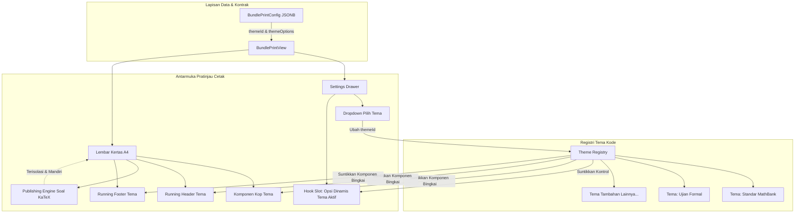

# Tema Halaman Cetak Paket Soal - Plan

## Goal Capsule

- **Objective:** Pengguna dan guru dapat memilih tema visual cetak naskah soal A4 dan mengonfigurasi opsi khusus per tema melalui kontrol dinamis di drawer pengaturan cetak, dengan hasil yang tersimpan atomik pada paket soal tanpa merusak tata letak rumus matematika.
- **Means:** Implementasi arsitektur registrasi tema berbasis berkas modular di dalam repo (`src/lib/print/themes/`) dengan antarmuka bingkai identitas cetak serta hook penyuntik kontrol opsi kustom ke dalam drawer pengaturan cetak.
- **Product Authority:** MathBank Publishing Engine. Bingkai identitas (kop, running header, running footer) didelegasikan ke tema aktif, sementara tata letak butir soal KaTeX dan pemutusan halaman CSS Paged Media tetap dikelola terpusat oleh engine inti.
- **Open Blockers:** Tidak ada.

---

## Product Contract

### Summary

MathBank menyediakan sistem tema cetak naskah soal A4 modular berbasis berkas kode di dalam repositori, di mana setiap tema menyediakan komponen bingkai naskah (kop halaman pertama, running header, running footer, serta variabel gaya) dan dapat mendaftarkan kontrol formulir kustom melalui hook opsi dinamis. Pengaturan tema dipilih melalui antarmuka pratinjau cetak dan disimpan ke dalam kolom JSONB `bundles.print_config` dengan fallback otomatis ke tema standar untuk seluruh naskah yang sudah ada.

### Problem Frame

Saat ini halaman cetak paket soal (`/bundles/[id]/print`) menggunakan tata letak tunggal yang mengikat (*hardcoded*) komponen kop dan running header ke format Math My ID. Guru di sekolah dan madrasah membutuhkan format naskah ujian formal dengan kop dinas resmi, kolom nomor peserta, serta tanda tangan pengawas, sedangkan lembaga bimbel membutuhkan format ringkas hemat kertas. Ketiadaan sistem tema memaksa pengguna memodifikasi naskah secara manual di luar MathBank setelah diekspor, atau membebani satu komponen cetak tunggal dengan puluhan sakelar *if-else* yang rapuh dan sulit dirawat.

### Key Decisions

- KD1. **Model Tema Berbasis Berkas Kode Modular di Repositori:** Tema diimplementasikan sebagai modul TypeScript/TSX di dalam direktori proyek (`src/lib/print/themes/`) dan didaftarkan ke registri tema terpusat.  
  (session-settled: user-directed — chosen over Upload Berkas Dinamis dan Konfigurasi JSON murni: Memastikan keamanan anti-XSS, type-safety penuh, performa kompilasi Next.js 16/Turbopack, dan kemudahan pengujian otomatis tanpa memerlukan sandbox runtime.)  
  Governs R1, R2, R7.

- KD2. **Hook Kontrol Opsi Dinamis di Drawer:** Setiap tema dapat mendaftarkan skema dan komponen kontrol formulir kustom yang otomatis disuntikkan ke dalam `BundlePrintSettingsDrawer`.  
  (session-settled: user-directed — chosen over Pipeline Render Penuh dan Preset Nilai Baku Saja: Memberikan fleksibilitas bagi tema untuk menambahkan opsi spesifik seperti sakelar tanda tangan atau format kop tanpa membongkar arsitektur inti.)  
  Governs R3, R4, R5.

- KD3. **Pemisahan Tanggung Jawab Bingkai & Identitas dari Engine Soal:** Tema hanya mengontrol bingkai luar naskah (Kop Halaman 1, Running Header Halaman 2+, Running Footer, serta token warna/font), sedangkan perenderan butir soal, diagram KaTeX, nomor soal, dan pembagian kolom tetap dikelola oleh Publishing Engine MathBank.  
  (session-settled: user-directed — chosen over Full Template dan CSS Saja: Melindungi invarian ADR-0021 dan CONSTRAINTS agar rumus matematika KaTeX tidak terbelah antar-halaman akibat modifikasi tema.)  
  Governs R1, R6.

- KD4. **Katalog Awal MVP (Tema Standar + Tema Ujian Formal):** Rilis perdana menghadirkan dua tema bawaan: Tema Standar MathBank (`math-my-id`, memigrasikan layout saat ini) dan Tema Ujian Formal (`formal-exam`, kop dinas/madrasah, kolom nomor peserta, dan opsi tanda tangan pengawas).  
  (session-settled: user-directed — chosen over 3 Tema Lengkap dan 1 Tema Fondasi Saja: Memberikan validasi nyata atas kemampuan hook opsi dinamis sekaligus menjaga naskah eksisting tetap 100% kompatibel tanpa regresi.)  
  Governs R8, R9.

- KD5. **Penyimpanan Opsi Tema Terisolasi di `print_config` JSONB:** Opsi tema disimpan di bawah properti `themeId` dan `themeOptions[themeId]` di dalam kolom `bundles.print_config`, sehingga pergantian tema tidak menghilangkan nilai opsi dari tema sebelumnya dan tidak memerlukan migrasi skema tabel PostgreSQL baru.  
  Governs R4, R7.

### Actors

- A1. **Guru / Penyusun Paket Soal:** Membuka halaman cetak naskah, memilih tema yang sesuai (misal: Ujian Formal untuk penilaian akhir semester), mengatur opsi tema di drawer, dan mencetak naskah atau menyimpannya sebagai pengaturan baku paket.
- A2. **Pengembang / Kontributor Sistem:** Menambahkan tema cetak baru di masa depan dengan membuat satu berkas modul tema yang mengimplementasikan antarmuka standar tanpa perlu memodifikasi kode perender halaman utama.

### Requirements

#### Arsitektur & Kontrak Tema

- R1. Sistem harus menyediakan kontrak antarmuka tema (`PrintTheme`) yang mendefinisikan metadata tema (ID, nama, deskripsi), komponen bingkai (Kop, Running Header, Running Footer), variabel CSS, serta hook opsi kustom.
- R2. Sistem harus menyediakan registri tema terpusat yang memuat seluruh tema terdaftar dan mengekspos fungsi untuk mengambil tema aktif berdasarkan `themeId` dengan fallback ke tema default (`math-my-id`).

#### Drawer Pengaturan & Hook Opsi Dinamis

- R3. Drawer pengaturan cetak (`BundlePrintSettingsDrawer`) harus menyediakan pemilih tema (dropdown) untuk mengganti tema aktif secara langsung (*reaktif*).
- R4. Sistem harus mengeksekusi hook opsi tema aktif untuk merender komponen kontrol formulir kustom di dalam drawer ketika tema yang dipilih mendeklarasikan opsi tambahan.
- R5. Kontrol formulir kustom di drawer harus mendukung tipe input standar (sakelar toggle/checkbox, pilihan select, dan input teks) dengan target sentuh minimal 44 piksel sesuai panduan aksesibilitas antarmuka.

#### Persistensi & Integritas Data

- R6. Tata letak butir soal matematika, isolasi KaTeX, ruang coretan siswa, lembar jawaban, dan aturan pemutusan halaman (*break-inside avoid*) harus tetap diatur oleh engine cetak utama dan tidak boleh rusak oleh pergantian tema.
- R7. Penyimpanan konfigurasi cetak harus menyimpan `themeId` dan peta opsi `themeOptions` ke dalam kolom `print_config` pada tabel `bundles` dengan validasi skema Zod, tanpa memerlukan tabel relasional tambahan.

#### Katalog Tema Bawaan (MVP)

- R8. Sistem harus menyertakan Tema Standar MathBank (`math-my-id`) yang mempertahankan secara presisi tata letak kop, header, dan footer yang saat ini aktif, sehingga naskah lama tanpa `themeId` tampil identik tanpa perubahan visual.
- R9. Sistem harus menyertakan Tema Ujian Formal (`formal-exam`) yang menyediakan kop bergaya dinas/madrasah, kolom identitas siswa (nama, kelas, nomor peserta), serta hook opsi cetak untuk menampilkan kolom tanda tangan pengawas ujian.

### Key Flows

- F1. Pemilihan dan Penyesuaian Tema oleh Guru
  - **Trigger:** Guru membuka halaman `/bundles/[id]/print` dan membuka drawer "Pengaturan".
  - **Actors:** A1 (Guru).
  - **Steps:**
    1. Guru memilih tema "Ujian Formal" pada dropdown tema di drawer.
    2. Halaman cetak secara instan memperbarui tampilan kop naskah menjadi format formal dinas.
    3. Drawer secara otomatis menampilkan seksi baru "Opsi Tema Ujian Formal" yang memuat kontrol kustom (misal: "Tampilkan Tanda Tangan Pengawas" dan "Tipe Kop: Dinas / Madrasah").
    4. Guru mengaktifkan opsi tanda tangan pengawas.
    5. Halaman cetak merefleksikan perubahan dengan menambahkan kolom tanda tangan di bagian akhir instruksi atau penutup naskah.
    6. Guru menekan tombol "Simpan Pengaturan Baku" untuk menyimpan konfigurasi ke database paket soal.
  - **Outcome:** Paket soal kini memiliki naskah dengan tema ujian formal dan opsi pengawas yang tersimpan secara permanen.
  - **Covers:** R1, R2, R3, R4, R5, R7, R9.

- F2. Pembukaan Naskah Eksisting Tanpa Konfigurasi Tema
  - **Trigger:** Guru membuka halaman cetak naskah dari paket soal lama yang dibuat sebelum fitur tema dirilis.
  - **Actors:** A1 (Guru).
  - **Steps:**
    1. Sistem memuat `bundle.printConfig` yang belum memiliki field `themeId`.
    2. Registri tema mendeteksi nilai kosong dan mengembalikan tema default (`math-my-id`).
    3. Halaman cetak merender kop dan running header standar Math My ID persis seperti versi sebelumnya.
    4. Drawer menampilkan tema "Standar MathBank" sebagai tema terpilih tanpa opsi tema kustom yang mengganggu.
  - **Outcome:** Naskah lama tetap dapat dibaca dan dicetak dengan tampilan yang 100% identik tanpa regresi atau galat data.
  - **Covers:** R2, R7, R8.

### Visualizations

### Acceptance Examples

- AE1. Pergantian Tema Dinamis di Pratinjau
  - **Covers:** R1, R3, R4, R9.
  - **Given:** Naskah sedang terbuka dengan Tema Standar MathBank aktif.
  - **When:** Pengguna mengubah pilihan tema di drawer menjadi "Ujian Formal".
  - **Then:** Kop halaman pertama berubah menjadi format kop dinas dengan kolom nomor peserta ujian, dan panel kontrol drawer memunculkan opsi kustom tema ujian formal tanpa memuat ulang seluruh halaman peramban.

- AE2. Isolasi Pengaturan Antar Tema
  - **Covers:** R5, R7.
  - **Given:** Pengguna telah mengaktifkan opsi "Tanda Tangan Pengawas" pada Tema Ujian Formal, lalu beralih sementara ke Tema Standar MathBank.
  - **When:** Pengguna beralih kembali ke Tema Ujian Formal.
  - **Then:** Opsi "Tanda Tangan Pengawas" tetap berada dalam kondisi aktif karena nilai disimpan terisolasi di dalam peta `themeOptions['formal-exam']`.

- AE3. Pemeliharaan Tata Letak Soal KaTeX saat Tema Berganti
  - **Covers:** R6.
  - **Given:** Naskah soal memiliki 20 butir dengan rumus matematika KaTeX bertingkat (integral dan matriks) dalam tata letak 2-kolom.
  - **When:** Pengguna berganti antar-tema cetak yang berbeda.
  - **Then:** Butir soal, opsi ganda A–E, diagram gambar, dan margin pemisah antar butir tetap mempertahankan aturan `break-inside: avoid` dan jumlah kolom yang dipilih, tanpa ada rumus KaTeX yang terpotong di tepi halaman.

### Scope Boundaries

#### Deferred for later

- Pustaka tema pihak ketiga (*Third-party marketplace* atau *remote theme fetching*).
- Editor visual seret-dan-lepas (*drag-and-drop theme customizer*) untuk menyusun posisi logo atau kop secara bebas.
- Tema khusus untuk naskah booklet/lipat tengah A3 (fokus v1 adalah naskah standar A4/Letter portrait).

#### Outside this product's identity

- Pengunggahan berkas kode ZIP / file TSX mentah melalui formulir web pengguna di runtime (ditolak demi keamanan sistem dari eksekusi kode acak dan pembatasan kompilasi Next.js).
- Pemindahan logika pemotongan halaman dan perenderan KaTeX ke dalam tema (ditolak untuk menjaga stabilitas invarian matematika MathBank).

### Dependencies / Assumptions

- Mengasumsikan skema kolom `bundles.print_config` mendukung properti `themeId?: string` dan `themeOptions?: Record<string, Record<string, unknown>>` tanpa memerlukan migrasi Drizzle tabel baru (cukup pembaruan antarmuka TypeScript dan validasi Zod).
- Mengasumsikan seluruh tema yang sah didefinisikan secara statis dan terdaftar di dalam repositori saat waktu kompilasi (*compile-time*).
- Komponen tema mematuhi aturan styling MathBank (Tailwind CSS, anti-`space-y-*`, pemanfaatan CSS variable `--paper-brand`).

### Sources / Research

- `src/components/bundles/bundle-print-view.tsx`: Komponen halaman cetak naskah saat ini yang mengoordinasikan kop, drawer, dan butir soal.
- `src/components/bundles/print/bundle-print-settings-drawer.tsx`: Drawer pengaturan cetak yang akan diintegrasikan dengan slot opsi kustom tema.
- `src/components/bundles/print/bundle-print-kop.tsx`: Implementasi kop naskah saat ini yang akan dijadikan basis Tema Standar MathBank.
- `src/lib/db/schema/bundle.ts`: Definisi antarmuka `BundlePrintConfig` dan `DEFAULT_BUNDLE_PRINT_CONFIG`.
- `docs/ADR/0021-konfigurasi-cetak-print-config-bundles.md`: Keputusan arsitektur penyimpanan konfigurasi cetak via JSONB KISS dan engine CSS Paged Media.

---

## Planning Contract

### Product Contract Preservation

Product Contract unchanged; implementation planning enriched in place.

### Key Technical Decisions

- KTD1. **Kontrak Antarmuka Tema & Struktur Direktori Self-Contained (`src/lib/print/themes/`):**  
  Setiap tema memiliki direktori mandiri (`src/lib/print/themes/<theme-id>/`) yang memuat berkas entri `index.tsx`, komponen kop (`kop.tsx`), komponen header (`header.tsx`), komponen footer (`footer.tsx`), kontrol opsi kustom (`options.tsx`), berkas pengujian (`index.test.tsx`), serta subdirektori aset lokal (`assets/`) untuk menyimpan file grafis tema (misal: ornamen garis ganda dinas, logo watermark, atau ikon SVG vektor lokal).  
  Antarmuka `PrintTheme` mendefinisikan metadata (`id`, `name`, `description`), komponen `KopComponent`, `HeaderComponent`, `FooterComponent`, opsional `ExtraSectionComponent` (untuk lembar tanda tangan atau catatan pengawas di akhir naskah), serta `optionsHook`. Setiap komponen menerima properti standar naskah (judul, instansi, grade, tahun, durasi, dll.) serta properti `options: Record<string, unknown>` spesifik tema terkait.  
  (session-settled: user-directed — chosen over monolithic component overrides dan file tunggal: Menghasilkan batas pemisah modular yang bersih antara data naskah, aset grafis, dan presentasi tema persis seperti struktur tema WordPress.)  
  Governs R1, R4.

- KTD2. **Registri Statis Compile-Time di `src/lib/print/themes/registry.ts`:**  
  Katalog tema dipetakan dalam `Map<string, PrintTheme>` statis yang diimpor langsung saat build/kompilasi Next.js. Fungsi `getPrintTheme(themeId?: string | null): PrintTheme` menjamin fallback ke `DEFAULT_THEME_ID = "math-my-id"` jika `themeId` kosong, tidak terdefinisi, atau tidak ditemukan di registri. Fungsi `listPrintThemes(): PrintTheme[]` mengekspos daftar untuk dropdown di drawer.  
  (session-settled: user-directed — chosen over dynamic module loaders: Menghilangkan risiko keamanan runtime dan memastikan kompatibilitas instan dengan Turbopack/Next.js 16.)  
  Governs R2, R8.

- KTD3. **Penyuntikan Kontrol Opsi Kustom melalui Slot Drawer (`ThemeOptionsSlot`):**  
  `BundlePrintSettingsDrawer` menyuntikkan sub-komponen `ThemeOptionsSlot` di bawah seksi "Pilihan Tema". Jika tema aktif mengekspor fungsi render `renderOptions({ options, onChange })`, drawer merender kontrol tersebut secara reaktif. Nilai opsi disimpan terisolasi di dalam `themeOptions[activeThemeId]`. Kontrol input dibangun menggunakan Base UI / Tailwind CSS dengan target sentuh minimal 44 piksel (WCAG 2.2 AA) dan anti-`space-y-*` (menggunakan `flex flex-col gap-3`).  
  (session-settled: user-directed — chosen over full render pipelines: Memberikan kebebasan tema untuk menambah UI opsi tanpa mengekspos state internal drawer.)  
  Governs R3, R4, R5.

- KTD4. **Ekspansi Skema Kontrak Tanpa Migrasi Database (KISS JSONB):**  
  Menambahkan `themeId?: string` dan `themeOptions?: Record<string, Record<string, unknown>>` pada antarmuka `BundlePrintConfig` di `src/lib/db/schema/bundle.ts` dan skema validasi Zod `bundlePrintConfigSchema` di `src/lib/contracts/bundle.ts`. Nilai default `DEFAULT_BUNDLE_PRINT_CONFIG` menyertakan `themeId: "math-my-id"` dan `themeOptions: {}`. Karena kolom `bundles.print_config` adalah `jsonb` (ADR-0021), perubahan ini zero-migration SQL.  
  Governs R7.

- KTD5. **Implementasi Dua Tema Perdana MVP:**  
  1. `math-my-id`: Memigrasikan implementasi kop, header, dan footer saat ini (`BundlePrintKop`, `BundlePrintHeader`, `BundlePrintFooter`) ke dalam modul `src/lib/print/themes/math-my-id/` sebagai baseline tanpa opsi kustom.  
  2. `formal-exam`: Modul baru di `src/lib/print/themes/formal-exam/` dengan kop formal sekolah/dinas/madrasah, kolom identitas siswa (Nama, Kelas, No. Peserta), dan hook opsi kustom untuk mengaktifkan `showSupervisorSignature` (kolom tanda tangan pengawas) dan `examType` (Ujian Sekolah / Penilaian Akhir Semester / Asesmen Sumatif).  
  Governs R8, R9.

---

## Implementation Units

### U1. Kontrak Tipe Tema & Registri Terpusat
- **Goal:** Mendefinisikan kontrak tipe TypeScript untuk sistem tema cetak dan menyediakan registri terpusat dengan mekanisme fallback aman ke tema default.
- **Requirements:** R1, R2, R8.
- **Files:** `src/lib/print/themes/types.ts`, `src/lib/print/themes/registry.ts`, `src/lib/print/themes/registry.test.ts`.

### U2. Ekspansi Skema Kontrak & Validasi Zod `BundlePrintConfig`
- **Goal:** Memperluas tipe data `BundlePrintConfig` dan skema validasi Zod `bundlePrintConfigSchema` untuk mendukung `themeId` dan `themeOptions`.
- **Requirements:** R7.
- **Files:** `src/lib/db/schema/bundle.ts`, `src/lib/contracts/bundle.ts`, `src/lib/contracts/bundle.test.ts`.

### U3. Refaktor Tema Standar MathBank (`math-my-id`)
- **Goal:** Memigrasikan implementasi kop naskah eksisting menjadi modul tema `math-my-id` mandiri yang terdaftar di registri tema.
- **Requirements:** R1, R8.
- **Files:** `src/lib/print/themes/math-my-id/index.tsx`, `src/lib/print/themes/math-my-id/kop.tsx`, `src/lib/print/themes/math-my-id/index.test.tsx`, `src/lib/print/themes/registry.ts`.

### U4. Implementasi Tema Ujian Formal Sekolah/Madrasah (`formal-exam`)
- **Goal:** Membuat tema baru bergaya ujian sekolah resmi dengan kop dinas/madrasah, kolom nomor peserta, dan hook opsi kustom untuk tanda tangan pengawas.
- **Requirements:** R1, R4, R5, R9.
- **Files:** `src/lib/print/themes/formal-exam/index.tsx`, `src/lib/print/themes/formal-exam/kop.tsx`, `src/lib/print/themes/formal-exam/header.tsx`, `src/lib/print/themes/formal-exam/footer.tsx`, `src/lib/print/themes/formal-exam/options.tsx`, `src/lib/print/themes/formal-exam/index.test.tsx`, `src/lib/print/themes/registry.ts`.

### U5. Integrasi Slot Opsi Tema Dinamis di `BundlePrintSettingsDrawer`
- **Goal:** Menambahkan dropdown pemilihan tema dan slot kontrol opsi dinamis tema aktif pada drawer pengaturan cetak.
- **Requirements:** R3, R4, R5.
- **Files:** `src/components/bundles/print/bundle-print-settings-drawer.tsx`, `src/components/bundles/print/bundle-print-settings-drawer.test.tsx`.

### U6. Orkestrasi `BundlePrintView` & Verifikasi Integrasi End-to-End
- **Goal:** Mengintegrasikan registri tema dan state opsi tema ke dalam `BundlePrintView`, mendelegasikan render bingkai ke tema aktif, memelihara isolasi butir soal KaTeX, dan memastikan persistensi ke database.
- **Requirements:** R1, R2, R3, R4, R6, R7, R8, R9.
- **Files:** `src/components/bundles/bundle-print-view.tsx`, `src/components/bundles/bundle-print-view.test.tsx`.
