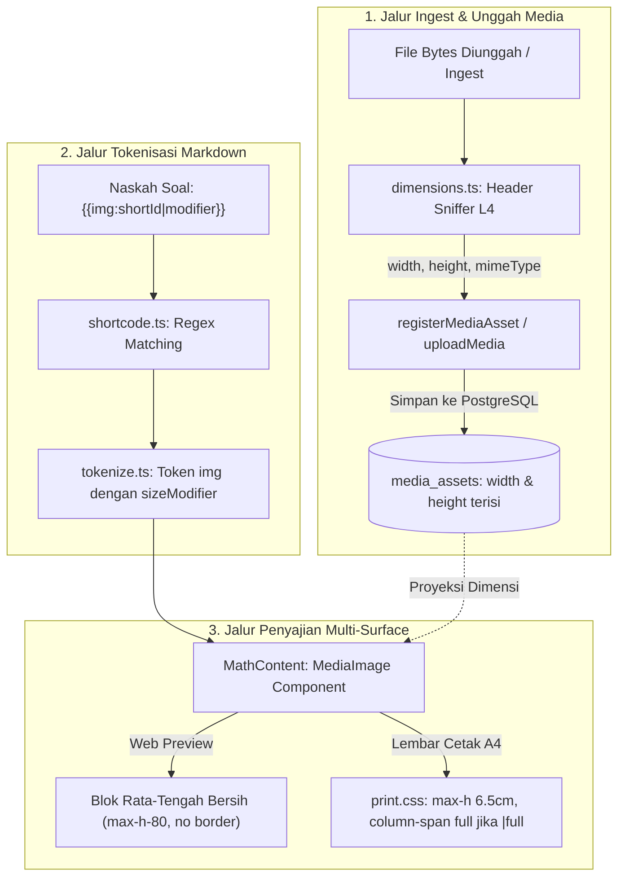

# Question Image Proportions and Print Rendering - Plan

## Goal Capsule

- **Objective:** Seluruh gambar diagram dan stimulus pada soal matematika MathBank tampil proporsional, bersih, bebas *Cumulative Layout Shift* (CLS), dan otomatis tertata rapi baik pada pratinjau Web maupun naskah cetak dua kolom (A4).
- **Means:** Penyempurnaan shortcode dengan modifier ukuran opsional (`{{img:id|modifier}}`), pembaruan komponen `MediaImage` (rata-tengah, tanpa border abu-abu), penataan CSS naskah cetak dua kolom dengan pembatasan tinggi proporsional serta dukungan *span-2-column*, dan *backfill* dimensi piksel ke basis data (KTD1, KTD2, KTD3, KTD4, KTD5).
- **Product Authority:** Standar estetika naskah ujian resmi (Pusmendik / UTBK / buku teks matematika) dan kontrak teknis tata letak naskah `mathmyid.cls` (Axiom).
- **Open Blockers:** Tidak ada.

---

## Product Contract

### Summary

Menghadirkan sistem penataan dan penskalaan media gambar matematika yang proporsional, menyatu alami dengan teks, dan bebas lonjakan layout (*CLS*). Diagram batang soal otomatis tampil sebagai blok terpusat (*center-aligned*) tanpa bingkai kotak abu-abu, ukuran naskah cetak dua kolom terjaga agar tidak memotong halaman secara berlebihan, dan guru memiliki fleksibilitas menambahkan modifier ukuran opsional pada *shortcode* untuk gambar opsi jawaban atau grafik lebar.

### Problem Frame

Saat ini, 1.809 butir soal di MathBank memuat gambar lewat shortcode `{{img:<shortId>}}`. Namun, seluruh 3.332 baris pada tabel `media_assets` memiliki nilai `width` dan `height` kosong (`NULL`). Ketiadaan metadata dimensi ini mengakibatkan:

1. **Pergeseran Tata Letak (*Cumulative Layout Shift*) di Web**: Peramban tidak dapat memesan rasio ruang sebelum berkas selesai diunduh, membuat konten teks melompat-lompat saat halaman dibuka.
2. **Estetika Tidak Alami**: Gambar dirender sebagai elemen `inline-block` berbingkai `border border-border rounded` dengan latar kartu tipis. Hal ini membuat diagram geometri atau grafik kartesius terlihat seperti tangkapan layar mentah alih-alih ilustrasi naskah buku resmi.
3. **Risiko Kerusakan Tata Letak Cetak 2-Kolom**: Naskah cetak A4 MathBank menggunakan layout dua kolom selebar ~90,5 mm per kolom. Aturan CSS saat ini hanya menetapkan `max-width: 100%` tanpa batasan tinggi proporsional, sehingga gambar vertikal panjang dapat menelan lebih dari separuh halaman kolom dan memecah kesinambungan butir soal.

### Key Decisions

- **KD1. Otomatis Cerdas sebagai Default + Modifier Opsional di Shortcode.**
  *(session-settled: user-directed — dipilih daripada 100% Otomatis Sistem dan Preset Modal: sistem otomatis menentukan ukuran ideal secara default namun mendukung modifier opsional pada shortcode `{{img:id|modifier}}`)*
  Default tanpa modifier (`{{img:id}}`) langsung memberikan tampilan terbaik untuk 90%+ kasus tanpa membebani guru. Modifier opsional (`|sm`, `|md`, `|lg`, `|full`) tersedia bagi kebutuhan khusus seperti gambar opsi jawaban atau grafik stimulus lebar.
  *Governs R1, R2, R4, R6.*

- **KD2. Rata Tengah Bersih Tanpa Border Kaku.**
  *(session-settled: user-directed — dipilih daripada Pertahankan Bingkai Kotak dan Rata Kiri: diagram batang soal ditampilkan rata tengah bersih tanpa border abu-abu atau sudut rounded, menyatu dengan naskah)*
  Ilustrasi matematika menyatu langsung dengan latar belakang halaman putih. Bingkai abu-abu kaku dibuang. Gambar dengan resolusi sangat kecil (<100px) tetap dibiarkan inline sejajar teks.
  *Governs R3, R4.*

- **KD3. Adaptasi Khusus Cetak 2-Kolom: 1 Kolom Default & Bentang Penuh untuk `|full`.**
  *(session-settled: user-directed — dipilih daripada Ketat 1 Kolom Saja: gambar di naskah cetak 2 kolom secara default dibatasi dalam 1 kolom, namun membentang menyeberang 2 kolom penuh bila diberi modifier `|full` atau berperan sebagai stimulus)*
  Diagram standar dibatasi maksimal selebar 1 kolom (~8,5 cm) dan tinggi maksimal ~6,5 cm agar naskah efisien dan tidak boros kertas. Bila diberi modifier `|full`, elemen dapat membentang melintasi kedua kolom (*column-span: all*).
  *Governs R6, R7.*

- **KD4. Backfill Dimensi Database untuk Eliminasi CLS.**
  Metadata dimensi (`width` dan `height`) diisi ke seluruh 3.332 baris `media_assets` yang ada dan diinspeksi otomatis pada setiap unggahan baru, sehingga tag gambar dapat merender rasio aspek eksplisit.
  *Governs R9, R10.*

### Requirements

#### Sintaks & Parsing Shortcode

- R1. Pola regex shortcode pada `src/lib/media/shortcode.ts` harus mengenali bentuk kanonik dasar `{{img:<shortId>}}` serta bentuk ber-modifier `{{img:<shortId>|<size>}}`, di mana `<size>` adalah salah satu dari `sm`, `md`, `lg`, atau `full`.
- R2. Tokenizer `tokenizeMath` pada `src/lib/math/tokenize.ts` harus mengekstrak token `img` yang memuat properti `shortId` dan `sizeModifier` (opsional, bertipe `"sm" | "md" | "lg" | "full"`). Seluruh soal yang tidak memiliki modifier harus tetap terurai secara valid tanpa kesalahan (*backward-compatible*).

#### Rendering Web & Layout Preview

- R3. Komponen `MediaImage` pada `src/components/math/math-content.tsx` harus merender diagram standar secara terpusat (*center-aligned block*) dengan jarak vertikal rapi (`my-3`), tanpa kelas `border`, `rounded`, atau bayangan kartu.
- R4. Komponen `MediaImage` harus membatasi ukuran gambar di layar peramban sesuai modifier:
  - `sm` (gambar kecil / opsi): tinggi maksimal 120px, tampil inline-block sejajar teks.
  - `md` (default / diagram standar): tinggi maksimal 320px (80 unit Tailwind / `max-h-80`), lebar maksimal 100%, rata tengah.
  - `lg` (diagram kompleks): tinggi maksimal 440px, lebar maksimal 100%, rata tengah.
  - `full` (stimulus lebar): lebar penuh kontainer, tinggi proporsional.
- R5. Gambar harus merender atribut `loading="lazy"` (kecuali bila diprioritaskan), `decoding="async"`, dan menyertakan rasio aspek melalui atribut `width`/`height` atau inline style `aspectRatio` untuk mencegah lonjakan layout (*CLS*).

#### Rendering Naskah Cetak

- R6. Lembar cetak pada `src/styles/print.css` (`@media print .print-sheet img`) harus meniadakan border, rounded, dan bayangan pada gambar, serta membatasi tinggi maksimum gambar naskah satu kolom sebesar 6,5 cm (`max-height: 6.5cm !important`) dengan lebar otomatis (`max-width: 100% !important; height: auto !important`).
- R7. Pada naskah cetak dua kolom (`.print-columns`), gambar yang memiliki modifier `|full` atau elemen stimulus harus mendukung bentang penuh dua kolom (`column-span: all !important`).
- R8. Gambar yang berada di dalam daftar opsi jawaban (`.print-options img`) harus dibatasi ukurannya secara kompak (tinggi maksimum 3,2 cm dan lebar maksimum 90% dari lebar opsi) agar tidak memecah baris pilihan A/B/C/D.

#### Integritas Data & Metadata Dimensi

- R9. Harus disediakan skrip *backfill* mandiri (`scripts/backfill-media-dimensions.ts`) yang membaca dimensi gambar nyata dari `storage/media/` dan memperbarui kolom `width` serta `height` pada tabel `media_assets` untuk seluruh baris yang masih bernilai `NULL`.
- R10. Layanan unggah media (`src/app/api/media/upload/route.ts` dan `src/lib/services/media/register.ts`) harus secara otomatis menginspeksi dimensi piksel berkas saat pertama kali disimpan dan menuliskan `width` dan `height` ke tabel `media_assets`.

### Key Flows

- F1. Penulisan Diagram Standar:
  - **Trigger:** Guru menulis soal geometri atau fungsi di editor.
  - **Actors:** Guru, Sistem Editor.
  - **Steps:** Guru menyisipkan gambar dari modal aset `{{img:a7Kx9mP2}}`.
  - **Outcome:** Di Web dan naskah cetak, diagram otomatis tampil di baris baru rata tengah tanpa kotak abu-abu, berukuran pas (tinggi maks 320px di web, maks 6,5 cm di kertas).
  - **Covered by:** R1, R2, R3, R4, R6.

- F2. Penulisan Opsi Pilihan Ganda Bergambar:
  - **Trigger:** Guru membuat soal yang opsi jawabannya berupa 4 grafik fungsi berbeda.
  - **Actors:** Guru, Sistem Editor.
  - **Steps:** Guru menyisipkan shortcode di opsi A dengan modifier kecil `{{img:x9Lp2mQ1|sm}}`.
  - **Outcome:** Opsi jawaban A/B/C/D merender grafik secara kompak (tinggi ~120px di layar, ~3cm di kertas cetak) sejajar dengan label huruf opsi tanpa menggeser layout grid opsi.
  - **Covered by:** R1, R2, R4, R8.

- F3. Cetak Naskah Ujian Dua Kolom:
  - **Trigger:** Guru membuka pratinjau cetak bundel soal format dua kolom dan menekan tombol cetak peramban.
  - **Actors:** Guru, Modul BundlePrintView, Mesin Cetak Peramban.
  - **Steps:** Peramban memproses `@media print`. Diagram biasa diskalakan pas dalam lebar kolom 90,5 mm. Grafik ber-modifier `|full` melintasi kedua kolom secara elegan.
  - **Outcome:** Dokumen PDF/kertas tercetak rapi, tidak ada teks label diagram yang terpotong, dan tidak ada halaman terbuang sia-sia akibat gambar terlalu tinggi.
  - **Covered by:** R6, R7, R8.

### Acceptance Examples

- AE1. Naskah Soal Lama Tanpa Modifier
  - **Given:** Soal lama memuat shortcode `{{img:QAGwtVfi}}` tanpa modifier ukuran.
  - **When:** Soal dirender di halaman detail soal atau pratinjau cetak.
  - **Then:** Sistem menganggap gambar sebagai ukuran `md` (standar), merendernya terpusat (*center*) di baris baru tanpa border kartu, dengan batas tinggi 320px di web dan 6,5cm di cetak.
  - **Covers R1, R2, R3, R4, R6.**

- AE2. Pilihan Ganda dengan Gambar
  - **Given:** Sebuah butir soal memiliki 4 opsi jawaban bertipe pilihan ganda, masing-masing berisi gambar.
  - **When:** Butir soal dirender di lembar cetak `.print-sheet`.
  - **Then:** Gambar pada `.print-options img` memiliki tinggi maksimal tidak melebihi 3,2 cm, sehingga susunan pilihan ganda 2-kolom tetap rapi dan tidak tumpang tindih.
  - **Covers R8.**

- AE3. Eliminasi Lonjakan Tata Letak (CLS)
  - **Given:** Halaman detail soal memuat 3 diagram dengan koneksi internet yang lambat.
  - **When:** Halaman pertama kali dibuka sebelum gambar selesai diunduh.
  - **Then:** Elemen kontainer gambar telah memesan ruang dengan rasio aspek sesuai `width` dan `height` dari database, sehingga teks soal tidak melompat ketika gambar selesai dimuat.
  - **Covers R5, R9, R10.**

### Scope Boundaries

#### In Scope
- Ekstensi parser shortcode untuk menerima modifier ukuran `|sm`, `|md`, `|lg`, `|full`.
- Refactor komponen visual `MediaImage` pada `MathContent.tsx` (posisi center, peniadaan border kaku, penyesuaian kelas ukuran).
- Pembaruan aturan gaya `@media print` pada `src/styles/print.css` untuk kontrol gambar 1-kolom, 2-kolom span, dan opsi pilihan ganda.
- Pembuatan skrip backfill dimensi `scripts/backfill-media-dimensions.ts` dan integrasi inspeksi dimensi pada alur unggah media.

#### Deferred for later
- Konversi otomatis gambar raster (PNG/JPG) menjadi grafik vektor SVG atau kode TikZ matematis menggunakan AI.
- Fitur pemangkasan (*cropping*) atau pemutaran (*rotation*) gambar interaktif di dalam editor peramban.
- Pilihan penataan gambar melayang (*float left / float right*) dengan teks melilit (*text wrap*), karena sering menimbulkan inkonsistensi pada cetak multi-kolom.

#### Outside this product's identity
- Penyimpanan media ke layanan CDN eksternal atau bucket cloud S3 (arsitektur MathBank tetap mengutamakan *self-hosted local sharded storage* sesuai ADR dan prinsip kemandirian data).

### Success Criteria

- SC1. **Nol Border Kaku**: 100% diagram matematika pada halaman soal dan lembar cetak tidak lagi memiliki border abu-abu `border border-border rounded` yang menyerupai kartu web generik.
- SC2. **Nol Regresi Soal Lama**: 1.809 soal aktif yang sudah memuat `{{img:...}}` tampil normal tanpa galat parsing atau perubahan makna konten.
- SC3. **Cakupan Dimensi Lengkap**: 100% berkas gambar pada `media_assets` memiliki nilai `width` dan `height` yang terisi valid (> 0).
- SC4. **Efisiensi Cetak 2-Kolom**: Tidak ada diagram tunggal dalam naskah cetak yang memakan tinggi lebih dari 7 cm pada satu kolom, mencegah butir soal terdorong ke halaman baru secara tidak perlu.

### Sources / Research

- Basis Kode: `src/lib/media/shortcode.ts`, `src/lib/math/tokenize.ts`, `src/components/math/math-content.tsx`, `src/styles/print.css`.
- Arsitektur Database: `src/lib/db/schema/media.ts` (kolom `width`, `height`, `mime_type` sudah tersedia di skema).
- Direktori Media: `storage/media/` memuat 3.341 berkas sharded per hash dengan median lebar 567px dan median tinggi 365px.
- Audit & Konvensi Proyek: `CONSTRAINTS.md` (#28b nama identifier Inggris, #7 `flex flex-col gap-*`), `docs/PRINT-THEMES.md` (geometri cetak naskah `mathmyid.cls`).
- Mockup Pratinjau: `docs/mockup/preview-question-image.png` — tangkapan layar halaman Detail Soal yang memperlihatkan dua diagram balok tampil rata tengah, tanpa bingkai kartu abu-abu, dan berskala proporsional; ini target tampilan `MediaImage` di web (U5).

---

## Planning Contract

### High-Level Technical Design

Alur pemrosesan media matematika mencakup dua jalur: jalur ingest/simpan dimensi ke DB dan jalur penguraian markdown ke rendering web/cetak.



### Key Technical Decisions

- **KTD1. Ekstensi Regex Shortcode Bersifat Non-Breaking.**
  *(session-settled: user-directed — dipilih daripada 100% Otomatis Sistem: mendukung modifier opsional `sm|md|lg|full`)*
  Pola regex shortcode diperbarui menjadi `/\{\{\s*img\s*:\s*([0-9A-Za-z]{8})(?:\s*\|\s*(sm|md|lg|full))?\s*\}\}/g`. Grup 1 tetap `shortId`, dan grup 2 menangkap `sizeModifier` opsional. Bila grup 2 tidak ada, renderer otomatis mengasumsikan modifier `"md"` (ukuran standar diagram). Seluruh 1.809 soal yang sudah ada di database tetap valid 100% tanpa migrasi naskah.
  *Governs R1, R2.*

- **KTD2. Parser Dimensi Murni Berbasis Byte Header (Zero External Dependencies).**
  Dimensi piksel gambar dibaca langsung dari segmen header biner (`Buffer` / `Uint8Array`) pada modul L4 `src/lib/media/dimensions.ts`:
  - **PNG**: Baca 8 byte IHDR pada offset 16–24 (lebar dan tinggi berupa 32-bit big-endian integer).
  - **JPEG**: Pindai segmen marker SOF0/SOF1/SOF2 (`0xFF 0xC0..0xC2`) untuk membaca tinggi dan lebar 16-bit big-endian.
  - **WebP**: Baca header chunk RIFF (`VP8 ` bitmask 14-bit atau `VP8L` bit-stream 14-bit).
  - **GIF**: Baca Logical Screen Descriptor pada offset 6–10 (16-bit little-endian).
  - **SVG**: Ekstraksi atribut `viewBox`, `width`, atau `height` menggunakan regex ringan.
  Solusi ini tidak membutuhkan paket biner C++ seperti `sharp` atau `canvas`, berjalan instan dalam <1 ms per berkas, dan mematuhi CONSTRAINTS #15 (L4 murni).
  *Governs R9, R10.*

- **KTD3. Arsitektur Kontainer Bersih MediaImage (Web).**
  *(session-settled: user-directed — dipilih daripada Pertahankan Bingkai Kotak: diagram batang soal ditampilkan rata tengah bersih tanpa border kaku)*
  Komponen `MediaImage` di `src/components/math/math-content.tsx` membungkus `` dalam elemen blok pembungkus semantik:
  ```tsx
  <span className={cn(
    "my-3 block text-center",
    size === "sm" && "my-1 inline-block text-left align-middle"
  )}>
    
  </span>
  ```
  Menghilangkan seluruh kelas `border`, `border-border`, dan `rounded` pada gambar diagram matematika.
  *Governs R3, R4, R5.*

- **KTD4. Aturan Geometri Cetak Dua Kolom & Opsi Pilihan Ganda.**
  *(session-settled: user-directed — dipilih daripada Ketat 1 Kolom Saja: gambar di naskah cetak dibatasi dalam 1 kolom default, span 2 kolom jika |full)*
  Pada `src/styles/print.css`:
  - Gambar umum di `.print-sheet img`: `max-width: 100% !important; max-height: 6.5cm !important; height: auto !important; border: none !important; border-radius: 0 !important;`.
  - Gambar ber-modifier `|full` atau peran stimulus: `column-span: all !important; max-height: 10cm !important;`.
  - Gambar dalam opsi jawaban `.print-options img`: `max-height: 3.2cm !important; max-width: 90% !important; display: inline-block !important;`.
  *Governs R6, R7, R8.*

- **KTD5. Skrip Backfill Idempoten & Transaksional.**
  Skrip `scripts/backfill-media-dimensions.ts` mengambil baris `media_assets` dengan `WHERE width IS NULL OR height IS NULL`, membaca berkas fisik dari `storage/media/`, membedah dimensinya, dan memperbarui basis data dalam batch 100 baris. Skrip ini aman dijalankan ulang (*idempotent*) tanpa mengubah baris yang sudah terisi.
  *Governs R9.*

### Assumptions & Constraints

- Asumsi: Seluruh 3.341 berkas media yang tercatat di `media_assets` berlokasi di direktori `storage/media/{xx}/{hash}.ext` sesuai konfigurasi `mediaStorageRoot()`.
- Batasan CONSTRAINTS #6: Dilarang menggunakan `useMemo` / `useCallback` pada komponen kustom MathBank.
- Batasan CONSTRAINTS #7: Dilarang menggunakan `space-y-*`, wajib menggunakan `flex flex-col gap-*`.
- Batasan CONSTRAINTS #15: Modul `dimensions.ts` harus berada di L4 (fungsi murni tanpa dependensi basis data atau jaringan).
- Batasan CONSTRAINTS #28b: Semua nama berkas, fungsi, dan pengenal teknis harus menggunakan Bahasa Inggris.

### Sequencing

Urutan implementasi dirancang berjenjang dari lapisan bawah (L4 Tokenizer & Dimensi) hingga lapisan atas (Service, Script, Komponen Web, dan CSS Cetak):
1. **U1 & U2** (Paralel): Pembuatan parser dimensi `dimensions.ts` dan pembaruan `shortcode.ts` + `tokenize.ts`.
2. **U3**: Integrasi pembaca dimensi ke dalam service `register.ts` dan endpoint `/api/media/upload`.
3. **U4**: Pembuatan dan eksekusi skrip backfill dimensi `scripts/backfill-media-dimensions.ts`.
4. **U5**: Refactor komponen web `MediaImage` pada `src/components/math/math-content.tsx`.
5. **U6**: Penyesuaian stylesheet cetak `src/styles/print.css` dan komponen cetak `print-question-item.tsx`.

---

## Implementation Units

### U1. Ekstensi Shortcode & Tokenizer Math

- **Goal:** Mendukung modifier ukuran opsional pada sintaks shortcode `{{img:shortId|modifier}}` dan memperbarui token matematika L4 tanpa merusak kompatibilitas soal lama.
- **Requirements:** R1, R2.
- **Dependencies:** Tidak ada.
- **Files:**
  - `src/lib/media/shortcode.ts`
  - `src/lib/media/shortcode.test.ts`
  - `src/lib/math/tokenize.ts`
  - `src/lib/math/tokenize.test.ts`
- **Approach:**
  1. Perbarui `SHORTCODE_RE` di `src/lib/media/shortcode.ts` agar mendukung pola `(?:\|(sm|md|lg|full))?`.
  2. Tambahkan fungsi bantu `parseImageShortcode(raw: string): { shortId: string; size?: "sm" | "md" | "lg" | "full" } | null`.
  3. Perbarui `Token` pada `src/lib/math/tokenize.ts` tipe `img` menjadi: `{ kind: "img"; shortId: string; size?: "sm" | "md" | "lg" | "full" }`.
  4. Perbarui `pushTextWithImages` di `tokenize.ts` untuk menangkap grup modifier ukuran dan memasukannya ke token `img`.
- **Test scenarios:**
  - *Happy path*: Shortcode tanpa modifier `{{img:a7Kx9mP2}}` menghasilkan token `{ kind: "img", shortId: "a7Kx9mP2" }`.
  - *Happy path*: Shortcode dengan modifier `{{img:a7Kx9mP2|sm}}` menghasilkan token `{ kind: "img", shortId: "a7Kx9mP2", size: "sm" }`.
  - *Edge case*: Shortcode dengan spasi `{{ img : a7Kx9mP2 | full }}` tetap terurai dengan benar sebagai `shortId="a7Kx9mP2"` dan `size="full"`.
  - *Error/Fallback*: Shortcode dengan modifier tidak sah `{{img:a7Kx9mP2|xl}}` mengabaikan modifier dan fallback ke default tanpa error.
- **Verification:** Seluruh unit test pada `shortcode.test.ts` dan `tokenize.test.ts` lolos hijau (`pnpm test src/lib/media/shortcode.test.ts src/lib/math/tokenize.test.ts`).

---

### U2. Modul Murni Pembaca Dimensi Gambar (Zero-Dependency)

- **Goal:** Membuat modul pembaca dimensi gambar (lebar & tinggi dalam piksel) murni berbasis sniffer header biner untuk format PNG, JPEG, WebP, GIF, dan SVG tanpa paket eksternal berat.
- **Requirements:** R9, R10.
- **Dependencies:** Tidak ada.
- **Files:**
  - `src/lib/media/dimensions.ts`
  - `src/lib/media/dimensions.test.ts`
- **Approach:**
  1. Buat fungsi murni `getImageDimensions(buffer: Uint8Array): { width: number; height: number; format: string } | null`.
  2. Implementasikan decoder header biner:
     - PNG: Cek magic bytes `89 50 4E 47`, baca width dan height pada byte index 16..24 (big-endian).
     - JPEG: Pindai marker `0xFF, 0xC0..0xC2`, baca height dan width 16-bit.
     - WebP: Cek magic bytes `RIFF....WEBP`, ekstrak dimensi dari chunk VP8 atau VP8L.
     - GIF: Cek magic bytes `GIF87a`/`GIF89a`, baca width dan height 16-bit (little-endian).
     - SVG: Konversi awal buffer ke string UTF-8, cari atribut `viewBox="minX minY width height"` atau `width` & `height`.
  3. Tangani buffer rusak/terpotong dengan mengembalikan `null` secara anggun tanpa melempar exception fatal.
- **Test scenarios:**
  - *Happy path PNG*: Buffer representatif PNG valid mengembalikan lebar dan tinggi yang tepat.
  - *Happy path JPEG*: Buffer representatif JPEG dengan marker SOF0 mengembalikan dimensi yang tepat.
  - *Happy path WebP*: Buffer WebP lossy/lossless mengembalikan dimensi yang tepat.
  - *Happy path SVG*: Teks SVG dengan `viewBox="0 0 800 600"` mengembalikan `{ width: 800, height: 600, format: "svg" }`.
  - *Edge case*: Buffer kosong (`new Uint8Array(0)`) atau buffer acak mengembalikan `null`.
- **Verification:** Unit test `dimensions.test.ts` lolos 100% pada seluruh format gambar sampel (`pnpm test src/lib/media/dimensions.test.ts`).

---

### U3. Integrasi Ekstraksi Dimensi pada Layanan Media

- **Goal:** Memastikan setiap aset media yang disimpan atau diunggah baru secara otomatis terisi kolom `width` dan `height`-nya pada tabel `media_assets`.
- **Requirements:** R10.
- **Dependencies:** U2.
- **Files:**
  - `src/lib/services/media/register.ts`
  - `src/app/api/media/upload/route.ts`
  - `src/lib/services/media-service.db.test.ts`
- **Approach:**
  1. Pada `src/lib/services/media/register.ts`, panggil `getImageDimensions` sebelum melakukan insert ke tabel `mediaAssets`.
  2. Isi kolom `width: dims?.width ?? null` dan `height: dims?.height ?? null` pada objek nilai `insert(mediaAssets)`.
  3. Pada `src/app/api/media/upload/route.ts`, pastikan ekstraksi dimensi berjalan mulus untuk berkas yang diunggah via form multipart.
- **Test scenarios:**
  - *Happy path*: Mengunggah file PNG melalui service menghasilkan baris `media_assets` dengan kolom `width` dan `height` terisi bilangan bulat positif.
  - *Edge case*: Mengunggah berkas yang dimensinya tidak terbaca tetap berhasil menyimpan berkas dengan nilai `width: null` dan `height: null` tanpa membatalkan transaksi unggah.
- **Verification:** Tes integrasi database `media-service.db.test.ts` membuktikan bahwa `width` dan `height` tersimpan di database saat media didaftarkan (`pnpm test:db src/lib/services/media-service.db.test.ts`).

---

### U4. Skrip Backfill Dimensi Media Assets

- **Goal:** Memperbarui kolom `width` dan `height` pada 3.332 baris data `media_assets` yang saat ini kosong dengan membaca berkas nyata di `storage/media/`.
- **Requirements:** R9.
- **Dependencies:** U2.
- **Files:**
  - `scripts/backfill-media-dimensions.ts`
- **Approach:**
  1. Buat skrip mandiri TypeScript yang menghubungkan ke DB via Drizzle (`src/lib/db`).
  2. Kueri tabel `media_assets` untuk mengambil aset dengan kondisi `isNull(mediaAssets.width)`.
  3. Lakukan resolusi path absolut berkas melalui `mediaStorageRoot()` dan `originalImagePath` / `svgPath`.
  4. Baca potongan header berkas (misal 16 KB awal), panggil `getImageDimensions`, dan lakukan `UPDATE media_assets SET width = ..., height = ... WHERE id = ...`.
  5. Jalankan dalam batch transaksional per 100 baris dengan pencatatan log progres yang informatif.
  6. Catat laporan akhir: jumlah aset diproses, berhasil diperbarui, dan berkas yang tidak ditemukan/tidak terbaca.
- **Test scenarios:**
  - *Dry-run / Test run*: Menjalankan skrip terhadap batch sampel mengisi `width` dan `height` pada baris target tanpa mengubah baris yang sudah memiliki dimensi.
  - *Idempotensi*: Menjalankan skrip dua kali berturut-turut pada iterasi kedua langsung menyelesaikan tugas dengan 0 baris tersisa untuk diperbarui.
- **Verification:** Kueri psql `SELECT count(*) FROM media_assets WHERE width IS NULL` menghasilkan angka 0 (atau hanya tersisa aset yang berkas fisiknya memang tidak ada di disk).

---

### U5. Refactor Komponen MediaImage Web & Penataan Rata-Tengah

- **Goal:** Merender diagram matematika pada komponen `MediaImage` secara bersih, terpusat (*center-aligned*), tanpa border kaku abu-abu, dan bebas CLS.
- **Requirements:** R3, R4, R5.
- **Dependencies:** U1.
- **Files:**
  - `src/components/math/math-content.tsx`
  - `src/components/math/math-content-img-render.test.tsx`
- **Approach:**
  1. Tambahkan prop opsional `mediaLookup?: Record<string, { width?: number | null; height?: number | null }>` pada `MathContent` untuk meneruskan dimensi media ke token `img`.
  2. Ubah markup `MediaImage` pada `src/components/math/math-content.tsx`:
     - Berikan atribut `data-size={size || "md"}` pada elemen pembungkus untuk kontrak styling cetak dan selektor semantik.
     - Ganti kontainer `span.inline-block` menjadi elemen blok `span.my-3.block.text-center` (kecuali untuk modifier `sm` yang tetap `inline-block align-middle`).
     - Hapus kelas `border border-border rounded` dari elemen ``.
     - Pasang pembatasan tinggi responsif: `max-h-28` untuk `sm`, `max-h-80` untuk `md`, `max-h-[28rem]` untuk `lg`, dan `max-w-full` dengan `object-contain`.
     - Terapkan `loading="lazy"`, `decoding="async"`, dan bila dimensi tersedia di `mediaLookup`, set atribut `width`, `height`, atau `style.aspectRatio` untuk mencegah lonjakan layout (CLS).
  3. Pertahankan penanganan kesalahan anggun (*graceful fallback*) saat gambar gagal dimuat (`[gambar shortId tidak dapat dimuat]`).
- **Test scenarios:**
  - *Covers AE1*: Diagram tanpa modifier dirender di dalam kontainer `block text-center` dengan `data-size="md"` tanpa kelas `border` atau `rounded`.
  - *Covers AE3*: Elemen gambar memiliki styling rasio aspek proporsional dan tidak menyebabkan lompatan elemen saat dimuat bila dimensi disediakan.
  - *Happy path*: Modifier `sm` dirender sebagai elemen `inline-block align-middle` dengan batas tinggi 120px/max-h-28.
- **Verification:** Tes render komponen `math-content-img-render.test.tsx` dan `math-content-corpus-image.test.tsx` lolos hijau (`pnpm test src/components/math/`).

---

### U6. Penataan CSS Naskah Cetak 2-Kolom & Span Full

- **Goal:** Menjamin hasil cetak naskah ujian 2-kolom rapi, diagram terpusat bersih, tidak memotong kolom secara berlebihan, dan mendukung bentang penuh dua kolom untuk grafik lebar.
- **Requirements:** R6, R7, R8.
- **Dependencies:** U5.
- **Files:**
  - `src/styles/print.css`
  - `src/styles/print-phase4.test.ts`
  - `src/components/bundles/print/print-question-item.tsx`
- **Approach:**
  1. Perbarui aturan `.print-sheet img` di `src/styles/print.css`:
     - `max-width: 100% !important;`
     - `max-height: 6.5cm !important;` (mencegah gambar menelan 1 kolom penuh).
     - `height: auto !important;`
     - `border: none !important; border-radius: 0 !important; box-shadow: none !important; background: transparent !important;`
  2. Tambahkan aturan untuk modifier `full` dan stimulus:
     - `.print-sheet [data-size="full"], .print-sheet .img-full { column-span: all !important; max-height: 10cm !important; width: 100% !important; }`.
     - `.print-sheet [data-size="full"] img { max-height: 10cm !important; }`.
  3. Tambahkan aturan khusus untuk gambar di dalam opsi pilihan ganda:
     - `.print-options img { max-height: 3.2cm !important; max-width: 90% !important; margin: 2px 0 !important; }`.
- **Test scenarios:**
  - *Covers AE2*: Gambar di dalam `.print-options` memiliki tinggi maksimal ≤ 3.2cm.
  - *Happy path*: Aturan `.print-sheet img` memuat `max-height: 6.5cm` dan meniadakan seluruh border.
  - *Happy path*: Elemen dengan `data-size="full"` memuat properti `column-span: all`.
- **Verification:** Unit test `src/styles/print-phase4.test.ts` memverifikasi aturan CSS cetak lolos tanpa kegagalan (`pnpm test src/styles/print-phase4.test.ts`).

---

## Verification Contract

### Automated Quality Gates

```bash
# 1. Typecheck tanpa error (CONSTRAINTS #1)
pnpm typecheck

# 2. Linting kode & nama identifier Inggris (CONSTRAINTS #2, #28b)
pnpm lint
pnpm lint:names

# 3. Unit test token, shortcode, dan dimensi gambar
pnpm test src/lib/media/ src/lib/math/ src/components/math/ src/styles/print-phase4.test.ts

# 4. Verifikasi skema & integritas DB (CONSTRAINTS #25)
pnpm db:verify
```

### Manual Acceptance Walkthrough

1. **Pratinjau Web Soal Bergambar**:
   - Buka halaman `/questions` dan pilih salah satu soal bertopik geometri/grafik (misal soal dari korpus Pusmendik/Mathcyber yang memiliki shortcode `{{img:...}}`).
   - Verifikasi bahwa gambar tampil di tengah (*centered*), proporsional, dan bersih tanpa bingkai abu-abu kaku.
2. **Pratinjau Cetak Bundel 2-Kolom**:
   - Buka bundel soal yang memuat diagram pada halaman `/bundles/[id]/print`.
   - Buka dialog cetak peramban (*Print Preview* A4).
   - Verifikasi diagram pas berada di dalam kolom selebar 90,5 mm, tidak memanjang ke bawah lebih dari separuh kertas, dan gambar pilihan ganda (A/B/C/D) tersusun kompak.
3. **Ekstraksi Dimensi Unggah**:
   - Unggah gambar baru di modal pemilih gambar editor soal (`/questions/new`).
   - Verifikasi kolom `width` dan `height` pada tabel `media_assets` langsung terisi nilai piksel yang sesuai.

---

## Definition of Done

- [ ] Seluruh 6 unit implementasi (U1 hingga U6) selesai dibangun dan diverifikasi.
- [ ] Skrip `scripts/backfill-media-dimensions.ts` telah dijalankan dan mengisi dimensi pada basis data `media_assets`.
- [ ] Tidak ada regresi pada 1.809 soal yang telah ada di MathBank.
- [ ] Seluruh gerbang mutu otomatis (`pnpm typecheck`, `pnpm lint`, `pnpm lint:names`, `pnpm test`, `pnpm db:verify`) lolos 100% exit 0.
- [ ] Tidak ada kode sementara, console.log debugging, atau berkas eksperimental yang tertinggal di branch git.
