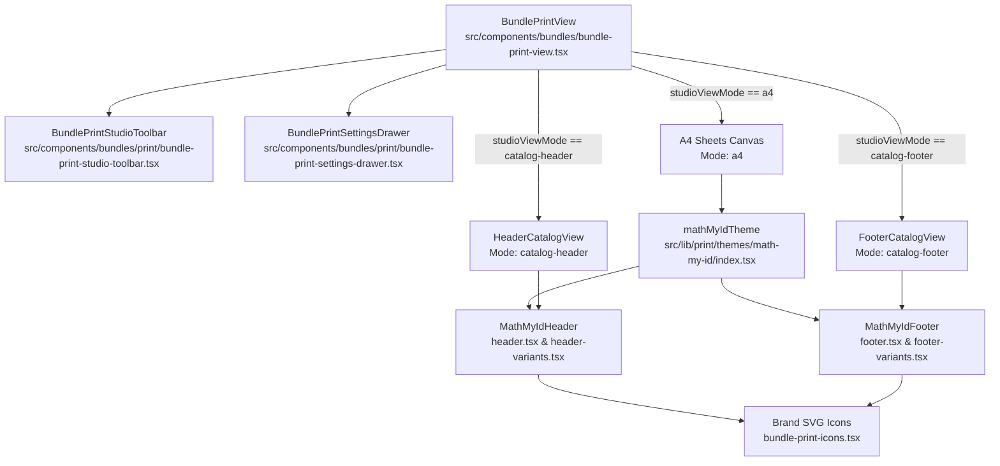
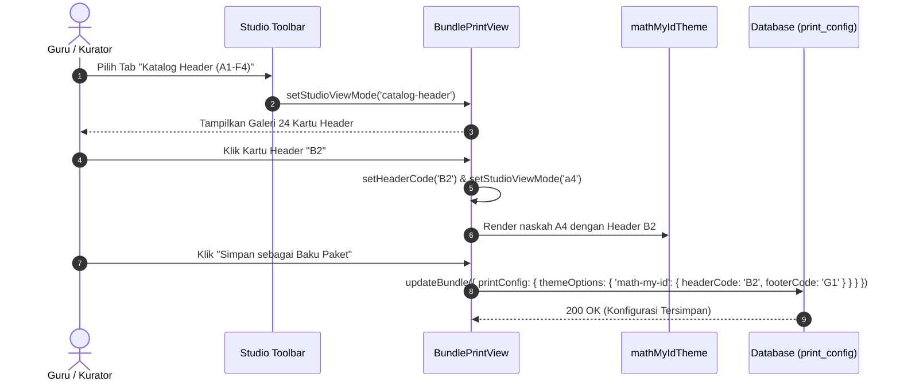

## Goal Capsule

- **Objective:** Guru dan kurator soal dapat mengeksplorasi, memilih, dan mencetak naskah ujian A4 berkualitas percetakan dengan 24 variasi header resmi (A1–F4) dan 32 variasi footer resmi (F1–G16) melalui antarmuka Studio Cetak terintegrasi di MathBank, dengan penegakan logo resmi Math My ID dan transisi otomatis running header antar-halaman.
- **Means:** Mengembangkan Studio Cetak terintegrasi 3-tab di `/bundles/[id]/print`, komponen modular variasi A1–F4 dan F1–G16 pada tema `math-my-id`, serta penegakan simbol SVG logo resmi kita (KTD1, KTD2).
- **Product Authority:** Fitur ini berfokus eksklusif pada modul cetak paket soal (`/bundles/[id]/print`) dan tema cetak `math-my-id`. Desain sistem web app secara menyeluruh di luar halaman cetak naskah berada di luar cakupan aktif dokumen ini.
- **Open Blockers:** Tidak ada. Seluruh keputusan arsitektur dan antarmuka produk telah disepakati pada sesi dialog terarah.

## Product Contract

*Product Contract preservation: Product Contract unchanged.*

### Summary
Mengintegrasikan Studio Cetak naskah interaktif langsung ke dalam halaman cetak paket soal (`/bundles/[id]/print`) dengan bilah kendali 3-tab: Lembar A4 (Mix & Match), Katalog Header (A1–F4), dan Katalog Footer (F1–G16). Sistem ini menyempurnakan tema cetak `math-my-id` dengan 24 variasi header, 32 variasi footer, transisi otomatis header 2-baris (Halaman 1) ke 1-baris (Halaman 2+), serta penegakan sistem logo resmi Math My ID.

### Problem Frame
Saat ini, halaman cetak naskah MathBank (`/bundles/[id]/print`) hanya menyediakan satu kop naskah dasar tanpa opsi variasi tata letak header dan footer. Guru dan pembuat soal tidak memiliki fleksibilitas estetika untuk menyesuaikan gaya naskah dengan jenis evaluasi (ujian formal, latihan ringkas, kuis cepat, atau lembar kerja bermerek). Dokumen referensi katalog Math My ID telah mendefinisikan 24 variasi header profesional dan 32 variasi footer presisi A4, namun aset dan aturan tata letak tersebut belum dihubungkan ke Publishing Engine MathBank.

### Key Decisions
- **Studio Terintegrasi pada Halaman Cetak Paket:** Mengembangkan fitur studio langsung di dalam rute `/bundles/[id]/print` (`BundlePrintView`), bukan sebagai halaman terpisah atau rute mandiri yang terisolasi dari data soal nyata. (session-settled: user-directed — dipilih daripada Halaman Studio Mandiri: naskah cetak langsung terhubung dengan data bundle aktual). Governs R1, R2.
- **Navigasi Galeri 3-Tab:** Bilah atas naskah menyediakan 3 mode tampilan utama: `Lembar A4 (Mix & Match)`, `Katalog Header (A1–F4)`, dan `Katalog Footer (F1–G16)`. (session-settled: user-directed — dipilih daripada Modal Dialog atau Pill Toolbar saja: memberikan pengalaman visual interaktif penuh). Governs R3, R4, R5.
- **Transisi Otomatis Running Header:** Naskah multi-halaman otomatis menggunakan variasi 2-baris pada Halaman 1 (memuat judul + mata pelajaran/kelas) dan beralih ke variasi 1-baris ramping (tinggi ~30px) pada Halaman 2 ke atas demi menghemat ruang butir soal. (session-settled: user-directed — dipilih daripada format seragam semua halaman: memaksimalkan ruang matematika dan keterbacaan). Governs R7, R8.
- **Penegakan Aset Logo Resmi Math My ID:** Setiap header, footer, dan kop wajib secara eksklusif menggunakan sistem logo resmi kita (vektor `mi`, lambang lingkaran `mathmyid-full-logo`, dan `/brand/logo-text-lite.png`), meniadakan logo dummy/generik. (session-settled: user-directed — dipilih daripada logo institusi bebas tanpa kontrol: menjaga konsistensi identitas brand). Governs R12, R13.
- **Peniadaan Ekspor HTML Mentah (Prinsip KISS):** Studio tidak menyediakan tombol unduh/salin kode HTML mentah; seluruh luaran fisik dan PDF dihasilkan secara native via browser print dialog (*Ctrl+P*) yang dioptimalkan oleh CSS Paged Media. (session-settled: user-directed — dipilih daripada ekspor HTML mandiri: mengurangi overhead komputasi dan kompleksitas dependensi). Governs R15, R16.
- **Persistensi Konfigurasi via `themeOptions`:** Pilihan `headerCode` dan `footerCode` disimpan ke dalam kolom JSONB `bundles.print_config.themeOptions["math-my-id"]` tanpa memerlukan migrasi skema database baru. (session-settled: user-approved — memanfaatkan skema ADR-0021 yang sudah ada). Governs R14.

### Actors
- **A1: Guru / Kurator Naskah Soal:** Pengguna yang menyusun paket soal, menyesuaikan tampilan naskah melalui bilah studio dan drawer pengaturan, lalu mencetaknya ke kertas A4 atau menyimpannya sebagai berkas PDF.
- **A2: Siswa / Peserta Ujian:** Penerima cetak fisik naskah yang membaca soal dengan header dan footer yang rapi, nomor halaman jelas, dan tata letak matematika yang bebas potong (*page-break-inside: avoid*).

### Requirements

#### Navigasi Studio & Bilah Kendali
- R1. Antarmuka naskah di `/bundles/[id]/print` menyediakan bilah atas interaktif yang tetap terlihat (*sticky*) saat menggulir naskah.
- R2. Bilah atas studio memuat tombol pemilih tab: `Lembar A4 (Mix & Match)`, `Katalog Header (A1–F4)`, dan `Katalog Footer (F1–G16)`.
- R3. Pada tab `Lembar A4`, bilah atas menyediakan pemilih cepat (*pill buttons*) untuk mengganti variasi Header (`A1` s.d. `F4`) dan Footer (`F1` s.d. `G16`) secara instan.
- R4. Pada tab `Lembar A4`, bilah atas menyediakan tombol sakelar pratinjau mode Running Header (`Mode: 2 Baris (Hal. 1)` vs `Mode: 1 Baris (Hal. 2+)`).
- R5. Tab `Katalog Header` menampilkan galeri komparasi visual seluruh 24 variasi header yang dikelompokkan ke dalam 6 kategori tematis, di mana setiap kartu dapat diklik untuk langsung mengaktifkan variasi tersebut ke naskah A4.
- R6. Tab `Katalog Footer` menampilkan galeri komparasi visual seluruh 32 variasi footer yang dikelompokkan ke dalam 2 seri (Clean F-series dan Decorative G-series), di mana setiap kartu dapat diklik untuk langsung mengaktifkan variasi tersebut ke naskah A4.

#### Sistem Variasi Header (A1–F4)
- R7. Tema `math-my-id` mengimplementasikan 24 variasi strip header:
  - Kelompok A (Minimalis / Clean Strip): A1 (Navy-Gold wedge), A2 (Navy trapezoid), A3 (Gold pipe), A4 (Slashes & badge).
  - Kelompok B (Soft Background): B1 (Watermark arch), B2 (Soft blue gradient), B3 (Clean soft tone), B4 (Gold line accent).
  - Kelompok C (Badge / Label): C1 (Subject badge), C2 (Curved pill), C3 (Outline badge), C4 (Square badge).
  - Kelompok D (Informasi Tambahan): D1 (Durasi & waktu), D2 (Instruksi ringkas), D3 (Alokasi waktu & soal), D4 (Info pengawas).
  - Kelompok E (Elegan & Ekspresif): E1 (Dua garis batas), E2 (Aksen geometris penuh), E3 (Trapezoid tebal), E4 (Strip mewah).
  - Kelompok F (Ultra Compact): F1 s.d. F4 dengan tinggi maksimum 30px (5–6mm) untuk efisiensi ruang maksimal.
- R8. Setiap variasi header mendukung dua mode tampilan: mode 2-baris (judul naskah + mapel/kelas pada Halaman 1) dan mode 1-baris running header (judul naskah + label latihan pada Halaman 2+).
- R9. Setiap variasi header menggunakan token warna resmi: Navy `#072652`, Biru `#0047b3`, Biru Terang `#2b7fff`, Emas `#f5b800`, dan Emas Gelap `#d99b00`.

#### Sistem Variasi Footer (F1–G16)
- R10. Tema `math-my-id` mengimplementasikan 32 variasi strip footer:
  - Seri F (F1 s.d. F16): Variasi minimalis dan bersih dengan garis pembatas tipis, penomoran halaman dinamis, tautan sosial, dan tanda copyright.
  - Seri G (G1 s.d. G16): Variasi dekoratif dengan badge sudut, aksen baji miring (Navy-Gold), strip dua warna, dan ornamen identitas visual.
- R11. Setiap variasi footer menampilkan penomoran halaman dinamis yang terhubung dengan pencacah halaman CSS Paged Media (`counter(page)` dan `counter(pages)`).

#### Konsistensi Aset Logo Resmi
- R12. Seluruh variasi header dan footer secara eksklusif menggunakan aset logo resmi Math My ID:
  - Vektor logo tanda huruf kecil `mi` (`#mathmyid-mi-logo` untuk latar terang dan `#mathmyid-mi-logo-light` untuk latar gelap).
  - Vektor lambang lingkaran penuh `LogoSquare` (`#mathmyid-full-logo`).
  - Berkas logo teks resmi di `public/brand/logo-text-lite.png`.
- R13. Pengaturan gaya logo di drawer kustomisasi menyediakan opsi pemilihan antara logo `mi` dan lambang lingkaran `LogoSquare`, tanpa mengizinkan logo dummy pihak ketiga.

#### Persistensi & Standar Cetak
- R14. Nilai `headerCode` (misal `A1`), `footerCode` (misal `F1`), gaya logo, dan opasitas watermark tersimpan dalam state sesi dan dapat disimpan permanen ke basis data via aksi "Simpan sebagai Baku Paket" (`bundles.print_config.themeOptions["math-my-id"]`).
- R15. Tata letak cetak naskah mempertahankan aturan nol pergeseran (*zero sub-pixel drift*) pada kertas A4 (210mm x 297mm) dengan header terkunci di bagian atas (`top: 0`) dan footer di bagian bawah (`bottom: 0`).
- R16. Seluruh elemen bilah kontrol, tab navigasi studio, tombol aksi, dan drawer pengaturan diberi penanda `@media print { display: none !important; }` sehingga lembar fisik dan PDF bersih 100% dari elemen antarmuka aplikasi.

### Key Flows

#### F1. Eksplorasi & Pemilihan Variasi via Galeri Visual
- **Trigger:** Pengguna membuka halaman cetak paket soal di `/bundles/[id]/print`.
- **Actors:** A1 (Guru / Kurator Naskah Soal).
- **Steps:**
  1. Pengguna melihat bilah atas studio dan memilih tab `Katalog Header (A1–F4)`.
  2. Kanvas naskah beralih menampilkan galeri kartu komparasi 24 variasi header yang dirender langsung dengan judul naskah paket tersebut.
  3. Pengguna mengevaluasi variasi dan mengklik salah satu kartu header (misal `B2`).
  4. Sistem menerapkan `B2` sebagai header aktif dan otomatis mengarahkan tampilan kembali ke tab `Lembar A4 (Mix & Match)`.
  5. Pengguna beralih ke tab `Katalog Footer (F1–G16)`, memilih footer (misal `G1`), dan melihat pembaruan instan pada lembar A4.
- **Outcome:** Variasi header dan footer terpilih aktif seketika pada pratinjau naskah A4. Governs R2, R3, R5, R6.

#### F2. Cetak Naskah Multi-Halaman dengan Running Header Otomatis
- **Trigger:** Pengguna menekan tombol "Cetak Naskah / Simpan PDF" (*Ctrl+P*).
- **Actors:** A1 (Guru / Kurator Naskah Soal), A2 (Siswa / Peserta Ujian).
- **Steps:**
  1. Sistem menyiapkan tata letak CSS Paged Media lembar A4.
  2. Halaman 1 mencetak variasi header terpilih dalam mode 2-baris (Judul + Mapel/Kelas) beserta logo resmi.
  3. Halaman 2 dan seterusnya otomatis mencetak variasi header terpilih dalam mode 1-baris running header ramping.
  4. Seluruh halaman mencetak variasi footer terpilih dengan nomor halaman dinamis yang akurat.
  5. Dialog cetak peramban terbuka dan menghasilkan cetakan fisik atau berkas PDF siap edar.
- **Outcome:** Naskah tercetak rapi tanpa terpotong di tengah rumus matematika dan menghemat ruang lembar ujian. Governs R8, R11, R15, R16.

### Acceptance Examples

- AE1. Transisi Otomatis Header Halaman 1 vs Halaman 2+
  - **Given:** Naskah soal terdiri dari 3 halaman A4 dengan header terpilih `A1`.
  - **When:** Dokumen dicetak atau diekspor ke PDF.
  - **Then:** Halaman 1 menampilkan strip `A1` setinggi 38px dengan teks judul naskah dan mata pelajaran (2 baris). Halaman 2 dan 3 menampilkan strip `A1` setinggi 30px dengan teks judul naskah saja (1 baris). Covers R7, R8, R15.

- AE2. Pemilihan Cepat via Toolbar Pills
  - **Given:** Pengguna berada di tab `Lembar A4 (Mix & Match)`.
  - **When:** Pengguna mengklik tombol pill `C2` pada kelompok pemilih header di bilah atas.
  - **Then:** Strip header pada lembar naskah A4 seketika berubah menjadi gaya `C2` (Curved Pill Badge) tanpa memuat ulang halaman (*zero page reload*). Covers R3, R7.

- AE3. Penegakan Aset Logo Resmi Kita
  - **Given:** Variasi header `A1` s.d. `F4` atau footer `F1` s.d. `G16` yang membutuhkan logo dirender di layar atau dicetak.
  - **When:** Komponen logo dirender.
  - **Then:** Komponen mengambil referensi simbol SVG `#mathmyid-mi-logo` atau `#mathmyid-full-logo` dari pustaka aset internal MathBank, bukan gambar placeholder eksternal. Covers R12, R13.

- AE4. Penyimpanan Preferensi ke Basis Data
  - **Given:** Pengguna memilih header `D1` dan footer `G4` pada paket soal ID `bundle-123`.
  - **When:** Pengguna membuka drawer pengaturan dan menekan "Simpan sebagai Baku Paket".
  - **Then:** API menyimpan `{ headerCode: "D1", footerCode: "G4" }` ke dalam `bundles.print_config.themeOptions["math-my-id"]`, dan pilihan ini tetap aktif saat paket dibuka kembali di masa depan. Covers R14.

### Success Criteria
- **Ketersediaan Lengkap:** Seluruh 24 variasi header (`A1`–`F4`) dan 32 variasi footer (`F1`–`G16`) dapat dipilih dan dirender dengan akurasi 100% sesuai spesifikasi desain.
- **Kerapian Cetak Nol Drift:** Hasil cetak fisik dan ekspor PDF tidak mengalami pergeseran margin atau elemen terpotong pada format kertas standar A4 (210mm x 297mm).
- **Performa Responsif:** Peralihan antar-tab katalog dan pergantian variasi header/footer terjadi secara instan (< 100ms) tanpa jeda rendering terasa.
- **Bebas Polusi Cetak:** Tidak ada satu pun elemen navigasi studio, tombol tab, atau pill selector yang bocor ke hasil cetak kertas atau PDF.

### Scope Boundaries
- **Termasuk dalam Cakupan v1:**
  - Bilah kendali studio 3-tab di `/bundles/[id]/print`.
  - 24 komponen variasi header (`A1`–`F4`) di tema `math-my-id`.
  - 32 komponen variasi footer (`F1`–`G16`) di tema `math-my-id`.
  - Galeri visual katalog header dan footer dengan pratinjau data naskah nyata.
  - Integrasi logo resmi Math My ID (vektor `mi`, lambang lingkaran `LogoSquare`, teks raster).
  - Persistensi konfigurasi ke `bundles.print_config.themeOptions["math-my-id"]`.
- **Ditangguhkan untuk Nanti:**
  - Penambahan variasi header/footer untuk tema lain di luar `math-my-id` (misalnya variasi khusus untuk tema `formal-exam`).
  - Pembuat tema visual mandiri (*visual theme customizer drag-and-drop*).
- **Bukan Sasaran (Explicit Non-Goals):**
  - Pembuatan fitur ekspor kode HTML mentah atau berkas HTML luring mandiri (ditiadakan demi prinsip KISS; cetak langsung browser sudah mencukupi).
  - Perombakan desain sistem dan antarmuka web MathBank di luar modul cetak naskah.

### Dependencies / Assumptions
- **Dependensi Skema:** Memanfaatkan kolom JSONB `bundles.print_config.themeOptions` yang sudah didefinisikan pada ADR-0021 dan `src/lib/db/schema/bundle.ts` tanpa perlu migrasi Drizzle baru.
- **Pustaka Vektor:** Aset simbol SVG logo Math My ID (`#mathmyid-mi-logo`, `#mathmyid-mi-logo-light`, `#mathmyid-full-logo`) disematkan sebagai komponen reusable di `src/components/bundles/print/bundle-print-icons.tsx`.
- **Peramban Klien:** Fitur cetak mengandalkan mesin cetak peramban modern berbasis Chromium/WebKit/Gecko yang mendukung CSS Paged Media.

### Sources / Research
- Dokumen Desain & Katalog Referensi: `/tmp/e8cbd6cb-72f3-4f43-bc6d-bb68190230ed.html` (Katalog & Studio Lengkap Header A1–F4 & Footer F1–G16 Math My ID).
- ADR-0021: `docs/ADR/0021-konfigurasi-cetak-print-config-bundles.md` (Konfigurasi Cetak Naskah A4 via `bundles.print_config` KISS & Engine CSS Paged Media).
- Implementasi Tema Cetak Saat Ini: `src/lib/print/themes/types.ts`, `src/lib/print/themes/registry.ts`, dan `src/lib/print/themes/math-my-id/`.
- Komponen Cetak Eksisting: `src/components/bundles/bundle-print-view.tsx`, `src/components/bundles/print/bundle-print-header.tsx`, `src/components/bundles/print/bundle-print-footer.tsx`, dan `src/components/bundles/print/bundle-print-kop.tsx`.
- Aset Brand Eksisting: `public/brand/logo-text-lite.png`.

## Planning Contract

### High-Level Technical Design

Sistem Studio Cetak `math-my-id` dibangun dengan arsitektur modular yang memisahkan logika penyajian lembar naskah A4, galeri katalog komparasi visual, serta komponen rendering strip header dan footer. Diagram di bawah mengilustrasikan hierarki komponen dan aliran state konfigurasi cetak.



Aliran state dan persistensi:



### Key Technical Decisions
- **KTD1. Pemecahan Variasi Modular (Anti-Monolith):** 24 variasi header dan 32 variasi footer dipecah ke dalam tabel pemetaan terstruktur (`header-variants.tsx` dan `footer-variants.tsx`) yang diekspor sebagai kamus fungsi per-kode (`RENDER_HEADER[code]`, `RENDER_FOOTER[code]`), menjaga `BundlePrintView` dan berkas utama tema tetap di bawah 300 baris. Governs R7, R10.
- **KTD2. Pustaka Simbol Vektor SVG Mandiri Tipe-Aman:** Seluruh simbol logo Math My ID (`MathMyIdMiLogo`, `MathMyIdMiLogoLight`, `MathMyIdFullLogo`) didefinisikan sebagai komponen SVG React di `bundle-print-icons.tsx` dengan dukungan `aria-hidden` dan `currentColor` / token bawaan, menghilangkan kebutuhan tag `<svg><use href="#...">` yang rentan gagal di peramban tertentu tanpa server SVG sprite. Governs R12, R13.
- **KTD3. Bilah Kendali Studio Khusus Berorientasi A4:** Membuat komponen `BundlePrintStudioToolbar` terisolasi yang mengelola switcher 3 tab, quick pill selectors, running header mode toggle, dan pemicu cetak langsung. Komponen ini memiliki penanda eksplisit `no-print print:hidden` agar tidak memengaruhi cetakan fisik. Governs R1, R2, R3, R4, R16.
- **KTD4. Mekanisme Running Header Otomatis via CSS Class & Sheet Index:** Naskah di `BundlePrintView` merender lembar Halaman 1 dengan `isFirstPage={true}` (memaksa mode 2-baris atau Kop), sedangkan lembar halaman 2 ke atas merender header dengan `isFirstPage={false}` (memaksa mode 1-baris running header setinggi 30px). Tombol sakelar pratinjau di toolbar memungkinkan pengujian paksa kedua mode di layar. Governs R8, R15.
- **KTD5. Validasi Tipe Opsi Tema `MathMyIdThemeOptions`:** Mengembangkan tipe Zod dan TypeScript untuk opsi tema `math-my-id`:
  ```typescript
  export interface MathMyIdThemeOptions {
    headerCode?: string;       // Default: "A1"
    footerCode?: string;       // Default: "F1"
    runningHeader?: boolean;   // Default: true (otomatis hal 2+)
    logoStyle?: "mi" | "circle"; // Default: "mi"
    watermarkOpacity?: number; // Default: 0.08
  }
  ```
  Opsi ini disimpan di `bundles.print_config.themeOptions["math-my-id"]`. Governs R14.
- **KTD6. Zero-Drift CSS Paged Media:** Menyempurnakan `src/styles/print.css` dengan aturan `@page { size: 210mm 297mm; margin: 0; }` dan kontainer lembar A4 berketinggian tetap `296.85mm` saat cetak fisik untuk menjamin header `top: 0` dan footer `bottom: 0` tidak bergeser antar-halaman. Governs R15, R16.

### Output Structure

```text
src/
├── components/
│   └── bundles/
│       ├── bundle-print-view.tsx                 # [Modifikasi] Integrasi studioViewMode 3-tab & toolbar studio
│       ├── bundle-print-view.test.tsx            # [Modifikasi] Pengujian integrasi studio mode & switching
│       └── print/
│           ├── bundle-print-studio-toolbar.tsx    # [Baru] Bilah kendali studio (3 tab, pills, toggle mode)
│           ├── bundle-print-studio-toolbar.test.tsx # [Baru] Unit test bilah studio toolbar
│           ├── bundle-print-icons.tsx             # [Modifikasi] Penambahan SVG logo resmi mi & full-logo
│           ├── bundle-print-icons.test.tsx        # [Modifikasi] Pengujian render komponen logo resmi
│           └── bundle-print-settings-drawer.tsx   # [Modifikasi] Integrasi renderOptions math-my-id
└── lib/
    └── print/
        └── themes/
            └── math-my-id/
                ├── index.tsx                      # [Modifikasi] Registrasi Header, Footer, options, defaults
                ├── index.test.tsx                 # [Modifikasi] Pengujian kontrak tema math-my-id
                ├── kop.tsx                        # [Modifikasi] Penegakan logo resmi pada Kop
                ├── header.tsx                     # [Baru] Komponen renderer header A1-F4 & 1/2 baris
                ├── header.test.tsx                # [Baru] Unit test variasi header A1-F4
                ├── header-variants.tsx            # [Baru] Definisi 24 variasi strip header A1-F4
                ├── footer.tsx                     # [Baru] Komponen renderer footer F1-G16
                ├── footer.test.tsx                # [Baru] Unit test variasi footer F1-G16
                ├── footer-variants.tsx            # [Baru] Definisi 32 variasi strip footer F1-G16
                ├── options.tsx                    # [Baru] Komponen form options di drawer pengaturan
                ├── types.ts                       # [Baru] Definisi tipe MathMyIdThemeOptions & konstanta
                └── catalog/
                    ├── header-catalog-view.tsx    # [Baru] Galeri visual kartu 24 header A1-F4
                    ├── footer-catalog-view.tsx    # [Baru] Galeri visual kartu 32 footer F1-G16
                    └── catalog.test.tsx           # [Baru] Unit test galeri visual katalog
```

### Assumptions
- Seluruh 24 header dan 32 footer dirancang untuk ukuran kertas A4 potret dengan lebar cetak efektif 200mm (margin 5mm kiri-kanan).
- Browser modern klien mengeksekusi cetak fisik via peramban Chromium/WebKit/Gecko dengan flag `-webkit-print-color-adjust: exact` aktif.
- Pilihan `headerCode` dan `footerCode` yang tidak valid (misal dari data basi) secara aman jatuh kembali ke nilai baku `A1` dan `F1`.

## Implementation Units

### U1. Simbol Vektor Logo Resmi & Token Brand Math My ID
- **Goal:** Menyediakan aset simbol SVG logo resmi Math My ID (`MathMyIdMiLogo`, `MathMyIdMiLogoLight`, `MathMyIdFullLogo`) dan konstanta token warna brand di `bundle-print-icons.tsx` secara tipe-aman dan reusable.
- **Requirements:** R12, R13, R9.
- **Dependencies:** Tidak ada.
- **Files:**
  - `src/components/bundles/print/bundle-print-icons.tsx`
  - `src/components/bundles/print/bundle-print-icons.test.tsx`
- **Approach:**
  1. Ekstrak path SVG vektor dari dokumen referensi (`/tmp/e8cbd6cb-72f3-4f43-bc6d-bb68190230ed.html` baris 373–408).
  2. Implementasikan komponen `MathMyIdMiLogo` (viewBox `0 0 120 76`), `MathMyIdMiLogoLight`, dan `MathMyIdFullLogo` (viewBox `50 120 1900 1850`) di `bundle-print-icons.tsx`.
  3. Ekspor konstanta token warna resmi: `MATH_MY_ID_COLORS = { navy: "#072652", blue: "#0047b3", blueLight: "#2b7fff", gold: "#f5b800", goldDark: "#d99b00" }`.
- **Test scenarios:**
  - U1-T1: Merender `MathMyIdMiLogo` dan memverifikasi atribut `viewBox="0 0 120 76"` serta keberadaan path SVG. Covers AE3.
  - U1-T2: Merender `MathMyIdFullLogo` dan memverifikasi atribut `viewBox="50 120 1900 1850"` dengan gradien arcGrad, blueGrad, dan goldGrad. Covers AE3.
  - U1-T3: Menguji properti `className` kustom (misal `h-5 w-auto`) terpasang dengan benar pada elemen SVG.

### U2. Komponen Variasi Header A1–F4 & Running Header Otomatis
- **Goal:** Membangun seluruh 24 variasi strip header (`A1`–`F4`) untuk tema `math-my-id` dengan dukungan mode 2-baris (Halaman 1) dan mode 1-baris running header (Halaman 2+).
- **Requirements:** R7, R8, R9, R12, R15.
- **Dependencies:** U1.
- **Files:**
  - `src/lib/print/themes/math-my-id/types.ts`
  - `src/lib/print/themes/math-my-id/header-variants.tsx`
  - `src/lib/print/themes/math-my-id/header.tsx`
  - `src/lib/print/themes/math-my-id/header.test.tsx`
- **Approach:**
  1. Definisikan tipe `HeaderCode = 'A1'|'A2'|...|'F4'` dan kelompok `HEADER_GROUPS` (A: Minimalis, B: Soft Bg, C: Badge, D: Info Tambahan, E: Elegan, F: Ultra Compact).
  2. Implementasikan fungsi pembantu ornamen geometris: `renderRightCornerWedge`, `renderDiagDivider`, `renderRightNavyTrapBlock`, dan `renderSoftStripWatermark` menggunakan elemen SVG/CSS murni.
  3. Susun kamus `RENDER_HEADER` di `header-variants.tsx` yang menghasilkan JSX untuk ke-24 variasi strip header, mendukung parameter `is1Line` (`height: 30px` untuk 1-baris vs `height: 38px` untuk 2-baris).
  4. Implementasikan komponen utama `MathMyIdHeader` di `header.tsx` yang mengonsumsi `ThemeHeaderProps`, mengekstrak `headerCode` dari `options`, dan merender variasi yang sesuai dengan fallback ke `A1`.
- **Test scenarios:**
  - U2-T1: Merender header variasi `A1` pada mode 2-baris dan memverifikasi adanya teks judul, teks mapel/kelas, dan baji diagonal emas-navy. Covers AE1.
  - U2-T2: Merender header variasi `A1` pada mode 1-baris (running header) dan memverifikasi tinggi kompak (30px) tanpa teks mapel/kelas baris kedua. Covers AE1.
  - U2-T3: Menguji fallback rendering ketika `options.headerCode` tidak valid atau kosong, memastikan variasi `A1` terpilih secara aman.
  - U2-T4: Menguji perwakilan variasi dari setiap kelompok (A2 trapezoid, B2 soft gradient, C1 badge, D1 waktu, E1 dual line, F1 ultra compact) terender tanpa galat. Covers R7.

### U3. Komponen Variasi Footer F1–G16 & Penomoran Halaman Dinamis
- **Goal:** Membangun seluruh 32 variasi strip footer (`F1`–`G16`) untuk tema `math-my-id` dengan penomoran halaman dinamis dan integrasi pencacah cetak CSS.
- **Requirements:** R10, R11, R12, R15.
- **Dependencies:** U1.
- **Files:**
  - `src/lib/print/themes/math-my-id/footer-variants.tsx`
  - `src/lib/print/themes/math-my-id/footer.tsx`
  - `src/lib/print/themes/math-my-id/footer.test.tsx`
- **Approach:**
  1. Definisikan tipe `FooterCode = 'F1'|'F2'|...|'F16'|'G1'|...|'G16'`.
  2. Susun kamus `RENDER_FOOTER` di `footer-variants.tsx` untuk 16 variasi seri F (Clean Minimalist) dan 16 variasi seri G (Decorative / Aksen).
  3. Setiap variasi menyematkan kanal sosial resmi Math My ID (`mathmyid`), tanda hak cipta, dan kontainer nomor halaman ganda: teks layar (`Halaman {pageNumber}`) dan elemen cetak tersembunyi berkelas `print-page-counter` yang diisi oleh CSS Paged Media.
  4. Implementasikan komponen utama `MathMyIdFooter` di `footer.tsx` yang mengonsumsi `ThemeFooterProps`, mengekstrak `footerCode` dari `options`, dan merender variasi terkait dengan fallback ke `F1`.
- **Test scenarios:**
  - U3-T1: Merender footer variasi `F1` dan memverifikasi elemen nomor halaman layar serta elemen `print-page-counter` untuk cetak fisik. Covers R10, R11.
  - U3-T2: Merender footer variasi `G1` dan memverifikasi badge sudut dekoratif navy-emas terpasang. Covers R10.
  - U3-T3: Menguji fallback footer ketika `options.footerCode` tidak valid atau kosong, memastikan variasi `F1` terpilih.

### U4. Galeri Visual Katalog Header & Footer Interaktif
- **Goal:** Menyediakan komponen galeri visual interaktif untuk tab `Katalog Header (A1–F4)` dan `Katalog Footer (F1–G16)` yang menampilkan komparasi kartu semua variasi secara berdampingan dengan data naskah aktual dan aksi satu kali klik untuk memilih.
- **Requirements:** R5, R6.
- **Dependencies:** U2, U3.
- **Files:**
  - `src/lib/print/themes/math-my-id/catalog/header-catalog-view.tsx`
  - `src/lib/print/themes/math-my-id/catalog/footer-catalog-view.tsx`
  - `src/lib/print/themes/math-my-id/catalog/catalog.test.tsx`
- **Approach:**
  1. Buat `HeaderCatalogView`: Menampilkan 6 seksi kelompok (A s.d. F) dalam layout grid responsif. Setiap kartu merender strip header riil menggunakan judul naskah dan mapel nyata paket soal, tombol "Gunakan Gaya Ini", dan indikator visual aktif jika kodenya cocok dengan `currentHeaderCode`.
  2. Buat `FooterCatalogView`: Menampilkan seksi Seri F (Minimalis) dan Seri G (Dekoratif) dalam layout grid kartu. Setiap kartu merender strip footer riil dengan indikator aktif dan aksi pemilihan.
  3. Tambahkan tombol "Kembali ke Lembar A4" di bagian atas setiap galeri untuk memudahkan navigasi.
- **Test scenarios:**
  - U4-T1: `HeaderCatalogView` merender tepat 24 kartu header dengan judul kelompok A s.d. F. Covers R5.
  - U4-T2: Mengklik salah satu kartu header memanggil callback `onSelectHeader('B2')` dengan kode variasi yang tepat. Covers R5, F1.
  - U4-T3: `FooterCatalogView` merender tepat 32 kartu footer dengan judul seri F dan G. Covers R6.
  - U4-T4: Mengklik salah satu kartu footer memanggil callback `onSelectFooter('G4')`. Covers R6, F1.

### U5. Bilah Kendali Studio Toolbar & Integrasi View Mode 3-Tab
- **Goal:** Membangun bilah kendali studio interaktif (`BundlePrintStudioToolbar`) dan mengintegrasikannya ke dalam `BundlePrintView` untuk mendukung 3 mode tampilan (`a4`, `catalog-header`, `catalog-footer`) serta pemilih cepat pill buttons.
- **Requirements:** R1, R2, R3, R4, R16.
- **Dependencies:** U4.
- **Files:**
  - `src/components/bundles/print/bundle-print-studio-toolbar.tsx`
  - `src/components/bundles/print/bundle-print-studio-toolbar.test.tsx`
  - `src/components/bundles/bundle-print-view.tsx`
  - `src/components/bundles/bundle-print-view.test.tsx`
- **Approach:**
  1. Implementasikan `BundlePrintStudioToolbar`:
     - Baris 1: Logo & Brand, tab switcher 3 mode (`Lembar A4`, `Katalog Header`, `Katalog Footer`), tombol "Kustomisasi" (membuka drawer), dan tombol "Cetak Naskah / PDF".
     - Baris 2 (khusus tab A4): Quick pill selector untuk Header (`A1..F4`), tombol sakelar running header (`2 Baris Hal. 1` vs `1 Baris Hal. 2+`), dan quick pill selector untuk Footer (`F1..G16`).
     - Pastikan pembungkus memiliki kelas `no-print print:hidden sticky top-0 z-40 bg-slate-900/95`.
  2. Modifikasi `BundlePrintView`:
     - Tambahkan state `studioViewMode: "a4" | "catalog-header" | "catalog-footer"`.
     - Ketika mode `catalog-header`, kanvas naskah digantikan oleh `HeaderCatalogView`. Pemilihan header mengubah state dan otomatis mengembalikan mode ke `a4`.
     - Ketika mode `catalog-footer`, kanvas naskah digantikan oleh `FooterCatalogView`. Pemilihan footer mengubah state dan mengembalikan mode ke `a4`.
     - Ketika mode `a4`, kanvas naskah A4 normal dirender dengan header dan footer variasi aktif.
- **Test scenarios:**
  - U5-T1: Memverifikasi default tampilan `BundlePrintView` adalah mode `a4`. Covers R2.
  - U5-T2: Beralih ke tab `catalog-header` merender galeri katalog header dan menyembunyikan lembar naskah A4. Covers R2, R5.
  - U5-T3: Mengklik tombol pill `C2` pada bilah atas seketika mengubah header aktif ke `C2`. Covers AE2, R3.
  - U5-T4: Memverifikasi seluruh elemen `BundlePrintStudioToolbar` tersembunyi pada mode print (`print:hidden`). Covers R16.

### U6. Kontrol Kustomisasi Drawer & Pengikatan Tema Math My ID
- **Goal:** Menghubungkan tema `math-my-id` secara utuh ke registry tema dengan menyediakan form pengaturan kustom di drawer (`options.tsx`), memperbarui Kop resmi dengan logo kita, dan memastikan persistensi ke database via `bundles.print_config`.
- **Requirements:** R13, R14.
- **Dependencies:** U2, U3, U5.
- **Files:**
  - `src/lib/print/themes/math-my-id/options.tsx`
  - `src/lib/print/themes/math-my-id/options.test.tsx`
  - `src/lib/print/themes/math-my-id/kop.tsx`
  - `src/lib/print/themes/math-my-id/index.tsx`
  - `src/lib/print/themes/math-my-id/index.test.tsx`
  - `src/components/bundles/print/bundle-print-settings-drawer.tsx`
- **Approach:**
  1. Implementasikan `MathMyIdOptions` di `options.tsx`: Kontrol select untuk Header Style (`A1`–`F4`), Footer Style (`F1`–`G16`), gaya logo (`mi` vs `circle`), dan slider opasitas watermark (0.04 s.d. 0.15).
  2. Perbarui `mathMyIdTheme` di `index.tsx`: Daftarkan `Header: MathMyIdHeader`, `Footer: MathMyIdFooter`, `renderOptions: MathMyIdOptions`, dan `defaultOptions: { headerCode: "A1", footerCode: "F1", logoStyle: "mi", runningHeader: true, watermarkOpacity: 0.08 }`.
  3. Perbarui `MathMyIdKop` di `kop.tsx` untuk menggunakan logo resmi SVG (`MathMyIdMiLogo` / `MathMyIdFullLogo`) atau berkas teks `/brand/logo-text-lite.png`.
  4. Pastikan `BundlePrintSettingsDrawer` merender kontrol tema `math-my-id` dengan benar saat tema tersebut aktif.
- **Test scenarios:**
  - U6-T1: Kontrak `mathMyIdTheme` memiliki properti `Kop`, `Header`, `Footer`, `renderOptions`, dan `defaultOptions`. Covers R7, R10.
  - U6-T2: Komponen `MathMyIdOptions` merender dropdown pemilih header dan footer, dan memanggil `onChange` saat nilai diubah. Covers R14.
  - U6-T3: Aksi "Simpan sebagai Baku Paket" memicu `useUpdateBundle` dengan payload `themeOptions["math-my-id"]` yang memuat `headerCode` dan `footerCode` aktif. Covers AE4, R14.

## Verification Contract

### Automated Verification Commands
```bash
# 1. Typecheck & Linter Integrity
pnpm typecheck
pnpm lint
pnpm lint:names

# 2. Unit Testing Spesifik Modul Tema & Studio Cetak
pnpm test src/lib/print/themes/math-my-id/
pnpm test src/components/bundles/print/bundle-print-studio-toolbar.test.tsx
pnpm test src/components/bundles/print/bundle-print-icons.test.tsx
pnpm test src/components/bundles/bundle-print-view.test.tsx

# 3. Seluruh Pengujian Unit & Skema DB
pnpm test
pnpm db:verify
pnpm build
```

### Manual Verification Walkthrough
1. **Buka Naskah Paket Soal:** Jalankan `pnpm dev`, login, dan navigasikan ke naskah cetak paket soal di `http://localhost:3002/bundles/<id>/print`.
2. **Uji Tab Studio Toolbar:**
   - Periksa keberadaan bilah sticky atas dengan tab `Lembar A4 (Mix & Match)`, `Katalog Header (A1–F4)`, dan `Katalog Footer (F1–G16)`.
   - Klik tab `Katalog Header (A1–F4)`: Pastikan kanvas berganti menampilkan grid 24 variasi kartu header. Klik kartu `B2`: naskah harus langsung kembali ke lembar A4 dengan header `B2` aktif.
   - Klik tab `Katalog Footer (F1–G16)`: Pastikan kanvas menampilkan 32 kartu footer. Klik kartu `G1`: naskah harus menampilkan footer `G1` aktif.
3. **Uji Quick Pills & Sakelar Running Header:**
   - Pada tab Lembar A4, klik pill `C1`: header seketika berganti gaya badge tanpa reload.
   - Klik tombol toggle mode running header: pastikan header berganti antara mode 2-baris (Hal. 1) dan mode 1-baris (Hal. 2+).
4. **Uji Penegakan Logo Resmi:**
   - Buka drawer kustomisasi via tombol "Kustomisasi": ubah gaya logo antara `mi` dan `circle`. Periksa logo di strip header/footer berganti menggunakan vektor resmi internal kita.
5. **Uji Cetak Fisik / PDF (*Ctrl+P*):**
   - Tekan tombol "Cetak Naskah / PDF" atau *Ctrl+P*.
   - Pada pratinjau cetak peramban: pastikan bilah toolbar studio dan drawer 100% tersembunyi (`display: none`), Halaman 1 mencetak header 2-baris, Halaman 2+ mencetak header 1-baris, dan footer tercetak dengan nomor halaman akurat tanpa pergeseran sub-piksel.
6. **Uji Simpan Konfigurasi:**
   - Di drawer pengaturan, klik "Simpan sebagai Baku Paket". Muat ulang peramban (*refresh*): pastikan pilihan variasi header dan footer tetap tersimpan dan langsung aktif.

## Definition of Done

- [ ] Seluruh 24 variasi header (`A1`–`F4`) terimplementasi di tema `math-my-id` dengan token warna resmi (`#072652`, `#f5b800`, dll.).
- [ ] Seluruh 32 variasi footer (`F1`–`G16`) terimplementasi di tema `math-my-id` dengan penomoran halaman dinamis.
- [ ] Sistem logo resmi Math My ID (`MathMyIdMiLogo`, `MathMyIdMiLogoLight`, `MathMyIdFullLogo`) terintegrasi penuh tanpa logo generik/dummy.
- [ ] Bilah kendali studio 3-tab (`Lembar A4`, `Katalog Header`, `Katalog Footer`) dan quick pills berfungsi mulus di `BundlePrintView`.
- [ ] Transisi otomatis running header (2-baris Halaman 1 ke 1-baris Halaman 2+) teruji akurat pada dokumen multi-halaman.
- [ ] Persistensi konfigurasi ke `bundles.print_config.themeOptions["math-my-id"]` berfungsi dan bertahan antar-sesi.
- [ ] Aturan cetak CSS Paged Media terbebas dari kebocoran elemen antarmuka web saat diekspor ke kertas/PDF.
- [ ] Seluruh gerbang mutu hijau: `pnpm typecheck`, `pnpm lint`, `pnpm lint:names`, `pnpm test`, dan `pnpm build` lulus 100%.
- [ ] Tidak ada kode eksperimental atau artefak sementara yang tertinggal di working tree.
