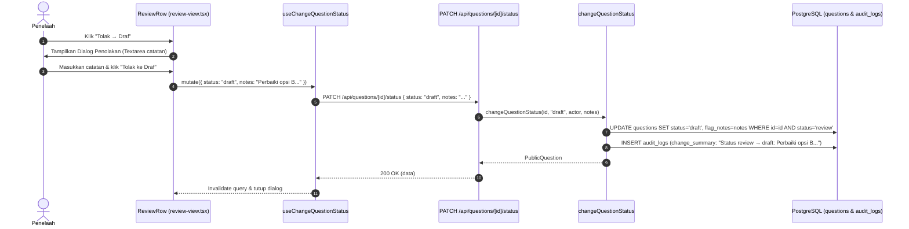

# Desain Teknis UX Audit Gelombang 1: Integritas Alur Kerja & Keamanan Aksi

**Target Proyek:** MathBank (`/home/hari/projects/mathbank`)  
**Dokumen Referensi:** [`MathBankAuditor/reports/UX-AUDIT-MENYELURUH-2026-10-04.md`](file:///home/hari/projects/MathBankAuditor/reports/UX-AUDIT-MENYELURUH-2026-10-04.md)  
**Tanggal:** 4 Oktober 2026  
**Status:** DRAFT (Menunggu Persetujuan User Review Gate)  

---

## 1. Ikhtisar & Tujuan

Gelombang 1 berfokus pada **penutupan celah kritis integritas data dan keamanan interaksi** yang ditemukan dalam UX Audit:
1. **[CRIT-01] Pelestarian Catatan Penolakan Telaah:** Menghentikan *silent data loss* saat penelaah menolak butir soal ke status Draf, memastikan catatan perbaikan tersimpan di database (`questions.flag_notes`), tercatat di riwayat audit (`audit_logs`), dan terlihat oleh guru penyusun.
2. **[CRIT-02] Eliminasi Dead Link Profil Pengguna:** Mengganti tautan buntu `/system/profile` (404) di dropdown menu pengguna dengan fitur nyata `Ganti Kata Sandi` (`/change-password`).
3. **[CRIT-04] Dialog Konfirmasi Aksi Merusak (Bulk Archive & Hapus Butir Paket):** Mencegah kehilangan data atau pengarsipan tidak sengaja melalui dialog konfirmasi eksplisit sebelum menjalankan aksi pengarsipan massal di Bank Soal dan pengeluaran butir soal dari paket ujian.

---

## 2. Arsitektur & Perubahan Kontrak Data

### 2.1. Alur Catatan Penolakan Telaah (CRIT-01)



### 2.2. Modifikasi Kontrak Zod (`src/lib/contracts/question.ts`)

Perluas `changeStatusSchema` untuk menerima field `notes` opsional:
```typescript
export const changeStatusSchema = z.object({
  status: questionStatusSchema,
  notes: z.string().max(1000).nullable().optional(),
});
```

### 2.3. Modifikasi Route Handler (`src/app/api/questions/[id]/status/route.ts`)

Teruskan `body.notes` ke fungsi service:
```typescript
export const PATCH = wrapRoute({
  rateLimit: { capacity: 30, refillPerSec: 1 },
  body: changeStatusSchema,
  handler: async ({ params, body, actor }) =>
    changeQuestionStatus(params.id, body.status, actor, body.notes),
});
```

### 2.4. Modifikasi Service Layer (`src/lib/services/question-status.ts`)

Perbarui fungsi `changeQuestionStatus` agar menerima `notes?: string | null`:
- Jika `notes` diberikan saat transisi ke `draft`:
  - Simpan `notes` ke kolom `questions.flag_notes`.
  - Sertakan `notes` pada `changeSummary` di `recordAudit`:
    ```typescript
    changeSummary: notes
      ? `Status ${from} → ${to}: ${notes}`
      : `Status ${from} → ${to}`,
    ```

### 2.5. Modifikasi Hook Klien (`src/lib/hooks/use-questions.ts`)

Dukung input fleksibel (backward compatible):
```typescript
export type ChangeStatusInput =
  | QuestionStatus
  | { status: QuestionStatus; notes?: string | null };

export function useChangeQuestionStatus(id: string) {
  const qc = useQueryClient();
  return useMutation({
    mutationFn: (input: ChangeStatusInput) => {
      const body = typeof input === "string" ? { status: input } : input;
      return apiFetch<PublicQuestion>(`/api/questions/${id}/status`, {
        method: "PATCH",
        body: JSON.stringify(body),
      });
    },
    onSuccess: () => qc.invalidateQueries({ queryKey: questionKeys.all }),
  });
}
```

---

## 3. Komponen Antarmuka & Interaksi Pengguna

### 3.1. Antrean Telaah (`src/components/questions/review-view.tsx`)
- Pada dialog penolakan di `ReviewRow`:
  - Saat tombol "Tolak ke Draf" ditekan, panggil:
    ```typescript
    status.mutate(
      { status: "draft", notes: notes.trim() || undefined },
      { onSuccess: () => setRejectOpen(false) }
    );
    ```

### 3.2. Menu Pengguna Sidebar (`src/components/layout/sidebar-user.tsx`)
- Ganti tautan dead link `/system/profile`:
  ```tsx
  <DropdownMenuItem
    render={
      <Link href="/change-password" onClick={handleNavClick} />
    }
  >
    <KeyRound className="size-4" /> Ganti Kata Sandi
  </DropdownMenuItem>
  ```
  Ini mengarahkan pengguna ke halaman ganti kata sandi nyata (`src/app/change-password/page.tsx`), menuntaskan rute 404 tanpa menambah halaman redundant.

### 3.3. Dialog Konfirmasi Bulk Archive (`src/components/questions/question-bank-view.tsx`)
- Tambahkan state `confirmArchiveOpen: boolean`.
- Tombol "Arsipkan" di bar seleksi massal tidak lagi memanggil `runBulk("archive")` langsung, melainkan `setConfirmArchiveOpen(true)`.
- Hadirkan `<Dialog>` konfirmasi dengan:
  - Judul: "Arsipkan {selected.size} butir soal?"
  - Deskripsi: "Soal yang diarsipkan akan disembunyikan dari hasil pencarian dan hanya dapat diakses melalui filter status Arsip."
  - Tombol Batal & Tombol "Ya, Arsipkan" (varian `destructive`).

### 3.4. Dialog Konfirmasi Hapus Butir Paket (`src/components/bundles/bundle-builder.tsx`)
- Pada `SortableRow`, hadirkan konfirmasi sebelum memanggil `removeItem.mutate(item.item.id)` agar guru tidak kehilangan butir naskah ujian saat salah sentuh di mobile/tablet.

---

## 4. Rencana Pengujian (Testing Strategy)

1. **Unit & Database Integration Tests (`pnpm test:db`):**
   - Tambahkan tes pada `src/lib/services/question-service.db.test.ts` untuk memverifikasi bahwa:
     - `changeQuestionStatus(id, "draft", reviewer, "Penjelasan salah di baris 2")` menyimpan `flagNotes` pada tabel `questions`.
     - `audit_logs` merekam catatan penolakan dalam `changeSummary`.
   - Pastikan tes otorisasi status tetap lulus.
2. **Kompilasi & Kualitas Mekanis:**
   - `pnpm typecheck` wajib exit 0.
   - `pnpm lint` wajib exit 0.
   - `pnpm test:coverage` wajib memenuhi ambang ≥ 85%.
